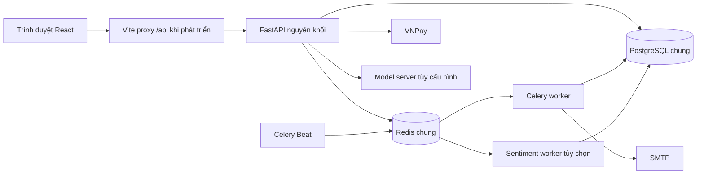
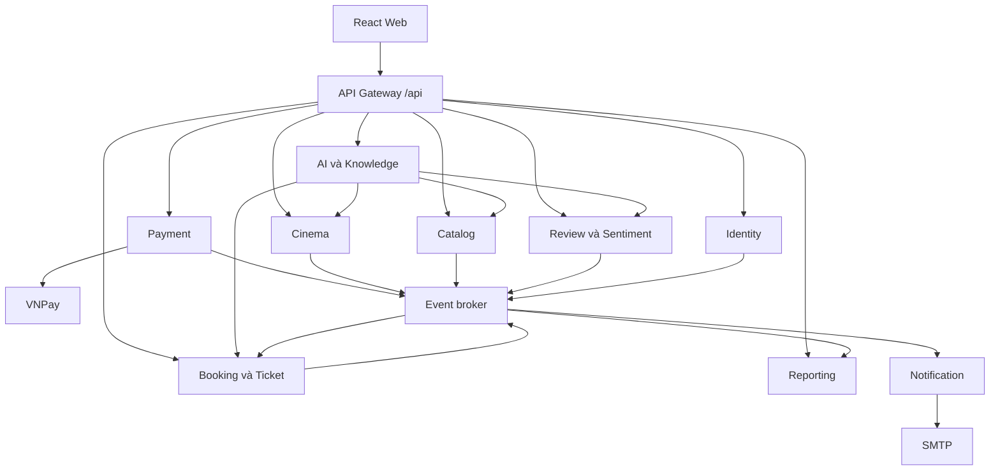

# Cinema Booking — Cấu trúc dự án và thiết kế chuyển sang microservices

> Ngày khảo sát: 02/11/2026. Mã nguồn đối chiếu: nhánh `main`, commit `3db6e3b`.
> Inventory dưới đây là ảnh chụp source tại commit khảo sát; cây đích là thiết kế đề xuất. Đã triển khai gateway, nền tảng messaging/auth cùng Notification, AI, Review, Identity, Catalog, Cinema, Booking và Payment Service có DB riêng. Reporting chưa tách; xem docs/migration/payment-phase.md để biết trạng thái mới nhất.
> Phạm vi: frontend, backend, API, dữ liệu, AI/ML, tác vụ nền, triển khai, kiểm thử và lộ trình di chuyển. Không đọc hoặc sao chép giá trị trong `.env` hay dữ liệu sao lưu vào tài liệu.

Kế hoạch thực hiện chi tiết, task và tiêu chí nghiệm thu: [MICROSERVICES_MIGRATION_PLAN.md](MICROSERVICES_MIGRATION_PLAN.md).

## Mục lục

1. [Hiện trạng và phạm vi hệ thống](#1-hiện-trạng-và-phạm-vi-hệ-thống)
2. [Toàn bộ cây mã nguồn hiện tại](#2-toàn-bộ-cây-mã-nguồn-hiện-tại)
3. [Các tầng backend và màn hình frontend](#3-các-tầng-backend-và-màn-hình-frontend)
4. [API hiện có](#4-api-hiện-có)
5. [Dữ liệu và migration hiện có](#5-dữ-liệu-và-migration-hiện-có)
6. [Kiến trúc microservices đích](#6-kiến-trúc-microservices-đích)
7. [Cấu trúc thư mục sau chuyển đổi](#7-cấu-trúc-thư-mục-sau-chuyển-đổi)
8. [Ánh xạ mã nguồn và định tuyến](#8-ánh-xạ-mã-nguồn-và-định-tuyến)
9. [Luồng đặt vé, thanh toán và tính nhất quán](#9-luồng-đặt-vé-thanh-toán-và-tính-nhất-quán)
10. [Hợp đồng API và sự kiện](#10-hợp-đồng-api-và-sự-kiện)
11. [Hạ tầng, bảo mật và vận hành](#11-hạ-tầng-bảo-mật-và-vận-hành)
12. [Lộ trình chuyển đổi và kiểm thử](#12-lộ-trình-chuyển-đổi-và-kiểm-thử)
13. [Giới hạn và quyết định cần ghi nhận](#13-giới-hạn-và-quyết-định-cần-ghi-nhận)
14. [Nguồn đối chiếu](#14-nguồn-đối-chiếu)

## 1. Hiện trạng và phạm vi hệ thống

Dự án hiện là **monorepo có backend nguyên khối được chia theo tầng**. Monorepo là cách tổ chức repository; microservices là cách chia ranh giới nghiệp vụ, dữ liệu và triển khai. Có thể tiếp tục dùng một repository khi chuyển sang microservices.

`Backend/main.py` khởi tạo một ứng dụng FastAPI và gắn các router vào cùng tiến trình. Các module dùng chung SQLModel/SQLAlchemy session, PostgreSQL và Redis. Worker và AI worker chạy ở tiến trình riêng nhưng còn truy cập dữ liệu, import model và dùng cấu hình chung; việc có nhiều container chưa tạo thành các dịch vụ nghiệp vụ độc lập.

### 1.1. Công nghệ được khai báo trong mã nguồn

| Phần | Hiện trạng |
| --- | --- |
| Web | React 19, React Router 7, Vite 6, Axios, Tailwind CSS 4; phiên bản theo `Frontend/package.json` |
| API | Python/FastAPI, Pydantic 2, SQLModel, SQLAlchemy; phiên bản phụ thuộc theo `Backend/requirements.txt` |
| Dữ liệu | PostgreSQL 15 trong Compose; Alembic quản lý schema |
| Khóa/cache/session | Redis 7; khóa ghế, refresh token, token blacklist, ngữ cảnh/rate limit AI tùy luồng |
| Tác vụ nền | Celery, Beat, Flower; Redis làm broker và result backend hiện tại |
| Thanh toán | VNPay: tạo URL, kiểm tra chữ ký, xử lý return và IPN |
| AI | Chat, RAG, lịch sử hội thoại, phân tích cảm xúc; pipeline train/evaluate và inference tùy chọn |
| Đóng gói | Docker Compose cho backend; frontend có script Vite riêng |

### 1.2. Chức năng hiện có

- Đăng ký, đăng nhập, refresh/logout, hồ sơ tài khoản; phân quyền theo vai trò/quyền và khóa tài khoản.
- Tra cứu phim, thể loại/định dạng, cụm rạp, phòng, loại ghế và lịch chiếu.
- Xem sơ đồ ghế, giữ/nhả ghế có thời hạn, kiểm tra số ghế còn trống.
- Chọn bỏng, nước, combo tùy chọn; tạo đơn gồm vé và đồ ăn; lưu snapshot giá/món.
- Thanh toán VNPay, xem lịch sử đơn/vé và check-in vé.
- Viết/kiểm duyệt đánh giá, phân tích cảm xúc, gợi ý phim có đánh giá tích cực.
- Trợ lý AI, dữ liệu kiến thức có phê duyệt, lưu hội thoại theo người dùng.
- Quản trị phim, phòng/ghế, suất chiếu, giá vé, nhân viên/phân quyền, tài liệu chatbot và báo cáo.
- Dọn đơn/giữ ghế hết hạn và gửi email xác nhận qua tác vụ nền.

### 1.3. Sơ đồ hiện tại



Model server được cấu hình qua `AI_MODEL_URL`; Compose AI hiện chỉ bổ sung sentiment worker, không tự triển khai model server chat.

## 2. Toàn bộ cây mã nguồn hiện tại

Cây dưới liệt kê **toàn bộ tệp được Git theo dõi** tại commit khảo sát, gồm mã nguồn, cấu hình mẫu, kiểm thử, dữ liệu ML mẫu và tài liệu. Không liệt kê nội dung `.git`, dependency cài đặt, môi trường ảo, cache, `.env`, dữ liệu PostgreSQL hay bản sao lưu. Chính file tài liệu này được tạo sau commit khảo sát.

<!-- CURRENT_TREE_START -->
```text
Cinema_Booking/
├── Backend/
│   ├── alembic/
│   │   ├── versions/
│   │   │   ├── 001_initial_migration.py
│   │   │   ├── 002_optimize_indexes_types_cascade.py
│   │   │   ├── 003_add_seat_type_table.py
│   │   │   ├── 004_add_version_to_seat_status.py
│   │   │   ├── 005_reviews_and_ai_knowledge.py
│   │   │   ├── 006_normalized_booking_schema.py
│   │   │   ├── 007_ai_chat_history.py
│   │   │   ├── 008_food_combos.py
│   │   │   └── 009_admin_management.py
│   │   ├── env.py
│   │   ├── README
│   │   └── script.py.mako
│   ├── app/
│   │   ├── core/
│   │   │   ├── __init__.py
│   │   │   ├── config.py
│   │   │   ├── database.py
│   │   │   └── redis.py
│   │   ├── models/
│   │   │   ├── __init__.py
│   │   │   ├── access_control.py
│   │   │   ├── ai.py
│   │   │   ├── booking.py
│   │   │   ├── booking_detail.py
│   │   │   ├── chat.py
│   │   │   ├── cinema_room.py
│   │   │   ├── film.py
│   │   │   ├── film_classification.py
│   │   │   ├── food.py
│   │   │   ├── payment.py
│   │   │   ├── seat.py
│   │   │   ├── seat_status.py
│   │   │   ├── seat_type.py
│   │   │   ├── showtime.py
│   │   │   ├── theater.py
│   │   │   ├── ticket.py
│   │   │   └── user.py
│   │   ├── repositories/
│   │   │   ├── __init__.py
│   │   │   ├── admin_repo.py
│   │   │   ├── auth_repo.py
│   │   │   ├── booking_repo.py
│   │   │   ├── cinema_room_repo.py
│   │   │   ├── film_repo.py
│   │   │   ├── payment_repo.py
│   │   │   ├── seat_repo.py
│   │   │   ├── seat_type_repo.py
│   │   │   ├── showtime_repo.py
│   │   │   └── theater_repo.py
│   │   ├── router/
│   │   │   ├── __init__.py
│   │   │   ├── access_control.py
│   │   │   ├── admin.py
│   │   │   ├── ai.py
│   │   │   ├── auth.py
│   │   │   ├── booking.py
│   │   │   ├── cinema_room.py
│   │   │   ├── film.py
│   │   │   ├── food.py
│   │   │   ├── payment.py
│   │   │   ├── reviews.py
│   │   │   ├── seat.py
│   │   │   ├── seat_type.py
│   │   │   ├── showtime.py
│   │   │   ├── theater.py
│   │   │   └── ticket.py
│   │   ├── schemas/
│   │   │   ├── __init__.py
│   │   │   ├── admin.py
│   │   │   ├── ai.py
│   │   │   ├── auth.py
│   │   │   ├── booking.py
│   │   │   ├── cinema_room.py
│   │   │   ├── film.py
│   │   │   ├── food.py
│   │   │   ├── payment.py
│   │   │   ├── seat.py
│   │   │   ├── seat_type.py
│   │   │   ├── showtime.py
│   │   │   └── theater.py
│   │   ├── services/
│   │   │   ├── __init__.py
│   │   │   ├── admin_service.py
│   │   │   ├── ai_tools.py
│   │   │   ├── auth_service.py
│   │   │   ├── booking_service.py
│   │   │   ├── chat_history_service.py
│   │   │   ├── chat_service.py
│   │   │   ├── cinema_room_service.py
│   │   │   ├── film_service.py
│   │   │   ├── food_service.py
│   │   │   ├── payment_service.py
│   │   │   ├── rag_service.py
│   │   │   ├── review_service.py
│   │   │   ├── seat_service.py
│   │   │   ├── seat_type_service.py
│   │   │   ├── sentiment_service.py
│   │   │   ├── showtime_service.py
│   │   │   ├── theater_service.py
│   │   │   └── ticket_service.py
│   │   ├── utils/
│   │   │   ├── __init__.py
│   │   │   ├── dependencies.py
│   │   │   ├── email_service.py
│   │   │   ├── enum.py
│   │   │   ├── redis_lock.py
│   │   │   └── security.py
│   │   ├── worker/
│   │   │   ├── __init__.py
│   │   │   ├── ai_tasks.py
│   │   │   ├── celery_config.py
│   │   │   └── tasks.py
│   │   └── ai_text.py
│   ├── migrations/
│   │   ├── 006_full_database.sql
│   │   ├── 007_full_database.sql
│   │   └── 008_full_database.sql
│   ├── ml/
│   │   ├── data/
│   │   │   └── drafts/
│   │   │       ├── chat_30.jsonl
│   │   │       ├── knowledge.json
│   │   │       └── sentiment_100.jsonl
│   │   ├── __init__.py
│   │   ├── chat_format.py
│   │   ├── data.py
│   │   ├── evaluate_chat.py
│   │   ├── evaluate_ranking.py
│   │   ├── evaluate_sentiment.py
│   │   ├── import_knowledge.py
│   │   ├── prepare_samples.py
│   │   ├── requirements.txt
│   │   ├── serve_chat.py
│   │   ├── train_chat.py
│   │   └── train_sentiment.py
│   ├── scripts/
│   │   └── export_database_schema.py
│   ├── tests/
│   │   ├── test_admin_management.py
│   │   ├── test_admin_postgres.py
│   │   ├── test_ai_features.py
│   │   ├── test_auth_contract.py
│   │   ├── test_booking_flow_contract.py
│   │   ├── test_booking_service.py
│   │   ├── test_concurrency_lock.py
│   │   ├── test_docker_compose_contract.py
│   │   ├── test_film_contract.py
│   │   ├── test_food_combos.py
│   │   ├── test_ml_data.py
│   │   ├── test_normalized_schema.py
│   │   ├── test_payment_consistency.py
│   │   ├── test_payment_contract.py
│   │   ├── test_payment_service.py
│   │   ├── test_redis_scan_performance.py
│   │   ├── test_seat_lock_contract.py
│   │   ├── test_theater_contract.py
│   │   └── test_worker_and_schema_hardening.py
│   ├── .dockerignore
│   ├── .env.example
│   ├── .gitignore
│   ├── alembic.ini
│   ├── docker-compose.yml
│   ├── Dockerfile
│   ├── Dockerfile.ai-worker
│   ├── main.py
│   ├── README.md
│   ├── requirements-ai-inference.txt
│   ├── requirements.txt
│   ├── seed_data.sql
│   └── test_main.http
├── docs/
│   ├── diagrams/
│   │   └── CinemaBooking_Sequence_Diagrams_Food_Combos.vpp
│   ├── Admin_Management.md
│   ├── AI_DANH_GIA.md
│   ├── AI_GAN_NHAN.md
│   ├── AI_TRIEN_KHAI.md
│   ├── co-che-tranh-trung-lap-ghe.md
│   ├── database-v2.md
│   └── FOOD_COMBOS.md
├── Frontend/
│   ├── public/
│   │   ├── CGV incon.png
│   │   ├── poster-placeholder.svg
│   │   └── vite.svg
│   ├── src/
│   │   ├── assets/
│   │   │   └── react.svg
│   │   ├── components/
│   │   │   ├── admin/
│   │   │   │   ├── admin.css
│   │   │   │   ├── AdminCatalogPages.jsx
│   │   │   │   ├── adminData.js
│   │   │   │   ├── AdminKnowledgeReports.jsx
│   │   │   │   ├── AdminLayout.jsx
│   │   │   │   ├── AdminPeoplePages.jsx
│   │   │   │   └── AdminShared.jsx
│   │   │   ├── ui/
│   │   │   │   ├── BookingSummary.jsx
│   │   │   │   ├── MovieCard.jsx
│   │   │   │   └── Primitives.jsx
│   │   │   ├── About.jsx
│   │   │   ├── AIAssistant.jsx
│   │   │   ├── CinemaList.jsx
│   │   │   ├── Contact.jsx
│   │   │   ├── FilmReviews.jsx
│   │   │   ├── FoodSelection.jsx
│   │   │   ├── HomePage.jsx
│   │   │   ├── LoginPage.jsx
│   │   │   ├── MainHomePage.jsx
│   │   │   ├── Movie.jsx
│   │   │   ├── MovieDetail.jsx
│   │   │   ├── NotFound.jsx
│   │   │   ├── PaymentPage.jsx
│   │   │   ├── PositiveFilms.jsx
│   │   │   ├── ReviewModeration.jsx
│   │   │   ├── SeatSelection.jsx
│   │   │   ├── TicketBooking.jsx
│   │   │   ├── UserInfor.jsx
│   │   │   └── VNPayReturn.jsx
│   │   ├── config/
│   │   │   └── api.js
│   │   ├── hooks/
│   │   │   └── useFilms.js
│   │   ├── services/
│   │   │   ├── authStorage.js
│   │   │   └── filmService.js
│   │   ├── utils/
│   │   │   ├── filmUtils.js
│   │   │   ├── formatters.js
│   │   │   └── logger.js
│   │   ├── App.css
│   │   ├── App.jsx
│   │   ├── index.css
│   │   └── main.jsx
│   ├── tests/
│   │   ├── admin-flow.mjs
│   │   ├── authStorage.test.mjs
│   │   ├── bookingPresentation.test.mjs
│   │   ├── food-flow.mjs
│   │   └── ui-smoke.mjs
│   ├── .env.example
│   ├── .gitignore
│   ├── eslint.config.js
│   ├── index.html
│   ├── package-lock.json
│   ├── package.json
│   ├── README.md
│   ├── UI_REVIEW.md
│   └── vite.config.js
├── .gitignore
├── docker-compose.ai.yml
└── README.md
```

Tổng: **224 tệp được Git theo dõi** tại thời điểm khảo sát.
<!-- CURRENT_TREE_END -->

### 2.1. Tệp và thư mục cục bộ bổ sung

Tại thời điểm khảo sát còn có `artifacts/`, `tmp/`, `.pytest_cache/`, `use-case-parse/`, `InspectParser.java`, `use_case_main_edit.py`, các ảnh `use-case-*.png`, `main-crop.png`, dự án `use-case-main.vpp`, bản `.bak_*`, log và các bản `docs/diagrams/cinema-db-*` chưa được Git theo dõi hoặc bị ignore. Đây là tài nguyên/tệp làm việc trên máy, không phải toàn bộ đều thuộc bản mã nguồn trên Git. Tài liệu không đưa nội dung các tệp này vào thiết kế dịch vụ hoặc tự xóa/chuyển chúng.

## 3. Các tầng backend và màn hình frontend

### 3.1. Trách nhiệm từng thư mục backend

| Đường dẫn | Vai trò hiện tại |
| --- | --- |
| `Backend/main.py` | Khởi tạo app, lifespan, CORS, xử lý lỗi, đăng ký router |
| `app/core/` | Đọc cấu hình môi trường, engine/session PostgreSQL, Redis client |
| `app/router/` | HTTP endpoint, validation đầu vào, dependency xác thực/phân quyền |
| `app/schemas/` | Schema request/response, DTO |
| `app/services/` | Nghiệp vụ và điều phối; một số module AI/admin truy vấn model trực tiếp |
| `app/repositories/` | Truy vấn dữ liệu auth, booking, phim, rạp, phòng, lịch, ghế, payment, admin |
| `app/models/` | 28 bảng nghiệp vụ SQLModel và quan hệ/constraint |
| `app/utils/` | JWT/hash mật khẩu, dependency người dùng/quyền, khóa Redis, email, enum |
| `app/worker/` | Celery config, dọn đơn hết hạn, email, phân tích/retry đánh giá |
| `app/ai_text.py` | Tiện ích văn bản phục vụ AI |
| `alembic/` | Lịch sử migration dùng chung cho toàn backend |
| `migrations/` | SQL snapshot cho các mốc schema; không thay thế migration tăng dần của DB đang có |
| `ml/` | Chuẩn bị dữ liệu, nhập kiến thức, train/evaluate sentiment/chat/ranking, serve chat |
| `scripts/` | Xuất schema từ model |
| `tests/` | Kiểm thử nghiệp vụ, hợp đồng API/source, schema, đồng thời và Compose |

Không nên di chuyển nguyên `router/`, `services/`, `repositories/` thành ba dịch vụ. Mỗi dịch vụ đích cần đủ các tầng của **một nhóm nghiệp vụ**.

### 3.2. Màn hình frontend

| Nhóm | Route chính theo `Frontend/src/App.jsx` | Component |
| --- | --- | --- |
| Trang chủ | `/` | `HomePage`, `MainHomePage`, thẻ phim và UI dùng chung |
| Phim | `/movie`, `/movies`, `/movie/:id`, `/MovieDetail/:id` | `Movie`, `MovieDetail`, `FilmReviews`, `PositiveFilms` được ghép trong trang |
| Rạp/thông tin | `/cinema`, `/contact`, `/about` | `CinemaList`, `Contact`, `About` |
| Đăng nhập | `/login`, `/loginPage`, `/loginpage` | `LoginPage` |
| Chọn suất | `/ticket-booking`, `/TicketBooking`, `/booking` | `TicketBooking` |
| Ghế/đồ ăn | `/seat-selection/:showtimeId`, `/food-selection/:showtimeId` | `SeatSelection`, `FoodSelection` |
| Thanh toán | `/payment/:bookingId`, `/payment-result` | `PaymentPage`, `VNPayReturn` |
| Cá nhân | `/user-info`, `/userInfo` | `UserInfor` |
| Kiểm duyệt | `/review-moderation` | `ReviewModeration` |
| Quản trị danh mục | `/admin/films`, `/admin/rooms`, `/admin/rooms/:roomId/seats`, `/admin/showtimes`, `/admin/prices` | `AdminLayout`, `AdminCatalogPages` |
| Quản trị nhân sự | `/admin/employees`, `/admin/roles` | `AdminPeoplePages` |
| Tài liệu/báo cáo | `/admin/documents`, `/admin/reports` | `AdminKnowledgeReports` |
| Trợ lý | Hiển thị ngoài nhóm `/admin` | `AIAssistant` |

`src/config/api.js` cung cấp Axios instance và gắn access token. API base mặc định `/api`; Vite proxy chuyển tới backend cổng 8000 và bỏ tiền tố `/api`. Vì vậy `/api` là tiền tố phía frontend/proxy, không phải prefix gắn vào FastAPI hiện tại.

### 3.3. Các liên kết cần tháo khi tách dịch vụ

- `payment_service.py` truy cập booking/ghế và gọi `TicketService` trong cùng giao dịch xác nhận; không thể chỉ đổi đường dẫn import rồi chạy riêng payment.
- `booking_service.py` đọc suất, ghế/loại ghế và gọi `FoodService.quote/save`; snapshot món và đơn hiện lưu trong cùng transaction.
- `admin_service.py` và `admin_repo.py` thao tác nhiều miền; báo cáo join booking/payment/ticket/seat/review.
- `ai_tools.py` truy vấn phim/rạp/lịch trực tiếp và gọi nghiệp vụ ghế; khi tách cần chuyển thành API chỉ đọc có hợp đồng.
- `utils/dependencies.py` hiện đọc user/quyền và trạng thái hoạt động từ DB chung; khi tách phải có cách kiểm tra thu hồi quyền/khóa tài khoản.
- Worker dọn booking dùng cùng DB với ghế và đơn; chỉ chuyển tác vụ email sang notification, giữ cleanup ở miền booking.

## 4. API hiện có

Bảng này được trích tĩnh từ `Backend/main.py` và decorator của các router, không phải kết quả gọi hệ thống đang chạy. Giữ nguyên dấu `/` cuối đường dẫn như source. Các endpoint mẫu `/` và `/hello/{name}` cũng được liệt kê. Khi triển khai, xác nhận OpenAPI thực tế và quyền của từng endpoint.

<!-- CURRENT_API_START -->
| Router / nguồn | Method | Đường dẫn FastAPI hiện tại | Miền đích đề xuất |
| --- | --- | --- | --- |
| [main.py](Backend/main.py) | `GET` | `/` | Entrypoint kỹ thuật |
| [main.py](Backend/main.py) | `GET` | `/hello/{name}` | Entrypoint kỹ thuật |
| [access_control.py](Backend/app/router/access_control.py) | `GET` | `/access-control/roles` | Identity |
| [access_control.py](Backend/app/router/access_control.py) | `GET` | `/access-control/permissions` | Identity |
| [access_control.py](Backend/app/router/access_control.py) | `GET` | `/access-control/roles/{role_id}/permissions` | Identity |
| [access_control.py](Backend/app/router/access_control.py) | `PUT` | `/access-control/users/{user_id}/role` | Identity |
| [access_control.py](Backend/app/router/access_control.py) | `PUT` | `/access-control/roles/{role_id}/permissions` | Identity |
| [admin.py](Backend/app/router/admin.py) | `GET` | `/admin/session` | Identity |
| [admin.py](Backend/app/router/admin.py) | `GET` | `/admin/catalog` | Gateway tổng hợp |
| [admin.py](Backend/app/router/admin.py) | `GET` | `/admin/films` | Catalog |
| [admin.py](Backend/app/router/admin.py) | `POST` | `/admin/films` | Catalog |
| [admin.py](Backend/app/router/admin.py) | `PUT` | `/admin/films/{film_id}` | Catalog |
| [admin.py](Backend/app/router/admin.py) | `DELETE` | `/admin/films/{film_id}` | Catalog |
| [admin.py](Backend/app/router/admin.py) | `GET` | `/admin/rooms` | Cinema |
| [admin.py](Backend/app/router/admin.py) | `POST` | `/admin/rooms` | Cinema |
| [admin.py](Backend/app/router/admin.py) | `PUT` | `/admin/rooms/{room_id}` | Cinema |
| [admin.py](Backend/app/router/admin.py) | `DELETE` | `/admin/rooms/{room_id}` | Cinema |
| [admin.py](Backend/app/router/admin.py) | `GET` | `/admin/rooms/{room_id}/seats` | Cinema |
| [admin.py](Backend/app/router/admin.py) | `POST` | `/admin/rooms/{room_id}/seats` | Cinema |
| [admin.py](Backend/app/router/admin.py) | `PUT` | `/admin/rooms/{room_id}/seats/{seat_id}` | Cinema |
| [admin.py](Backend/app/router/admin.py) | `DELETE` | `/admin/rooms/{room_id}/seats/{seat_id}` | Cinema |
| [admin.py](Backend/app/router/admin.py) | `GET` | `/admin/showtimes` | Cinema |
| [admin.py](Backend/app/router/admin.py) | `POST` | `/admin/showtimes` | Cinema |
| [admin.py](Backend/app/router/admin.py) | `PUT` | `/admin/showtimes/{showtime_id}` | Cinema |
| [admin.py](Backend/app/router/admin.py) | `DELETE` | `/admin/showtimes/{showtime_id}` | Cinema |
| [admin.py](Backend/app/router/admin.py) | `GET` | `/admin/prices` | Cinema |
| [admin.py](Backend/app/router/admin.py) | `POST` | `/admin/prices` | Cinema |
| [admin.py](Backend/app/router/admin.py) | `PUT` | `/admin/prices/{price_id}` | Cinema |
| [admin.py](Backend/app/router/admin.py) | `DELETE` | `/admin/prices/{price_id}` | Cinema |
| [admin.py](Backend/app/router/admin.py) | `GET` | `/admin/employees` | Identity |
| [admin.py](Backend/app/router/admin.py) | `POST` | `/admin/employees` | Identity |
| [admin.py](Backend/app/router/admin.py) | `PUT` | `/admin/employees/{user_id}` | Identity |
| [admin.py](Backend/app/router/admin.py) | `PUT` | `/admin/employees/{user_id}/status` | Identity |
| [admin.py](Backend/app/router/admin.py) | `GET` | `/admin/documents` | AI |
| [admin.py](Backend/app/router/admin.py) | `GET` | `/admin/documents/{document_id}` | AI |
| [admin.py](Backend/app/router/admin.py) | `POST` | `/admin/documents` | AI |
| [admin.py](Backend/app/router/admin.py) | `PUT` | `/admin/documents/{document_id}/approval` | AI |
| [admin.py](Backend/app/router/admin.py) | `DELETE` | `/admin/documents/{document_id}` | AI |
| [admin.py](Backend/app/router/admin.py) | `GET` | `/admin/reports` | Reporting |
| [ai.py](Backend/app/router/ai.py) | `POST` | `/ai/chat` | AI |
| [ai.py](Backend/app/router/ai.py) | `GET` | `/ai/conversations` | AI |
| [ai.py](Backend/app/router/ai.py) | `GET` | `/ai/conversations/{conversation_id}` | AI |
| [ai.py](Backend/app/router/ai.py) | `DELETE` | `/ai/conversations/{conversation_id}` | AI |
| [auth.py](Backend/app/router/auth.py) | `POST` | `/auth/register` | Identity |
| [auth.py](Backend/app/router/auth.py) | `POST` | `/auth/login` | Identity |
| [auth.py](Backend/app/router/auth.py) | `GET` | `/auth/me` | Identity |
| [auth.py](Backend/app/router/auth.py) | `POST` | `/auth/refresh` | Identity |
| [auth.py](Backend/app/router/auth.py) | `POST` | `/auth/logout` | Identity |
| [booking.py](Backend/app/router/booking.py) | `POST` | `/bookings` | Booking |
| [booking.py](Backend/app/router/booking.py) | `GET` | `/bookings/{booking_id}` | Booking |
| [booking.py](Backend/app/router/booking.py) | `GET` | `/bookings` | Booking |
| [booking.py](Backend/app/router/booking.py) | `PATCH` | `/bookings/{booking_id}/payment-status` | Booking |
| [cinema_room.py](Backend/app/router/cinema_room.py) | `GET` | `/cinema-rooms/` | Cinema |
| [cinema_room.py](Backend/app/router/cinema_room.py) | `GET` | `/cinema-rooms/theater/{theater_id}` | Cinema |
| [cinema_room.py](Backend/app/router/cinema_room.py) | `GET` | `/cinema-rooms/{room_id}` | Cinema |
| [film.py](Backend/app/router/film.py) | `GET` | `/films/` | Catalog |
| [film.py](Backend/app/router/film.py) | `GET` | `/films/{film_id}` | Catalog |
| [food.py](Backend/app/router/food.py) | `GET` | `/food-items` | Catalog |
| [payment.py](Backend/app/router/payment.py) | `POST` | `/payment/vnpay-url` | Payment |
| [payment.py](Backend/app/router/payment.py) | `POST` | `/payment/vnpay-return` | Payment |
| [payment.py](Backend/app/router/payment.py) | `GET` | `/payment/vnpay-return` | Payment |
| [payment.py](Backend/app/router/payment.py) | `GET` | `/payment/vnpay-ipn` | Payment |
| [payment.py](Backend/app/router/payment.py) | `POST` | `/payment/vnpay-ipn` | Payment |
| [payment.py](Backend/app/router/payment.py) | `GET` | `/payment/status/{booking_id}` | Payment |
| [reviews.py](Backend/app/router/reviews.py) | `GET` | `/films/positive-trending` | Review |
| [reviews.py](Backend/app/router/reviews.py) | `GET` | `/films/{film_id}/sentiment-summary` | Review |
| [reviews.py](Backend/app/router/reviews.py) | `GET` | `/films/{film_id}/reviews` | Review |
| [reviews.py](Backend/app/router/reviews.py) | `GET` | `/films/{film_id}/reviews/mine` | Review |
| [reviews.py](Backend/app/router/reviews.py) | `POST` | `/films/{film_id}/reviews` | Review |
| [reviews.py](Backend/app/router/reviews.py) | `PATCH` | `/reviews/{review_id}` | Review |
| [reviews.py](Backend/app/router/reviews.py) | `DELETE` | `/reviews/{review_id}` | Review |
| [reviews.py](Backend/app/router/reviews.py) | `GET` | `/reviews/moderation/pending` | Review |
| [reviews.py](Backend/app/router/reviews.py) | `PATCH` | `/reviews/{review_id}/moderation` | Review |
| [reviews.py](Backend/app/router/reviews.py) | `POST` | `/reviews/{review_id}/retry` | Review |
| [seat.py](Backend/app/router/seat.py) | `GET` | `/seats/showtime/{showtime_id}` | Booking |
| [seat.py](Backend/app/router/seat.py) | `POST` | `/seats/hold` | Booking |
| [seat.py](Backend/app/router/seat.py) | `POST` | `/seats/release` | Booking |
| [seat.py](Backend/app/router/seat.py) | `GET` | `/seats/showtime/{showtime_id}/available-count` | Booking |
| [seat.py](Backend/app/router/seat.py) | `DELETE` | `/seats/showtime/{showtime_id}/cancel-hold` | Booking |
| [seat_type.py](Backend/app/router/seat_type.py) | `GET` | `/seat-types/room/{room_id}` | Cinema |
| [seat_type.py](Backend/app/router/seat_type.py) | `POST` | `/seat-types/` | Cinema |
| [seat_type.py](Backend/app/router/seat_type.py) | `PUT` | `/seat-types/{seat_type_id}/price` | Cinema |
| [seat_type.py](Backend/app/router/seat_type.py) | `DELETE` | `/seat-types/{seat_type_id}` | Cinema |
| [showtime.py](Backend/app/router/showtime.py) | `GET` | `/showtimes` | Cinema |
| [showtime.py](Backend/app/router/showtime.py) | `GET` | `/showtimes/{showtime_id}` | Cinema |
| [theater.py](Backend/app/router/theater.py) | `GET` | `/theaters/` | Cinema |
| [theater.py](Backend/app/router/theater.py) | `GET` | `/theaters/{theater_id}` | Cinema |
| [theater.py](Backend/app/router/theater.py) | `GET` | `/theaters/by-film/{film_id}` | Cinema |
| [ticket.py](Backend/app/router/ticket.py) | `GET` | `/tickets/booking/{booking_id}` | Booking |
| [ticket.py](Backend/app/router/ticket.py) | `POST` | `/tickets/{ticket_code}/check-in` | Booking |

Tổng: **90 tổ hợp method/path** trong source khảo sát. Notification chưa có HTTP API public riêng; Reporting hiện nằm trong router admin.
<!-- CURRENT_API_END -->

## 5. Dữ liệu và migration hiện có

### 5.1. Toàn bộ bảng nghiệp vụ và chủ sở hữu đích

Danh sách dưới được trích từ model; không tính bảng quản lý Alembic. Chủ sở hữu là **đề xuất sau chuyển đổi**. `review_sentiments` được để cùng review để cập nhật kết quả theo phiên bản nguyên tử; tiến trình sentiment thuộc review, có thể tái sử dụng thư viện inference thuần hoặc gọi model server.

<!-- CURRENT_MODELS_START -->
| Bảng | Model / tệp | Các cột theo model | FK khai báo tại Field hiện tại | Owner đích |
| --- | --- | --- | --- | --- |
| `ai_chunks` | `KnowledgeChunk` — [ai.py](Backend/app/models/ai.py) | `id: Optional[int]`, `document_id: int`, `content: str`, `embedding: list[float]`, `embedding_version: str` | `document_id → ai_documents.id` | `ai-service` |
| `ai_conversations` | `AIConversation` — [chat.py](Backend/app/models/chat.py) | `id: UUID`, `user_id: int`, `title: str`, `context: dict`, `created_at: datetime`, `updated_at: datetime` | `user_id → users.id` | `ai-service` |
| `ai_documents` | `KnowledgeDocument` — [ai.py](Backend/app/models/ai.py) | `id: Optional[int]`, `source_id: str`, `title: str`, `version: str`, `source_url: str`, `approved: bool`, `effective_at: datetime`, `updated_at: datetime` | — | `ai-service` |
| `ai_messages` | `AIMessage` — [chat.py](Backend/app/models/chat.py) | `id: int \| None`, `conversation_id: UUID`, `role: str`, `content: str`, `metadata: dict`, `created_at: datetime` | `conversation_id → ai_conversations.id` | `ai-service` |
| `booking_details` | `BookingDetail` — [booking_detail.py](Backend/app/models/booking_detail.py) | `id: Optional[int]`, `booking_id: int`, `seat_id: int`, `price: Decimal` | `booking_id → bookings.id`; `seat_id → seats.id` | `booking-service` |
| `booking_food_items` | `BookingFoodItem` — [food.py](Backend/app/models/food.py) | `id: Optional[int]`, `booking_id: int`, `food_item_id: int`, `name: str`, `category: str`, `quantity: int`, `unit_price: Decimal`, `components: list[dict]` | `booking_id → bookings.id`; `food_item_id → food_items.id` | `booking-service` |
| `bookings` | `Booking` — [booking.py](Backend/app/models/booking.py) | `id: Optional[int]`, `user_id: int`, `showtime_id: int`, `booking_date: datetime`, `total_amount: Decimal`, `payment_method: Optional[str]`, `payment_status: str`, `booking_status: str`, `created_at: datetime`, `expires_at: Optional[datetime]` | `user_id → users.id`; `showtime_id → showtimes.id` | `booking-service` |
| `cinema_rooms` | `CinemaRoom` — [cinema_room.py](Backend/app/models/cinema_room.py) | `id: Optional[int]`, `theater_id: int`, `name: str`, `capacity: int`, `room_type: Optional[str]`, `status: str`, `deleted_at: Optional[datetime]` | `theater_id → theaters.id` | `cinema-service` |
| `combo_items` | `ComboItem` — [food.py](Backend/app/models/food.py) | `id: Optional[int]`, `combo_id: int`, `food_item_id: int`, `quantity: int` | `combo_id → food_items.id`; `food_item_id → food_items.id` | `catalog-service` |
| `film_formats` | `FilmFormat` — [film_classification.py](Backend/app/models/film_classification.py) | `film_id: int`, `format_id: int` | `film_id → films.id`; `format_id → formats.id` | `catalog-service` |
| `film_genres` | `FilmGenre` — [film_classification.py](Backend/app/models/film_classification.py) | `film_id: int`, `genre_id: int` | `film_id → films.id`; `genre_id → genres.id` | `catalog-service` |
| `films` | `Film` — [film.py](Backend/app/models/film.py) | `id: Optional[int]`, `title: str`, `image: Optional[str]`, `rating: Optional[str]`, `duration_minutes: Optional[int]`, `language: Optional[str]`, `subtitle: Optional[str]`, `deleted_at: Optional[datetime]`, `release_date: Optional[date]`, `end_date: Optional[date]`, `description: Optional[str]`, `trailer: Optional[str]` | — | `catalog-service` |
| `food_items` | `FoodItem` — [food.py](Backend/app/models/food.py) | `id: Optional[int]`, `name: str`, `description: str`, `category: str`, `price: Decimal`, `is_active: bool` | — | `catalog-service` |
| `formats` | `Format` — [film_classification.py](Backend/app/models/film_classification.py) | `id: Optional[int]`, `code: str`, `name: str` | — | `catalog-service` |
| `genres` | `Genre` — [film_classification.py](Backend/app/models/film_classification.py) | `id: Optional[int]`, `name: str` | — | `catalog-service` |
| `payments` | `Payment` — [payment.py](Backend/app/models/payment.py) | `id: Optional[int]`, `booking_id: int`, `provider: str`, `payment_method: str`, `merchant_ref: str`, `transaction_ref: Optional[str]`, `amount: Decimal`, `currency: str`, `status: str`, `paid_at: Optional[datetime]`, `created_at: datetime`, `updated_at: datetime` | `booking_id → bookings.id` | `payment-service` |
| `permissions` | `Permission` — [access_control.py](Backend/app/models/access_control.py) | `id: Optional[int]`, `code: str`, `name: str` | — | `identity-service` |
| `review_sentiments` | `ReviewSentiment` — [ai.py](Backend/app/models/ai.py) | `review_id: int`, `content_version: int`, `status: str`, `label: Optional[str]`, `scores: dict`, `model_version: Optional[str]`, `attempts: int`, `updated_at: datetime` | `review_id → reviews.id` | `review-service` |
| `reviews` | `Review` — [ai.py](Backend/app/models/ai.py) | `id: Optional[int]`, `user_id: int`, `film_id: int`, `content: str`, `content_version: int`, `moderation_status: str`, `is_deleted: bool`, `created_at: datetime`, `updated_at: datetime` | `user_id → users.id`; `film_id → films.id` | `review-service` |
| `role_permissions` | `RolePermission` — [access_control.py](Backend/app/models/access_control.py) | `role_id: int`, `permission_id: int` | `role_id → roles.id`; `permission_id → permissions.id` | `identity-service` |
| `roles` | `Role` — [access_control.py](Backend/app/models/access_control.py) | `id: Optional[int]`, `code: str`, `name: str` | — | `identity-service` |
| `seat_status` | `SeatStatus` — [seat_status.py](Backend/app/models/seat_status.py) | `id: Optional[int]`, `seat_id: int`, `showtime_id: int`, `status: str`, `version: int`, `hold_by_user_id: Optional[int]`, `hold_expired_at: Optional[datetime]`, `created_at: datetime`, `updated_at: datetime` | `seat_id → seats.id`; `showtime_id → showtimes.id`; `hold_by_user_id → users.id` | `booking-service` |
| `seat_types` | `SeatType` — [seat_type.py](Backend/app/models/seat_type.py) | `id: Optional[int]`, `room_id: int`, `name: str`, `base_price: Decimal` | `room_id → cinema_rooms.id` | `cinema-service` |
| `seats` | `Seat` — [seat.py](Backend/app/models/seat.py) | `id: Optional[int]`, `room_id: int`, `seat_type_id: int`, `seat_name: str`, `status: str` | `room_id → cinema_rooms.id`; `seat_type_id → seat_types.id` | `cinema-service` |
| `showtimes` | `Showtime` — [showtime.py](Backend/app/models/showtime.py) | `id: Optional[int]`, `film_id: int`, `room_id: int`, `show_date: date`, `start_time: time`, `end_time: time`, `format_id: int`, `status: ShowtimeStatus` | `film_id → films.id`; `room_id → cinema_rooms.id`; `format_id → formats.id` | `cinema-service` |
| `theaters` | `Theater` — [theater.py](Backend/app/models/theater.py) | `id: Optional[int]`, `name: str`, `address: str`, `city: str`, `image: Optional[str]`, `rating: Optional[Decimal]`, `technologies: Optional[Dict]`, `special: Optional[str]`, `deleted_at: Optional[datetime]` | — | `cinema-service` |
| `tickets` | `Ticket` — [ticket.py](Backend/app/models/ticket.py) | `id: Optional[int]`, `booking_detail_id: int`, `ticket_code: str`, `status: str`, `issued_at: datetime`, `used_at: Optional[datetime]` | `booking_detail_id → booking_details.id` | `booking-service` |
| `users` | `User` — [user.py](Backend/app/models/user.py) | `id: Optional[int]`, `username: str`, `password: str`, `email: str`, `phone: Optional[str]`, `full_name: Optional[str]`, `avatar: Optional[str]`, `role_id: int`, `is_active: bool`, `created_at: datetime` | `role_id → roles.id` | `identity-service` |

Kiểu cột được ghi theo annotation Python; chi tiết Numeric, JSON/JSONB, index/check/unique và nullability xem model/migration. FK ở bảng này được trích từ `Field(foreign_key=...)`; `showtimes` còn có composite FK khai báo qua `ForeignKeyConstraint` trong model. Danh sách không thay thế DDL/schema introspection của DB đang chạy.
<!-- CURRENT_MODELS_END -->

### 5.2. Migration

| Revision | Nội dung chính |
| --- | --- |
| `001` | Schema ban đầu |
| `002` | Tối ưu index, kiểu dữ liệu, cascade |
| `003` | Chuẩn hóa loại ghế |
| `004` | Version cho kiểm soát đồng thời trạng thái ghế |
| `005` | Đánh giá, cảm xúc và kiến thức AI |
| `006` | Chuẩn hóa booking/payment/ticket, phân loại phim và RBAC |
| `007` | Lịch sử hội thoại AI |
| `008` | Đồ ăn, combo, snapshot món trong đơn |
| `009` | Trạng thái hoạt động tài khoản và quyền quản trị; không thêm bảng nghiệp vụ |

Head **tại commit khảo sát** là `009`, tổng 28 bảng nghiệp vụ. Đợt M1–M2 sau đó thêm `010` cho ba bảng messaging kỹ thuật; Notification có store/migration riêng `notification_001`. M3 thêm nguồn `011` cho ownership/audit và AI store riêng `ai_001`; M4 thêm nguồn `012` đăng ký Review fence cùng Review store riêng `review_001`. M5 thêm nguồn `013` cho Identity fence/contact snapshot, gỡ FK users liên miền, Identity store riêng `identity_001` gồm RBAC/users/login_sessions. M6 thêm nguồn `014` với Catalog fence/film snapshots/external references, Catalog store `catalog_001` gồm bảy bảng danh mục, quotes và schedule bindings. M7 thêm nguồn `015` cho Cinema fence và Booking sales projection/version, Cinema store `cinema_001` và Catalog `catalog_002` cho lifecycle tham chiếu. M8 thêm nguồn `016` cho Booking/payment archive fence, store `booking_001` và reservation/checkout/idempotency/expiry riêng; payment vẫn cùng transaction. Xem [báo cáo M8](docs/migration/booking-phase.md). Lần khảo sát cấu trúc ban đầu chưa kiểm tra DB; kết quả nâng DB local mới nhất nằm trong docs/migration/notification-phase.md. README backend còn nhắc 23 bảng/revision 006 nên không dùng con số đó làm hiện trạng mới nhất. SQL snapshot mới nhất trong repository là `008_full_database.sql`; DB mới/DB hiện có đều cần bảo đảm schema đạt migration head thích hợp.

### 5.3. Nguyên tắc sở hữu dữ liệu sau chuyển đổi

- Mỗi bảng có đúng một dịch vụ được ghi. Database của service khác chỉ được tiếp cận qua API/sự kiện, không import ORM hoặc join SQL xuyên dịch vụ.
- Giai đoạn đầu có thể dùng một PostgreSQL server với database riêng và tài khoản riêng cho từng dịch vụ. Điều đó vẫn tách quyền dữ liệu; không cần ngay lập tức có chín máy PostgreSQL.
- Mỗi service có Alembic riêng. Bảng phiên bản và migration của monolith được giữ đến khi kết thúc chuyển đổi.
- ID tham chiếu ngoài miền được giữ như ID nghiệp vụ, bỏ FK xuyên database **sau khi** đã thay bằng validation/snapshot/sự kiện và đối chiếu dữ liệu. FK trong cùng miền vẫn giữ.
- `booking_food_items` thuộc booking dù model hiện nằm trong `food.py`; giá và thành phần là snapshot giao dịch. `food_items`/`combo_items` thuộc catalog.
- `seat_status` thuộc booking; `seats`, `seat_types`, `showtimes` thuộc cinema. Booking cần bản cấu hình bán vé đã công bố, không query DB cinema.
- Dữ liệu báo cáo là bản sao để đọc; không được dùng độ trễ của báo cáo làm căn cứ quyết định ghế/thanh toán.

Việc mỗi dịch vụ quản lý dữ liệu của mình và trao đổi bằng API/sự kiện theo [hướng dẫn dữ liệu microservices của Microsoft](https://learn.microsoft.com/en-us/azure/architecture/microservices/design/data-considerations). Cách chia bảng cụ thể ở tài liệu này là thiết kế đề xuất dựa trên mã nguồn Cinema Booking.

## 6. Kiến trúc microservices đích

Giữ monorepo, React và Python/FastAPI để tận dụng code hiện có. Thiết kế đích có 9 dịch vụ nghiệp vụ; đây là ranh giới dài hạn, **không yêu cầu tách cả 9 cùng lúc**. Bắt đầu theo các giai đoạn ở mục 12.

### 6.1. Ranh giới và trách nhiệm

| Dịch vụ | Trách nhiệm | Dữ liệu gốc | Phụ thuộc cần thiết |
| --- | --- | --- | --- |
| `identity-service` | Auth, profile, nhân viên, tài khoản hoạt động, vai trò/quyền | users, roles, permissions, role_permissions, login_sessions | PostgreSQL sessions theo ADR 0006 (không dùng Redis auth) |
| `catalog-service` | Phim, thể loại, định dạng, thực đơn/combo và báo giá món | films, genres, formats, film_genres, film_formats, food_items, combo_items | Không đọc DB booking; cung cấp snapshot/version cho cinema/booking |
| `cinema-service` | Rạp, phòng, ghế vật lý, loại ghế/giá cấu hình, lịch chiếu; chống lịch trùng | theaters, cinema_rooms, seats, seat_types, showtimes | Catalog qua API/snapshot phim và định dạng |
| `booking-service` | Tồn ghế theo suất, hold/release, đơn vé, snapshot món, xác nhận, phát hành/check-in vé, hết hạn | seat_status, bookings, booking_details, booking_food_items, tickets; bản cấu hình suất/ghế bán vé | Cinema/catalog qua hợp đồng công bố và quote; nhận kết quả payment |
| `payment-service` | VNPay, payment attempt, chữ ký, kết quả nhà cung cấp, đối soát | payments; inbox/outbox và hồ sơ đối soát bổ sung | Booking qua snapshot checkout; VNPay |
| `review-service` | Đánh giá, kiểm duyệt, sentiment, tổng hợp/xếp hạng tích cực | reviews, review_sentiments | Catalog xác nhận phim; worker/model sentiment |
| `ai-service` | Chat, RAG, tài liệu/chunk, duyệt tài liệu, hội thoại và AI tool chỉ đọc | ai_documents, ai_chunks, ai_conversations, ai_messages | API catalog/cinema/booking/review; model server tùy cấu hình |
| `notification-service` | Gửi email và retry, chống gửi trùng | delivery_jobs/delivery_attempts mới; dữ liệu tối thiểu cần gửi | Sự kiện BookingConfirmed, SMTP |
| `reporting-service` | Báo cáo quản trị, CSV, projection theo ngày/phim/rạp | Read model mới, checkpoint và inbox sự kiện | Sự kiện booking/payment/ticket/review/cinema/catalog |

Gateway là hạ tầng đầu vào và lớp tổng hợp mỏng, không sở hữu bảng nghiệp vụ. Màn hình admin gọi API quản trị của từng service; không tạo thêm `admin-service` được phép ghi mọi DB.

Giữ ghế, đơn và vé trong một booking service để giao dịch xác nhận ghế + đơn + phát hành vé vẫn nguyên tử trong DB booking. Chưa tách ticket/inventory thành service riêng vì sẽ tăng số giao dịch phân tán ở luồng quan trọng nhất.

### 6.2. Sơ đồ đích



Sơ đồ tập trung vào luồng chính; mỗi service có DB/credential riêng theo mục 5. Sự kiện không thay thế toàn bộ HTTP: tra cứu tương tác và lấy quote dùng HTTP; thông báo, projection và kết quả thanh toán dùng sự kiện bền vững.

## 7. Cấu trúc thư mục sau chuyển đổi

**Toàn bộ cây trong mục này là đề xuất.** Không có lệnh trong tài liệu tự tạo hoặc chạy các dịch vụ này.

```text
Cinema_Booking/
├── apps/
│   └── web/                              # Chuyển từ Frontend/, vẫn một React SPA
│       ├── public/
│       ├── src/
│       │   ├── app/                      # Router, providers, layout
│       │   ├── features/
│       │   │   ├── auth/
│       │   │   ├── movies/
│       │   │   ├── cinemas/
│       │   │   ├── booking/              # Chọn suất, ghế, đồ ăn, đơn
│       │   │   ├── payment/
│       │   │   ├── tickets/
│       │   │   ├── reviews/
│       │   │   ├── assistant/
│       │   │   ├── profile/
│       │   │   └── admin/
│       │   ├── shared/                   # UI, formatters, HTTP client
│       │   └── main.jsx
│       ├── tests/
│       ├── .env.example
│       ├── package.json
│       ├── package-lock.json
│       ├── vite.config.js
│       └── Dockerfile
├── gateway/
│   ├── app/
│   │   ├── main.py
│   │   ├── routes.py                    # Routing, thứ tự rule, admin composition
│   │   ├── upstreams.py                 # Timeout, connection pool, giới hạn retry
│   │   ├── auth.py                      # Xác thực/token introspection khi cần
│   │   └── observability.py
│   ├── tests/
│   ├── requirements.txt
│   ├── Dockerfile
│   └── .env.example
├── services/
│   ├── identity-service/                # Auth, user, RBAC
│   ├── catalog-service/                 # Phim, phân loại, đồ ăn/combo
│   ├── cinema-service/                  # Rạp, phòng, ghế vật lý, lịch, giá cấu hình
│   ├── booking-service/                 # Availability, hold, order, ticket, expiry
│   ├── payment-service/                 # VNPay, payment attempt, đối soát
│   ├── review-service/                  # Reviews, moderation, sentiment worker
│   ├── ai-service/                      # Chat, RAG, knowledge, conversation
│   ├── notification-service/            # Consumer, email template, delivery worker
│   └── reporting-service/               # Consumer, projection, report API/CSV
├── contracts/
│   ├── openapi/                         # Đặc tả HTTP có version cho từng service
│   ├── events/
│   │   └── v1/                          # JSON Schema cho integration events
│   ├── fixtures/                        # Payload mẫu đã loại thông tin nhạy cảm
│   └── compatibility/                   # Kiểm tra tương thích producer/consumer
├── packages/
│   └── python-platform/                 # Logging, trace ID, envelope, lỗi kỹ thuật
│       ├── pyproject.toml
│       ├── src/cinema_platform/
│       └── tests/
├── ml/
│   ├── data/drafts/                     # Di chuyển dữ liệu mẫu từ Backend/ml/
│   ├── training/                        # train_chat, train_sentiment, data utilities
│   ├── evaluation/                      # evaluate_chat/sentiment/ranking
│   ├── serving/                         # Model server tùy chọn
│   └── requirements.txt
├── infra/
│   ├── compose/
│   │   ├── compose.yml                  # Dev: gateway, services, databases, broker
│   │   ├── compose.ai.yml               # Profile model/ML tùy chọn
│   │   └── .env.example
│   ├── postgres/
│   │   └── init-databases.sql           # DB/user riêng, không chứa password thật
│   ├── broker/                         # Exchange/queue/retry/dead-letter topology
│   ├── observability/                  # Collector, metrics, logs, dashboard
│   └── proxy/                          # TLS, static web, callback routes
├── tests/
│   ├── contract/                       # HTTP/event compatibility liên dịch vụ
│   ├── integration/                    # PostgreSQL/broker/service thật trên test DB
│   ├── e2e/                            # Toàn luồng React qua gateway
│   ├── concurrency/                    # Tranh chấp ghế/lịch/check-in
│   └── resilience/                     # Duplicate, out-of-order, outage, replay
├── scripts/
│   ├── migration/                      # Backfill, checksum, cutover theo miền
│   └── dev/                            # Bootstrap và seed môi trường phát triển
├── docs/
│   ├── architecture/
│   ├── adr/                            # Quyết định ranh giới, broker, saga, JWT
│   ├── migration/
│   ├── runbooks/                       # Đối soát, refund thủ công, restore, replay
│   └── diagrams/                       # Giữ tài liệu VPP và sơ đồ hiện có
├── .github/workflows/                  # CI/build/test/deploy theo service thay đổi
├── .gitignore
├── README.md
└── PROJECT_STRUCTURE_MICROSERVICES.md
```

### 7.1. Cấu trúc chuẩn trong mỗi service

```text
<service-name>/
├── app/
│   ├── main.py                         # API bootstrap; worker thuần có thể không cần API public
│   ├── api/
│   │   ├── public.py                   # HTTP cho frontend qua gateway
│   │   ├── admin.py                    # HTTP quản trị của chính miền này
│   │   └── internal.py                 # Giao tiếp nội bộ có xác thực
│   ├── schemas/                        # Request/response của service
│   ├── services/                       # Business logic của service
│   ├── repositories/                   # Chỉ truy cập DB của service
│   ├── models/                         # ORM của dữ liệu service sở hữu
│   ├── clients/                        # Typed HTTP clients tới service khác
│   ├── events/
│   │   ├── handlers.py                 # Inbox, dedup, xử lý event
│   │   └── publisher.py                # Outbox relay
│   ├── workers/                        # Job của miền: expiry, delivery, sentiment...
│   └── core/                           # Settings, database, auth, health, logging
├── alembic/
│   └── versions/
├── tests/
│   ├── unit/
│   ├── integration/
│   └── contract/
├── alembic.ini
├── requirements.txt                    # Dependency/lock riêng theo chuẩn dự án chọn
├── Dockerfile
├── .dockerignore
├── .env.example
└── README.md
```

Không bắt buộc tạo thư mục rỗng không dùng. Notification/reporting cần thêm các bảng kỹ thuật mới; consumer, relay và scheduler có thể chạy dưới process riêng từ cùng image service. Không đặt SQLModel nghiệp vụ, repository dùng chung hay `get_session()` toàn hệ thống vào `packages/`.

## 8. Ánh xạ mã nguồn và định tuyến

### 8.1. Di chuyển theo nghiệp vụ

| Nguồn hiện có trong `Backend/` | Đích đề xuất | Điều chỉnh bắt buộc |
| --- | --- | --- |
| `router/auth.py`, `router/access_control.py`, auth schema/service/repo; user/access_control models | Identity | Tách Redis auth; API quản lý nhân viên và trạng thái hoạt động lấy từ admin |
| Film router/schema/service/repo; film/film_classification models | Catalog | Kiểm tra phim đã dùng bởi lịch/đơn qua lifecycle/sự kiện, không join DB cinema |
| `router/food.py`, `schemas/food.py`, phần danh mục/quote của `food_service.py`; FoodItem/ComboItem | Catalog | Tách phần lưu `BookingFoodItem` sang booking; thêm hợp đồng quote có version/deadline |
| Theater/cinema_room/showtime/seat_type router/schema/service/repo; models tương ứng và Seat | Cinema | Quản lý ghế vật lý, lịch và giá; công bố phiên bản cấu hình bán vé cho booking |
| `router/seat.py`, `seat_service.py`, `redis_lock.py`, phần availability/OCC của `seat_repo.py` | Booking | Tách phần đọc/ghi ghế vật lý sang cinema; availability đọc cấu hình bán vé local |
| Booking router/schema/service/repo, Booking/BookingDetail, BookingFoodItem | Booking | Loại FK ngoài miền; dùng snapshot user/showtime/food, idempotency tạo đơn |
| Ticket router/service/model | Booking | Giữ phát hành vé trong cùng transaction với confirm và BOOKED |
| Payment router/schema/service/repo/model | Payment | Bỏ ghi trực tiếp booking/seat/ticket; lưu kết quả và phát event qua outbox |
| Review router/service, sentiment service, Review/ReviewSentiment, phần review của `ai_tasks.py` | Review | Sentiment worker thuộc review; kiểm soát `content_version`, moderation và retry |
| AI router/schema; chat/history/RAG/tools; KnowledgeDocument/Chunk, AIConversation/Message | AI | Tool gọi API chỉ đọc; quản trị kiến thức đi theo AI service |
| `utils/email_service.py`, `send_payment_success_email_task` | Notification | Nhận snapshot xác nhận vé; delivery state/idempotency/retry riêng |
| `cleanup_expired_bookings` | Booking | Giữ cùng nơi sở hữu hold/booking; scheduler không chạy trùng không kiểm soát |
| `admin_repo.report`, `/admin/reports` | Reporting | Thay truy vấn join DB gốc bằng projection và checkpoint rõ ràng |
| `admin_service.py`, `router/admin.py`, `schemas/admin.py` | Chia theo Identity/Catalog/Cinema/AI/Reporting | Không sao chép toàn bộ admin vào mỗi service |
| `ml/` | `ml/` ở root và runtime adapter theo service | Train/evaluate tách khỏi request đặt vé; sentiment runtime ở review, chat runtime ở AI |
| `Frontend/` | `apps/web/` | Đổi tổ chức sau khi gateway tương thích; không bắt buộc micro-frontend |
| `Backend/tests/`, `Frontend/tests/` | Service tests + root integration/e2e | Giữ hành vi cũ; đổi kiểm tra source-string thành kiểm tra kết quả khi tái cấu trúc |

### 8.2. Routing gateway giữ tương thích frontend

Các đường dẫn dưới là đường dẫn public **sau tiền tố `/api`**. Gateway bỏ `/api` trước khi chuyển upstream để giữ contract cũ trong giai đoạn đầu.

| Đường dẫn | Service đích |
| --- | --- |
| `/auth/*`, `/access-control/*`, `/admin/session`, `/admin/employees*` | Identity |
| `/films/positive-trending`, `/films/{id}/sentiment-summary`, `/films/{id}/reviews*`, `/reviews/*` | Review |
| Các `/films*` còn lại, `/food-items*`, `/admin/films*` | Catalog |
| `/theaters*`, `/cinema-rooms*`, `/showtimes*`, `/seat-types*`, `/admin/rooms*`, `/admin/showtimes*`, `/admin/prices*` | Cinema |
| `/seats*`, `/bookings*`, `/tickets*` | Booking |
| `/payment/*` | Payment |
| `/ai/*`, `/admin/documents*` | AI |
| `/admin/reports*` | Reporting |
| `/admin/catalog` | Gateway tổng hợp dữ liệu tham chiếu Identity/Catalog/Cinema theo contract cũ |

Các mẫu `*` chỉ là cách viết tắt trong bảng, không phải cấu hình proxy có thể chép trực tiếp. Rule review phải đứng trước rule tổng quát films; `/films/positive-trending` không được bị hiểu thành film ID. Gateway không thực hiện transaction nhiều service. `/admin/catalog` cần timeout và response tương thích, không trả dữ liệu nửa vời như thành công hoàn chỉnh.

Callback VNPay giữ nguyên URL đã đăng ký hoặc cung cấp reverse proxy tương thích. Gateway không sửa/thêm/bớt các tham số ký của callback; payment tự kiểm tra chữ ký. Endpoint cũ không thể đổi hành vi tức thì: trong thời gian event chưa hoàn tất, UI cần hiển thị đang xác nhận và poll trạng thái, không suy ra đã có vé chỉ từ return page.

## 9. Luồng đặt vé, thanh toán và tính nhất quán

### 9.1. Hành vi hiện tại cần bảo toàn

- Ghế được giữ bằng Redis kết hợp trạng thái DB/version; thời hạn hiện được mô tả và triển khai cho luồng giữ ghế khoảng 10 phút. Tạo booking dùng thời hạn sớm nhất của các hold.
- Booking yêu cầu đúng chủ hold, đúng phòng/suất, ghế hoạt động, hold chưa hết hạn, không có ghế trùng; server tính lại giá vé và món bằng Decimal.
- Đồ ăn là bước tùy chọn; không gia hạn giữ ghế. Snapshot tên, đơn giá, số lượng, thành phần combo không thay đổi theo menu về sau.
- Chỉ phát hành vé sau đơn PAID + CONFIRMED. Payment hiện gọi trực tiếp nghiệp vụ ghế/booking/ticket trong cùng DB transaction; dọn Redis lock sau commit.
- Check-in dùng cập nhật có điều kiện trạng thái ISSUED sang USED để tránh dùng vé hai lần.
- Callback đến muộn vẫn cần lưu kết quả nhà cung cấp phục vụ đối soát; có tiền đã thu không đồng nghĩa còn ghế để cấp vé.

### 9.2. Công bố cấu hình suất và giá

Cinema giữ dữ liệu gốc phòng/ghế/lịch/giá, booking giữ bản cấu hình bán vé bất biến theo `showtime_id + sales_version`:

1. Cinema xác nhận phim/định dạng/thời lượng qua catalog và kiểm tra lịch không trùng trong transaction local.
2. Khi mở bán, tạo phiên bản có danh sách ghế hợp lệ, loại ghế, mức giá, thời gian/phòng và snapshot phim. Booking nhập đủ phiên bản và xác nhận sẵn sàng trước khi hiển thị suất có thể giữ ghế.
3. Booking dùng bản đã công bố để kiểm tra và tính giá; không quyết định bán từ projection báo cáo hoặc cache tùy ý.
4. Thay đổi lịch, xóa/khóa ghế hoặc đóng suất đang mở bán đi qua quy trình **đóng nhận hold mới tại booking → xử lý hold/đơn đang có → cinema sửa → công bố phiên bản mới**. Trong lúc đồng bộ hiển thị trạng thái đang cập nhật; không cam kết sửa thành công trước khi booking ngừng bán.
5. Không thay thế phiên bản mà booking đã dùng để chốt đơn. Ràng buộc “không xóa/sửa dữ liệu đã có giao dịch” hiện tại phải được bảo toàn bằng workflow, thay cho kiểm tra join xuyên DB.

Đây là cơ chế mới cần xây dựng khi tách cinema/booking. Chỉ sao chép bảng định kỳ sẽ không giữ được các ràng buộc đồng thời hiện tại.

Món/combo được catalog báo giá bằng quote có ID, version, giá thành phần cần lưu và `expires_at`. Booking kiểm tra quote còn hiệu lực, ghi snapshot và tổng tiền trong transaction local. Cần chốt chính sách giữ giá đến hết quote; menu thay đổi không được âm thầm làm đổi đơn đã chốt. Hệ thống hiện chưa có tồn kho thực phẩm theo rạp nên thiết kế này chưa bao gồm reserve hàng trong kho.

### 9.3. Luồng thành công sau khi tách payment

```mermaid
sequenceDiagram
    actor U as Khách
    participant B as Booking
    participant C as Catalog
    participant P as Payment
    participant V as VNPay
    participant E as Event broker
    participant N as Notification
    U->>B: Giữ ghế theo suất và phiên bản bán
    B-->>U: Hold, deadline
    U->>C: Lấy quote đồ ăn nếu có
    C-->>U: Quote có version và thời hạn
    U->>B: Tạo đơn với idempotency key
    B->>B: Kiểm tra hold, quote, giá; lưu snapshot
    B-->>U: Booking PENDING
    U->>P: Tạo URL thanh toán theo booking ID
    P->>B: Lấy checkout snapshot được xác thực
    B-->>P: Booking, amount, currency, deadline, version
    P->>P: Lưu payment attempt và merchant_ref
    P-->>U: URL VNPay
    U->>V: Thanh toán
    V->>P: Return hoặc IPN có chữ ký
    P->>P: Xác minh; lưu kết quả PAID và outbox cùng transaction
    P->>E: PaymentSucceeded
    E->>B: PaymentSucceeded có thể được giao lại
    B->>B: Inbox dedup; khóa đơn và ghế; kiểm tra deadline/quyền
    B->>B: PAID + CONFIRMED + BOOKED + tickets + outbox; commit
    B->>E: BookingConfirmed
    E->>N: BookingConfirmed
    N->>N: Lưu delivery job; gửi email có retry
    U->>B: Poll trạng thái đơn/vé
    B-->>U: Đơn xác nhận và vé đã phát hành
```

Nếu payment và booking còn chung monolith ở giai đoạn đầu, vẫn giữ giao dịch hiện tại; chỉ áp dụng saga/outbox bên trên khi chính thức tách dữ liệu payment.

### 9.4. Trạng thái, callback trùng và lỗi

| Trường hợp | Xử lý đề xuất |
| --- | --- |
| Hai người giữ cùng ghế | Booking kiểm tra/cập nhật nguyên tử trên `(showtime_id, seat_id)`; Redis giúp điều phối, DB giữ constraint và trạng thái quyết định |
| Giữ nhiều ghế | Khóa/cập nhật theo thứ tự ID ổn định, tất cả thành công hoặc rollback; tránh giữ được một phần rồi trả thành công |
| Nhấn tạo đơn nhiều lần | Idempotency key scoped theo user + thao tác; cùng payload trả lại cùng kết quả, payload khác cùng key bị từ chối |
| Tạo nhiều payment attempt | Ref riêng cho từng attempt; liên kết checkout version/amount; chính sách chỉ một attempt đang có hiệu lực cần được thực thi và audit |
| Return và IPN cùng tới | Payment dedup theo merchant_ref/provider transaction; event được replay vẫn chỉ xác nhận/phát vé một lần |
| Sự kiện PAID tới sau FAILED | Không ghi đè PAID bằng FAILED đến muộn; áp dụng state transition theo attempt/version, giữ raw result hợp lệ để đối soát |
| PAID nhưng hold/đơn đã hết hạn hoặc ghế đã bán | Giữ payment PAID; booking không cấp vé và phát `BookingConfirmationRejected`; tạo hồ sơ đối soát/hoàn tiền cần xử lý |
| Expiry worker chạy cùng xác nhận | Cùng khóa/kiểm tra trạng thái booking và ghế trong DB booking; chỉ một chuyển trạng thái hợp lệ thắng |
| Consumer chết sau commit nhưng trước ACK | Broker giao lại; inbox unique `(consumer_name, event_id)` ngăn tác dụng phụ trùng |
| Broker lỗi sau commit DB | Outbox còn sự kiện chưa gửi; relay retry khi broker phục hồi |
| DB commit thất bại | Không ACK event hoặc báo thành công; không phát vé/email dựa trên thay đổi chưa commit |
| Redis mất kết nối/restart | Không coi cache mất là ghế AVAILABLE; fail closed nếu chưa có đường ghi DB đủ kiểm soát; dựng lại cache từ DB |
| Email lỗi | Đơn/vé vẫn hợp lệ; notification retry có backoff và hàng lỗi, không rollback thanh toán |
| AI/báo cáo lỗi | Không chặn giữ ghế và thanh toán; hiển thị trạng thái không khả dụng tại phần tương ứng |

DB booking giữ unique `(showtime_id, seat_id)` ở trạng thái ghế và một vé cho mỗi booking detail; handler kiểm tra quyền sở hữu hold, expiry và cập nhật tất cả ghế cùng transaction. Nên thêm liên kết reservation/hold với booking hoặc mã hold bất biến: user ID đơn thuần không phân biệt hai lần giữ/đặt cùng ghế của cùng người. Đây là phần tăng cường đích, chưa có trong model hiện tại.

Khóa hàng/conditional update là cơ chế local DB, không phải khóa xuyên database. Tham khảo [PostgreSQL 15 — Explicit Locking](https://www.postgresql.org/docs/15/explicit-locking.html). Không giữ transaction/row lock mở trong lúc gọi HTTP sang service khác.

### 9.5. Thanh toán và trạng thái đối soát

Hiện model payment chỉ cho `PENDING`, `PAID`, `FAILED`, `CANCELLED`; booking dùng `PENDING`, `CONFIRMED`, `CANCELLED`, `EXPIRED`. Các trạng thái “đang xác nhận”, “cần hoàn tiền”, “đã hoàn tiền” trong thiết kế đích là workflow/bảng mới phải có migration và hợp đồng UI riêng, không phải chức năng đã có.

Tiền đã thu được ghi nhận ở payment; vé đã xác nhận được ghi nhận ở booking. Khi hai kết quả lệch nhau phải có job đối soát theo payment ID/booking ID, deadline, tổng tiền và currency. Không tự đổi giao dịch PAID thành FAILED để che trường hợp chưa cấp được vé. Chưa có tích hợp refund trong code hiện tại; giai đoạn đầu dùng hàng đối soát cùng quy trình xử lý thủ công, chỉ tự hoàn khi đã xây và kiểm chứng API hoàn tiền.

## 10. Hợp đồng API và sự kiện

### 10.1. HTTP nội bộ đề xuất

| Producer | Hợp đồng cần có | Consumer |
| --- | --- | --- |
| Identity | Token introspection/trạng thái hoạt động/quyền hiệu lực; public key nếu chọn JWT bất đối xứng | Gateway và mọi service có dữ liệu bảo vệ |
| Catalog | Chi tiết phim/định dạng có version; quote món có deadline | Cinema, booking, AI |
| Cinema | Snapshot cấu hình suất/ghế/giá đã công bố; đồng bộ open/close sales | Booking, AI |
| Booking | Checkout snapshot bất biến theo booking/version; trạng thái đơn/vé; available-count | Payment, AI chỉ được đọc dữ liệu công khai phù hợp |
| Review | Sentiment summary, positive trending có filter/pagination | AI, frontend qua gateway |

Đường dẫn nội bộ có thể dùng `/internal/v1/...`; phải đặc tả OpenAPI trước khi chuyển caller. Tham số timeout, giới hạn retry và hợp đồng lỗi thuộc client. Không retry POST không có idempotency key. User ID trong request không thay thế danh tính đã xác thực.

### 10.2. Danh mục sự kiện đề xuất

| Event | Producer | Consumer chính | Dữ liệu tối thiểu/ghi chú |
| --- | --- | --- | --- |
| `UserAccessChanged.v1` | Identity | Các service bảo vệ dữ liệu | user_id, auth_version, active; dùng invalidation, không thay thế kiểm tra quyền tức thời ở tác vụ nhạy cảm |
| `CatalogItemChanged.v1` | Catalog | Cinema, reporting | Loại entity, ID, version, thuộc tính công khai cần đọc |
| `ShowtimeSalesPublished.v1` | Cinema | Booking, reporting | showtime_id, sales_version, snapshot/ref và checksum; cần đủ dữ liệu trước open |
| `ShowtimeSalesClosed.v1` | Cinema/luồng điều phối đóng bán | Booking, reporting | showtime_id, version; workflow còn cần ACK đóng bán thực tế |
| `BookingCreated.v1` | Booking | Reporting | booking ID, giá snapshot, ngày chiếu/phim/rạp và deadline |
| `BookingExpired.v1` | Booking | Reporting, payment khi cần | booking ID, version, thời điểm hết hạn |
| `PaymentSucceeded.v1` | Payment | Booking, reporting | payment ID, attempt/merchant ref, booking ID, checkout version, amount/currency, paid_at |
| `PaymentFailed.v1` | Payment | Booking, reporting | attempt ID và kết quả; không hủy một đơn đã xác nhận vì attempt khác lỗi |
| `BookingConfirmed.v1` | Booking | Notification, reporting | Đơn/vé/snapshot và confirmed_at; dữ liệu liên hệ chỉ gửi qua luồng có quyền hạn |
| `BookingConfirmationRejected.v1` | Booking | Payment/đối soát, reporting | payment ID, booking ID, reason, booking version |
| `TicketCheckedIn.v1` | Booking | Reporting | ticket ID, booking ID, used_at; không phát tán ticket secret |
| `ReviewChanged.v1` | Review | Reporting | review ID, film ID, content_version, moderation/deletion state |
| `ReviewSentimentUpdated.v1` | Review | Reporting | review ID, content_version, model version, trạng thái và nhãn |

Notification không có quyền query DB booking/identity. Có thể dùng queue riêng cho payload email tối thiểu; topic báo cáo không cần chứa email, token hoặc ticket code. Sự kiện xóa/thu hồi quyền/dữ liệu cũng cần contract khi triển khai chính sách lưu trữ.

### 10.3. Envelope mẫu

```json
{
  "event_id": "00000000-0000-4000-8000-000000000001",
  "event_type": "PaymentSucceeded.v1",
  "occurred_at": "2026-11-02T03:00:00Z",
  "producer": "payment-service",
  "aggregate_id": "payment:1001",
  "aggregate_version": 2,
  "correlation_id": "checkout-example",
  "causation_id": "vnpay-callback-example",
  "data": {
    "payment_id": 1001,
    "booking_id": 2001,
    "checkout_version": 1,
    "merchant_ref": "example-attempt-1001",
    "amount": "250000.00",
    "currency": "VND",
    "paid_at": "2026-11-02T03:00:00Z"
  }
}
```

ID/giá ở trên chỉ là ví dụ, không phải dữ liệu giao dịch thật. Tiền truyền dưới dạng chuỗi decimal; không tính bằng float. Schema và ý nghĩa field có version; thay đổi tương thích là thêm field tùy chọn, thay đổi phá vỡ phải có version mới và giai đoạn nâng consumer.

### 10.4. Outbox, inbox và broker

Thiết kế đề xuất dùng RabbitMQ cho integration events, tiếp tục dùng Celery cho job của từng miền nếu phù hợp. Đây là lựa chọn thiết kế cần ghi ADR; hiện repository chỉ dùng Redis/Celery, chưa có RabbitMQ. Celery task queue hiện tại không tự trở thành event bus broadcast cho mọi service.

- Producer ghi business state và `outbox_events` trong **một local transaction**. Relay đọc các event đã commit, publish bền vững và đánh dấu sau broker confirm.
- Consumer ghi `inbox_events` và thay đổi nghiệp vụ trong cùng transaction, rồi ACK. Delivery có thể lặp; không hứa exactly-once giữa các hệ thống.
- Sự kiện theo aggregate có version; không mặc định broker giữ thứ tự toàn hệ thống. Sự kiện cũ bỏ qua, thiếu phiên bản cần retry/reconcile theo hợp đồng.
- Retry có backoff, giới hạn số lần, dead-letter queue và công cụ replay có audit. Handler vẫn idempotent khi replay.
- Notification lưu delivery job trước khi gửi SMTP. SMTP không bảo đảm exactly-once; crash ngay sau khi nhà cung cấp nhận thư có thể gây gửi lặp khi retry, cần theo dõi/provider dedup nếu có.

Nguyên tắc ghi state và event cùng transaction dựa trên [AWS — Transactional outbox pattern](https://docs.aws.amazon.com/prescriptive-guidance/latest/cloud-design-patterns/transactional-outbox.html). Cấu trúc bảng, topology broker và các event ở trên là phần cần triển khai cho dự án.

## 11. Hạ tầng, bảo mật và vận hành

### 11.1. Thành phần triển khai

| Thành phần | Hiện tại | Đề xuất |
| --- | --- | --- |
| Web | Vite chạy riêng | Dev Vite; production build static phục vụ qua proxy/CDN |
| Public API | FastAPI cổng 8000 | Một gateway; service HTTP nội bộ không public mặc định |
| Database | Một PostgreSQL, host cổng 5434 | DB/user riêng cho từng owner; có thể cùng cluster giai đoạn đầu |
| Redis | Chung auth, hold, Celery và AI | Tách instance cho khóa/session quan trọng và queue/cache theo tải; namespace/ACL rõ ràng, DB index không phải ranh giới bảo mật |
| Queue | Celery/Redis | Integration broker bền vững riêng; worker/job thuộc từng miền |
| Lịch chạy | Beat cleanup mỗi 60 giây; retry review mỗi 300 giây | Booking scheduler cho expiry; review scheduler cho retry; chống nhiều scheduler phát trùng bằng idempotency/leader |
| Email | Worker backend gửi SMTP | Notification consumer + delivery worker |
| AI | Sentiment overlay tùy chọn, chat model URL | Review inference worker và AI runtime có tài nguyên/queue riêng |
| Monitoring | Flower theo Compose | Giữ nếu dùng Celery; thêm log/metrics/traces theo service và nghiệp vụ |

Các cổng hiện khai báo: FastAPI 8000, PostgreSQL host 5434, Redis 6379, PgAdmin 5050, Flower 5555; frontend dev thường 5173. Đây là cấu hình source, không khẳng định các dịch vụ đang chạy.

### 11.2. Cấu hình và xác thực

- Mỗi service chỉ nhận cấu hình cần thiết: DB/Redis/broker của mình; VNPay secret chỉ ở payment; SMTP secret chỉ ở notification; model URL/config ở AI hoặc review.
- `VITE_*` và mã build frontend đều công khai với trình duyệt. Không đưa JWT signing key, DB password, VNPay secret hoặc SMTP secret vào frontend. Khi chuyển đổi cần rà soát phần `define` trong Vite config hiện tại và tách hoàn toàn bí mật server khỏi client bundle.
- Identity phát token; quyết định dùng JWT hiện có kết hợp introspection hay JWT bất đối xứng/public key phải được chốt trong ADR. Không chia sẻ signing secret cho tất cả service chỉ để tiện verify.
- Kiểm tra issuer/audience/expiry/type theo contract mới, chống nhầm refresh token thành access token. Endpoint nhạy cảm cần kiểm tra user hoạt động và quyền hiệu lực; event thu hồi quyền có thể trễ nên không đủ cho cam kết khóa ngay lập tức.
- Giao tiếp nội bộ có service authentication/authorization; không tin header user ID/quyền do client tự gửi. Gateway loại bỏ header danh tính giả mạo trước khi thêm context đã xác minh.
- Mỗi service vẫn kiểm tra quyền nghiệp vụ và chủ sở hữu dữ liệu. Chặn truy cập trực tiếp từ Internet vào endpoint nội bộ.
- Không log toàn bộ token, payment secret, raw dữ liệu cá nhân hoặc ticket code. Lưu evidence thanh toán cần che dữ liệu và giới hạn truy cập.
- AI tool chỉ gọi API được cho phép và giữ kiểm tra chủ sở hữu hội thoại; không cấp quyền ghi đơn/thanh toán qua một tool tùy ý.

### 11.3. Health, quan sát và báo cáo

- Mỗi HTTP service có liveness và readiness; readiness xét phụ thuộc cần thiết để phục vụ chức năng của nó.
- Correlation/trace ID đi từ gateway qua HTTP, event và worker; log có service, request/event ID, booking/payment ID phù hợp.
- Theo dõi latency/error, DB pool, hold conflict, số đơn PENDING quá hạn, khoảng lệch PAID chưa CONFIRMED, outbox lag, consumer lag, dead-letter và delivery failures.
- Reporting lưu watermark/checkpoint và hiển thị “dữ liệu cập nhật đến”; không trình bày projection trễ như số tức thời.
- Giữ semantics báo cáo hiện có: doanh thu gồm đồ ăn, chỉ đơn đã xác nhận với payment hợp lệ đúng tiền; không nhân doanh thu bởi nhiều attempt; thống kê theo ngày chiếu và múi giờ Việt Nam theo tài liệu admin.
- Review sentiment chỉ tính kết quả succeeded đúng content_version và review được duyệt/chưa xóa; replay không được cộng bộ đếm lần nữa.
- Backfill báo cáo phải có mốc snapshot rồi replay từ cursor để tránh mất/đếm đôi sự kiện. Phân biệt dữ liệu lịch sử bất biến của đơn với metadata rạp/phim hiện tại.
- Backup/restore riêng từng DB kèm quy trình đối soát/replay sau restore. Không tự replay event thanh toán chưa kiểm tra trạng thái hiện tại.

## 12. Lộ trình chuyển đổi và kiểm thử

### 12.1. Chuyển từng miền qua gateway

| Giai đoạn | Công việc | Điều kiện hoàn tất |
| --- | --- | --- |
| 0. Chốt hiện trạng | Kiểm tra DB revision thực tế; backup; xuất OpenAPI; lập baseline tests và lỗi sẵn có; ADR ranh giới dữ liệu | Có đường restore đã kiểm tra, danh sách contract và hành vi giữ ghế/thanh toán được ghi nhận |
| 1. Gateway | Đưa `/api` qua gateway tới monolith, giữ URL/response/callback; thêm trace ID | Toàn luồng frontend hoạt động qua gateway; chưa thay DB owner |
| 2. Notification | Thêm outbox BookingConfirmed trong monolith; tách email consumer/store; tắt đường gửi cũ sau cutover | Booking thành công khi SMTP lỗi; không mất job giữa commit/publish; có kiểm tra retry |
| 3. AI và Review | Tách hai miền theo đợt; chuyển AI tools sang API, sentiments ở review; backfill hội thoại/knowledge/review | AI lỗi không ảnh hưởng đặt vé; user ownership và content_version được bảo toàn |
| 4. Identity | Tách user/RBAC và session store PostgreSQL (ADR 0006); thay dependency đọc DB chung bằng contract xác thực | Khóa tài khoản/đổi quyền/refresh/logout được kiểm tra xuyên service; không còn đọc trực tiếp user DB |
| 5. Catalog và Cinema | Tách danh mục; tách lịch/phòng/ghế; triển khai quote và open/close sales version với booking còn trong monolith | Chống lịch trùng; thay đổi ghế/lịch không mở bán sai; snapshot cũ không đổi |
| 6. Booking và Payment | Cô lập booking/hold/ticket; payment tách sau khi saga/outbox/inbox/đối soát đạt yêu cầu | Callback trùng/muộn/mất kết nối không phát vé trùng hoặc bán trùng; xử lý PAID không có vé rõ ràng |
| 7. Reporting và kết thúc | Tạo projection/backfill; chuyển `/admin/reports`; dọn route/import/schema legacy theo miền đã kết thúc | Báo cáo đối chiếu đúng; service chạy bằng credential riêng, không SQL xuyên DB; monolith có thể dừng |

Ở giữa lộ trình, phần monolith còn lại vẫn chạy `Backend/`. Chỉ chuyển `Frontend/` sang `apps/web/` và dọn cấu trúc cuối khi giảm được xung đột thay đổi. Không cần chờ đổi tên toàn bộ thư mục mới bắt đầu tách service.

### 12.2. Quy trình di chuyển dữ liệu cho mỗi miền

1. Tạo schema/constraint/index ở DB mới, giữ nguyên ID cần tham chiếu và sequence sau import; so sánh timestamp, numeric, UUID và encoding.
2. Backfill có snapshot/checkpoint; đối chiếu row count, checksum và mẫu quan hệ/giá/tổng đơn. Ghi rõ phần mềm cũ còn là writer chính.
3. Chạy shadow read/contract compare nếu phù hợp; không dùng shadow để gọi thanh toán hoặc gửi email thật lần hai.
4. Tạm chặn ghi miền trong cửa sổ cutover, chuyển delta cuối, xác nhận đối chiếu, rồi đổi gateway/caller và quyền ghi. Nếu cần không downtime phải thiết kế CDC/outbox riêng; không mặc định dual-write hai DB là an toàn.
5. Chỉ một writer sau cutover; vô hiệu hóa job/endpoint ghi cũ, giữ dữ liệu cũ ở chế độ đọc để đối chiếu trong thời gian đã định.
6. Bỏ FK/ORM dependency ngoài miền sau khi consumer/caller đã đổi. Triển khai lifecycle và workflow thay thế trước khi bỏ ràng buộc.
7. Rollback trước khi có ghi mới có thể đổi route trở lại; sau khi DB mới đã nhận ghi, phải đồng bộ ngược/forward-fix theo runbook, không chỉ đổi route về DB cũ.

Đặc biệt với `payments`, không backfill rồi mở cả hai callback handler cùng xử lý. Duy trì một owner của merchant_ref và kết quả provider trong suốt cutover.

### 12.3. Kiểm thử cần có

| Nhóm | Kịch bản quan trọng |
| --- | --- |
| Regression | Login/profile, danh mục, admin UC01–UC07, quote đồ ăn, lịch sử đơn/vé, chatbot/review |
| Contract | OpenAPI cũ qua gateway; event schema; field tùy chọn; phân trang/lỗi/quyền; callback VNPay giữ tham số ký |
| Đồng thời | Nhiều người giữ một ghế; giữ nhiều ghế nguyên tử; cùng user tạo hai đơn; expiry cạnh tranh confirm; lịch chiếu trùng; check-in kép |
| Payment | Sai chữ ký/merchant/amount/currency/ref; callback trùng và đảo thứ tự; nhiều attempts; PAID sau expiry; consumer lỗi sau commit |
| Message reliability | Relay crash trước/sau publish; DB rollback; consumer crash trước ACK; duplicate/replay; dead-letter; missing version |
| Dữ liệu | Backfill đủ 28 bảng theo owner; ID/sequence/FK nội miền; snapshot giá/combo; khoản tiền không bị làm tròn sai; đối chiếu báo cáo |
| Bảo mật | Token giả/thu hồi/refresh sai loại; tài khoản khóa; quyền thay đổi; đọc booking/chat của người khác; header giả; internal API không có credential |
| Resilience | Redis/broker/SMTP/AI/service HTTP mất kết nối; timeout; không để outage AI làm treo checkout |
| E2E | React → gateway → services → VNPay giả lập → callback → vé/email; kiểm tra UI trạng thái đang xác nhận và hết hạn |

Các lệnh **đang tồn tại** để lập baseline, không phải xác nhận đã chạy trong lần viết tài liệu:

```powershell
# Từ thư mục gốc; cần môi trường Python/dependency/test DB phù hợp
python -m pytest Backend/tests

# Từ Frontend/
npm test
npm run lint
npm run build
npm run test:ui
npm run test:food
npm run test:admin
```

Browser tests cần frontend đang chạy và Playwright theo cấu hình của test. Test PostgreSQL cần DB kiểm thử riêng (`TEST_POSTGRES_URL` theo contract hiện có), không trỏ vào DB ứng dụng. Tài liệu admin/food có ghi nhận lỗi source-contract cũ và các bài bỏ qua theo môi trường; phải tái lập baseline trước khi quy lỗi cho migration. Chưa có suite tests cho các service đề xuất.

### 12.4. Tiêu chí hoàn tất chuyển đổi

- Mỗi service khởi động, test, build image và migrate DB của mình độc lập; không import `app.models` từ service khác.
- Gateway giữ contract công khai hoặc có kế hoạch version/migrate frontend đã kiểm thử.
- Không còn đọc/ghi DB xuyên owner; admin và báo cáo cũng tuân theo nguyên tắc này.
- Ràng buộc ghế/đơn/vé, khóa tài khoản, phê duyệt kiến thức và version sentiment có kiểm thử thực tế.
- Có outbox/inbox, giám sát lag, retry/replay và xử lý PAID chưa có vé.
- Backup/restore/cutover/rollback đã được diễn tập; biết rõ writer ở từng giai đoạn.
- Luồng cũ được tắt sau khi đối chiếu; không chạy song song hai expiry scheduler hoặc callback writers ngoài cơ chế idempotency đã kiểm tra.

## 13. Giới hạn và quyết định cần ghi nhận

Tài liệu này được tạo bằng khảo sát mã nguồn, không kiểm tra dữ liệu thật, hạ tầng production, tải, SLA hay chạy migration. Cây file/API/bảng là hiện trạng source; chất lượng hoạt động cần test riêng. Tạo tài liệu không đồng nghĩa đã chuyển dự án sang microservices.

Các quyết định thiết kế đề xuất: giữ monorepo và stack hiện có; tách theo miền; giữ ghế/booking/ticket cùng service; menu thuộc catalog; sentiment thuộc review; admin phân tán theo owner; reporting dùng projection. Có thể gộp catalog/cinema vào một deployment tạm thời khi đội nhỏ, nhưng vẫn xác định ranh giới trước để tách dần.

Cần lập ADR trước khi triển khai: broker và cơ chế retry; JWT/introspection và độ trễ thu hồi quyền; hold ownership/booking binding; giữ giá quote; workflow đóng/mở bán; callback đến muộn và quy trình hoàn tiền; retention dữ liệu cá nhân/hội thoại; mức trễ báo cáo; mục tiêu hiệu năng và phương án triển khai. Không thể chọn số replica, tài nguyên hoặc thời gian di chuyển đáng tin cậy khi chưa đo tải và dữ liệu.

Không tự bổ sung Kubernetes, service mesh, Kafka, micro-frontend hay database khác cho từng service trong giai đoạn đầu. Chỉ đưa thêm khi có nhu cầu vận hành/tải cụ thể; Compose đủ để xây dựng môi trường phát triển và kiểm thử kiến trúc ban đầu, còn production cần thiết kế theo môi trường triển khai thực tế.

## 14. Nguồn đối chiếu

### Mã nguồn trong repository

- [Entrypoint và danh sách router](Backend/main.py)
- [Model và danh sách entity](Backend/app/models/__init__.py)
- [Migration 009](Backend/alembic/versions/009_admin_management.py)
- [Tạo đơn và snapshot món](Backend/app/services/booking_service.py)
- [Xác nhận thanh toán](Backend/app/services/payment_service.py)
- [Phát hành/check-in vé](Backend/app/services/ticket_service.py)
- [Worker và lịch chạy](Backend/app/worker/celery_config.py)
- [Compose backend](Backend/docker-compose.yml), [overlay sentiment](docker-compose.ai.yml)
- [Frontend routes](Frontend/src/App.jsx), [API client](Frontend/src/config/api.js), [Vite proxy](Frontend/vite.config.js)
- [Quản trị và cách tính báo cáo](docs/Admin_Management.md), [đồ ăn/combo](docs/FOOD_COMBOS.md)
- [Schema nền](docs/database-v2.md), [giữ ghế](docs/co-che-tranh-trung-lap-ghe.md), [triển khai AI](docs/AI_TRIEN_KHAI.md)

### Tài liệu kỹ thuật tham khảo

- [Microsoft — Data considerations for microservices](https://learn.microsoft.com/en-us/azure/architecture/microservices/design/data-considerations): quyền sở hữu dữ liệu và bản sao phục vụ truy vấn.
- [AWS — Transactional outbox pattern](https://docs.aws.amazon.com/prescriptive-guidance/latest/cloud-design-patterns/transactional-outbox.html): ghi thay đổi dữ liệu và thông điệp tin cậy trong bối cảnh dual write.
- [PostgreSQL 15 — Explicit locking](https://www.postgresql.org/docs/15/explicit-locking.html): cơ chế khóa local transaction.

Các nguồn trên giải thích nguyên tắc chung; tên dịch vụ, cây thư mục, API nội bộ, sự kiện và lộ trình là phương án thiết kế cho repository này.
