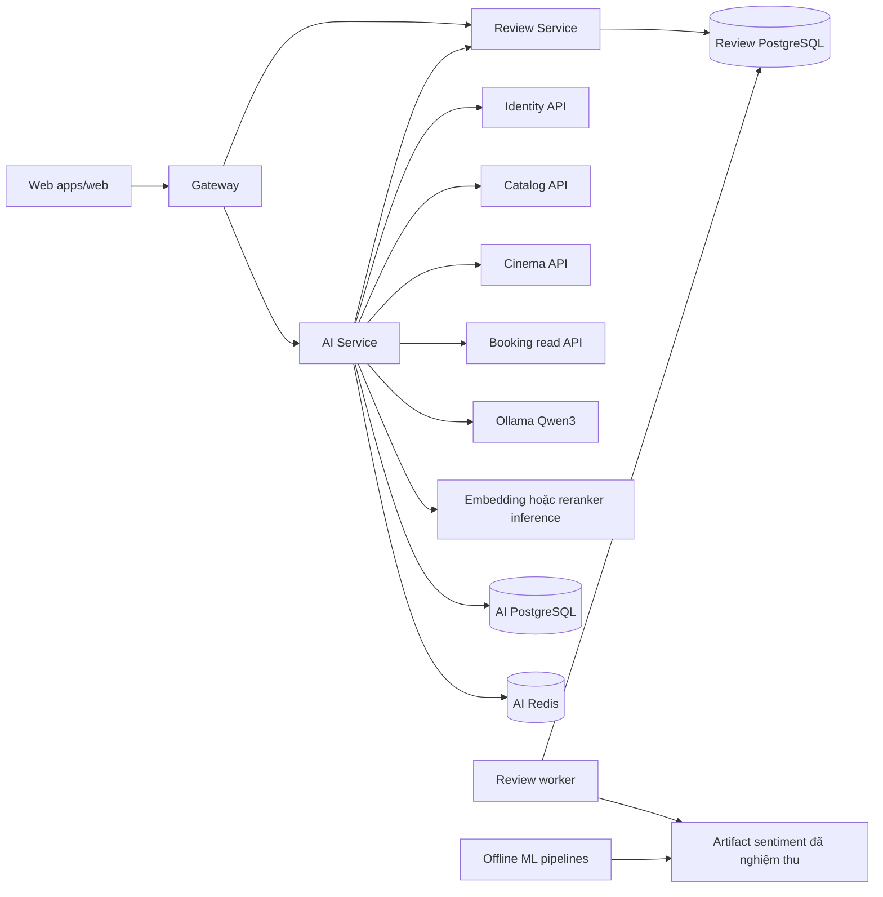
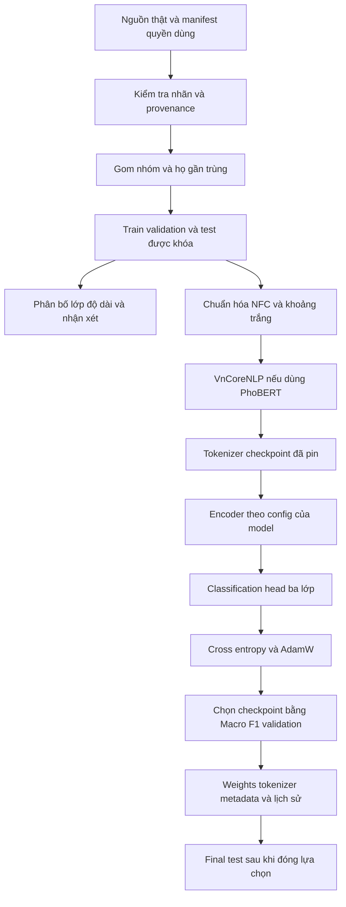
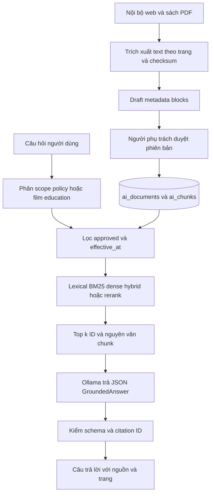

# Thiết kế AI và luồng bằng chứng

Cập nhật 04/11/2026. Phần này đóng góp vào các chương kiến trúc, cấu trúc/luồng và cài đặt của báo cáo chung. Dùng cùng [checklist](AI_GVHD_CHECKLIST.md), [plan](AI_FEATURE_PLAN.md) và [runbook](AI_RUNBOOK.md).

Bổ sung triển khai: [profile Docker AI](AI_PORTABLE_SETUP.md) chạy Ollama trong mạng service, CPU mặc định, tự tải và xác minh digest model. Credential và volume theo từng máy/project; project mặc định `backend` vẫn giữ nguyên tên volume cũ. API không cần đường dẫn máy tác giả.

Trong generation hiện hành, `grounding.covers_specifics` loại bằng chứng thiếu năm/số/đơn vị cụ thể mà câu hỏi yêu cầu; `support_spans` chia text truy xuất thành các đoạn nguồn có ID. Model chọn ID đoạn và viết tối đa hai câu, code kiểm tra ID, dữ kiện cụ thể và câu lặp lại câu hỏi rồi ánh xạ về citation chunk gốc. Trace giữ nguyên request, response và câu nguồn do code lấy. Các kiểm tra này không chứng minh entailment/đúng nghĩa; chấm người vẫn bắt buộc. Policy trong luồng chat tiếp tục ưu tiên trích bằng chứng, không dùng model tự tạo chính sách. Replay generation có thể kiểm tra riêng cả scope policy và film education.

`rag.upsert_document` mặc định vẫn chunk 1.200 ký tự, overlap 0. Các tham số chunking bổ sung dùng cho replay ablation, có provenance vị trí ký tự tương ứng; API nhập KB không cho client tùy ý đổi cấu hình này. Kết quả phát triển và phiên bản cũ được giữ trong [snapshot](reports/evidence/2026-11-04/README.md).

## Ranh giới microservices

AI không được cấp database credential của owner khác. Web tiếp tục đặt vé qua các API nghiệp vụ sau khi người dùng mở link chọn ghế; LLM không gọi thao tác giữ ghế/thanh toán. Runtime sentiment vẫn tắt trong khi chưa có model được nghiệm thu trên review phim. Model ngân hàng được lưu trong research runs, chưa được promote vào worker.

## Huấn luyện và suy luận cảm xúc

Sơ đồ áp dụng cho nhánh transformer; model không cần tách từ đi từ chuẩn hóa thẳng tới tokenizer. Số encoder layer và số tham số lấy từ từng config/model, không suy từ tên. BERT/RoBERTa/DeBERTa có các khác biệt nội bộ; `AutoModelForSequenceClassification` chọn implementation tương ứng và lưu `model_config.json`. Không biểu diễn tất cả như CNN/RNN hoặc nhận đã đề xuất kiến trúc mới.

TF IDF LR là nhánh bổ sung: chuẩn hóa → char n gram 2–5 → TF IDF → Logistic Regression cân bằng lớp → chọn C trên validation. Đây không phải mạng nhiều layer, không có learning rate/epoch DL. Số tham số LR phụ thuộc vocabulary thực fit và được lưu riêng.

Các seed 17/42/73 dùng cùng fingerprint dữ liệu. Batch hiệu dụng tính cả số thiết bị/tích lũy gradient. Epoch hoàn tất và checkpoint tốt nhất khác nhau: có thể chạy đủ ba epoch nhưng chọn checkpoint ở epoch trước. Không dùng final test để chọn checkpoint/ngưỡng.

## RAG kết nối Knowledge Base

Kho bền vững hiện tại là document/chunk trong database của AI, cùng lexical hash 256 chiều dạng JSON. Chunking là 1.200 ký tự, không overlap. Dense gửi text sang runtime E5 và nhận cosine score; cache embedding trong RAM tiến trình inference. Hybrid dùng RRF với hằng số 60. Chưa có vector database hay chỉ mục E5 lưu bền vững.

Policy dùng đoạn nguồn đã duyệt; sinh câu trả lời với citation cho tri thức điện ảnh là nhánh riêng. Giá/ghế/suất chỉ lấy từ owner API vì là dữ liệu thay đổi. Nhập draft không tự duyệt. Trong các CLI pilot, nguồn chỉ được bật tạm trong SQLite RAM; trạng thái file gốc và DB ứng dụng không bị đổi.

Điểm retrieval không tự chứng minh nguồn đủ trả lời. Pilot có câu không có chính sách nhưng vẫn nhận đoạn gần chủ đề. Chất lượng nội dung/citation cần người chấm và gold độc lập; không dùng citation ID hợp lệ làm thay groundedness.

## Đối chiếu thiết kế và code

| Thành phần thiết kế | Code | Bằng chứng |
| --- | --- | --- |
| Planner và giới hạn hành động | `ai_service/llm.py`, `chat.py`, `recommendations.py` | Tests AI và live UI đã ghi ở trạng thái triển khai |
| Chuẩn bị dữ liệu, nhóm, admission | `pipelines/ml/data.py`, `dataset_audit.py` | Source manifest, data card, audit, distribution |
| Train theo config và chọn validation | `train_sentiment.py`, `benchmark.py` | TrainingArguments, model config, lịch sử/checkpoint, validation |
| Bảng ngang và tính tham số | `export_evidence.py` | Model table CSV/Markdown, research evidence, trang ngang Word |
| Ingest và chunk/page provenance | `scripts/ai/prepare_knowledge.py`, `ai_service/rag.py` | KB inventory, chunks JSONL, sample page |
| Truy xuất và sinh có citation | `rag.py`, `llm.py`, `scripts/ai/smoke_rag_answer.py` | Query/top k/context/request/response trong RAG IN OUT |
| Quyết định nhãn có người và audit | `review_service/service.py`, `router/api.py`, `worker.py` | Regression CAS/idempotency, migration owner và moderation UI |

Code path `ai_service/*` và `review_service/*` lần lượt thuộc `services/ai-service/src/` và `services/review-service/src/`. Huấn luyện/evaluate không nằm trong request hay image API. Lệnh cài đặt, cấu hình private, migrations owner và kiểm thử xem runbook; không đưa credential vào báo cáo.
