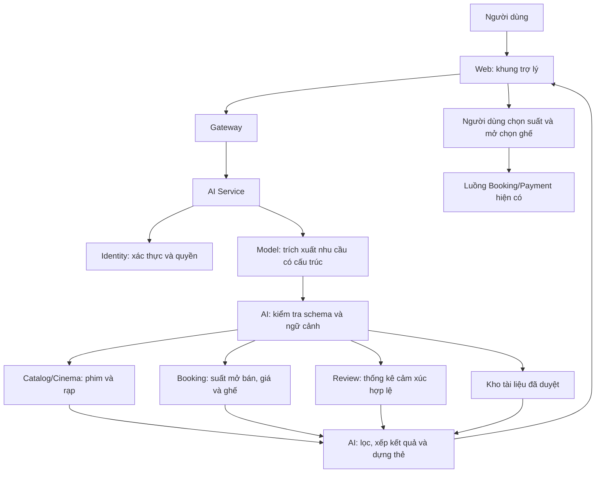
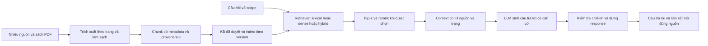

# Kế hoạch tính năng AI — Cinema Booking

**Ưu tiên cho đợt nộp hiện tại đã chạy xong:** [bốn corpus tiếng Việt](AI_FOUR_DATASET_COMPARISON.md) gồm Bank, ViSFD GENERAL, Shopee hai lớp và phim silver; năm Transformer + LR, seed 42, **24/24 lượt hoàn tất**. [Báo cáo Word cập nhật](reports/AI_GVHD_4_DATASET_2026-11-04.docx) có bảng ngang, kết quả thực, phân bố, hình và Chương 4 KB/RAG. Đây là điều chỉnh minh bạch về nguồn nhãn/số lớp cho báo cáo tiến độ, không nhận là đã hoàn tất bốn bộ gold ba lớp hoặc ba seed của plan gốc. Các mục bên dưới giữ lịch sử/mục tiêu của plan gốc; nguồn hiện hành cho đợt nộp là protocol bốn corpus nêu trên.

Phương án bổ sung theo yêu cầu giảm đọc tay: [AI_ASSISTED_LABELING.md](AI_ASSISTED_LABELING.md). AI xử lý ứng viên train, giữ một pilot mù khoảng 100 câu và bảo toàn quyết định người dùng đã làm. Đây là nghiên cứu silver riêng; mục D1 chuẩn và tiêu chí đánh giá cuối bên dưới chưa được tự nhận hoàn tất hoặc thay bằng nhãn AI.

Ngày lập: **03/11/2026**. Cập nhật **bản 3 theo góp ý GVHD, 04/11/2026**. Mã nguồn nền: nhánh `main`, commit `7d9ca6f`; các bổ sung đang ở working tree local.

Yêu cầu bàn giao bổ sung ngày 04/11: source nhóm tự commit phải có thể pull và thiết lập trên máy khác. Dùng Compose AI/Ollama CPU mặc định, khóa model/image, sinh credential mới, tải lại PDF/dataset/model theo phiên bản, không phụ thuộc `.local` hoặc đường dẫn tác giả. Snapshot kết quả gọn đi theo tài liệu; raw data/weights và secret không đưa vào Git. Bản kiểm tra clean source + fresh owner volumes đã chạy thật; chưa nhận là đã kiểm thử trên mọi hệ điều hành. Không commit/push nếu chưa được người dùng yêu cầu rõ.

**Trạng thái: đang triển khai theo yêu cầu của nhóm từ 03/11/2026.** Chi tiết code đã làm, lệnh chạy, kết quả đo và phần còn thiếu được theo dõi tại [AI_RUNBOOK.md](AI_RUNBOOK.md) và [AI_IMPLEMENTATION_STATUS.md](AI_IMPLEMENTATION_STATUS.md). Model sản xuất và ngưỡng chất lượng cuối cùng chưa được chốt. Các mục tiêu/ước lượng trong plan không phải kết quả thực nghiệm; chỉ các báo cáo chạy thật trong tài liệu trạng thái được coi là bằng chứng.

## 0. Điều chỉnh theo yêu cầu GVHD

**Bổ sung ngày 04/11/2026:** Chương 3 phải có bảng ngang cả trang gồm model, đặc trưng, kiến trúc, số layer, số tham số, learning rate, epoch, batch/gradient accumulation, max length và optimizer. Tách bảng cấu hình dự kiến khỏi thông số thực chạy; LR ghi N/A cho layer/epoch DL và ghi C/số vòng tối ưu thực tế. Chương 4 phải có link nguồn/file PDF đã thu thập, một trang output KB có giải thích và trace IN–OUT gồm query → chunks/điểm/page → context thực gửi model → output/citation. Bằng chứng được xuất bằng code và đối chiếu tại [checklist GVHD](AI_GVHD_CHECKLIST.md).

Theo lựa chọn của nhóm, **không chờ xin VLSP2016**: nguồn này thành tùy chọn, vị trí dataset thứ ba trong config `pipelines/configs/ai_research.advisor-v3.json` chờ nguồn tải trực tiếp có ba lớp và provenance phù hợp. Lock cũ được giữ nguyên để tái lập. Mục tiêu vẫn 5 transformer × 4 dataset độc lập. Shopee binary và bản dịch/augmentation không được ép thành dataset ba lớp độc lập. Nguồn đã tìm/tải và corpus phim chờ gán nhãn: [AI_DATA_SOURCES.md](AI_DATA_SOURCES.md).

**Kết luận: cần sửa phạm vi học thuật của plan.** Bản 1 đủ để định hướng tính năng sản phẩm nhưng chưa đủ cho yêu cầu thực nghiệm và minh chứng trong báo cáo. Bản 2 giữ kiến trúc/tính năng phù hợp, đồng thời bổ sung các đầu ra bắt buộc dưới đây.

| Góp ý GVHD liên quan AI | Khoảng trống của bản 1 | Thay đổi ở bản 2 |
| --- | --- | --- |
| Chương 1 phải rõ tổng quan vấn đề gì | Mới nêu các tính năng muốn làm | Đặt vấn đề, câu hỏi nghiên cứu, đối tượng đánh giá và đóng góp AI |
| Chương 2 phải rõ kiến trúc gì | Có microservices nhưng cần thể hiện ranh giới AI | Mô tả kiến trúc hệ thống có AI, kiến trúc classifier và kiến trúc KB/RAG, nối sang mã nguồn |
| Chương DL không chỉ ghi CNN/RNN | Mới dự kiến LR và PhoBERT, so sánh mở rộng để sau | Đưa so sánh 5 encoder Transformer trên 4 bộ dữ liệu thành đầu ra bắt buộc; bộ thứ 5 có điều kiện ở mục 7 |
| Thử nghiệm, visual phong phú | Thiếu ma trận chạy và danh mục hình | Có protocol, thống kê phân bố, biểu đồ, phân tích lỗi, hiệu năng và bằng chứng tái lập |
| KB nhiều nguồn, có file sách PDF | Chưa có nguồn sách/PDF, pipeline nhập và provenance theo trang | Xây KB đa nguồn, có ít nhất một sách PDF phù hợp, metadata và màn hình xem nguồn/chunk |
| Show KB, giải thích RAG, code và output | Chủ yếu mới mô tả retriever hiện có | Có trace nguồn → chunk → truy xuất → context → câu trả lời/citation, ablation và output chạy thật |
| Thiết kế phải tương ứng code, thể hiện cài đặt | Chưa có danh mục đối chiếu và bộ minh chứng | Bổ sung ma trận yêu cầu → sơ đồ → hàm/API → test → output và gói minh chứng theo chương |
| Data có phân bố, nhận xét và tiền xử lý | Chưa bắt buộc EDA riêng cho từng bộ dữ liệu | Thêm data card, bảng trước/sau xử lý, phân bố lớp/độ dài/nguồn, nhận xét và ablation |

### 0.1. Cách hiểu để phân bổ đúng phạm vi AI

- Góp ý lặp tên “Chương 3”; tạm hiểu phần sau làm rõ yêu cầu thực nghiệm cho chương DL. Số chương và tên cuối cùng cần được nhóm đối chiếu lại với GVHD khi chốt mục lục.
- Câu về CNN/RNN được hiểu là yêu cầu nội dung DL có chiều sâu và thực nghiệm cụ thể, không chỉ chép lý thuyết các kiến trúc cũ. Đây là cách diễn giải góp ý, không suy thành quy định cấm mọi baseline ML/CNN/RNN.
- Phân bổ yêu cầu 4–5 model × 4–5 dataset cho bài toán **phân tích cảm xúc** vì có đầu vào/nhãn/chỉ số so sánh rõ. Chốt mức thực hiện chính là **5 model × 4 dataset**, hướng tới bộ thứ 5 nếu điều kiện dữ liệu và bài toán phù hợp. Train/validation/test là các phần của một dataset, không được tính thành ba dataset.
- Không tự suy ra GVHD yêu cầu mua/chạy 5 API LLM hoặc 5 hệ microservices. KB/RAG có thiết kế thực nghiệm riêng; model chat, model cảm xúc và embedding là ba vai trò khác nhau.
- Chương 1, 2, 5, 6 vẫn thuộc báo cáo chung của dự án. Plan này chỉ xác định phần AI đóng góp vào từng chương, không viết lại kế hoạch cả dự án.

### 0.2. Đề xuất câu hỏi nghiên cứu và đóng góp

1. **RQ1:** Các encoder tiếng Việt và đa ngôn ngữ khác nhau thế nào về phân loại cảm xúc trên nhiều miền dữ liệu, đặc biệt dữ liệu đánh giá phim của nhóm?
2. **RQ2:** Tiền xử lý, mất cân bằng nhãn và ngưỡng chuyển nhân viên tác động thế nào đến chất lượng và tỷ lệ tự xử lý?
3. **RQ3:** BM25, truy xuất ngữ nghĩa và hybrid thay đổi khả năng tìm nguồn/trả lời so với lexical baseline hiện tại như thế nào, trên KB đa nguồn có PDF?
4. **RQ4:** Cách tích hợp model/KB với API dữ liệu động đáp ứng độ đúng, khả năng truy nguồn, độ trễ và luồng đặt vé tới mức nào?

Đóng góp dự kiến là bộ thực nghiệm có thể tái lập, dữ liệu phim được mô tả/gán nhãn, KB đa nguồn có provenance và tích hợp được minh chứng bằng code/output. Không tự nhận đề xuất kiến trúc DL mới nếu chỉ fine-tune và tích hợp model có sẵn.

## 1. Mục tiêu và phạm vi

Xây dựng hai phần AI kết nối với nhau:

1. **Trợ lý tư vấn phim, suất chiếu và hỗ trợ đặt vé:** hiểu nhu cầu bằng tiếng Việt, tìm dữ liệu phù hợp, hỏi lại khi cần và đưa người dùng đến đúng màn hình chọn ghế.
2. **Phân tích cảm xúc đánh giá phim:** phân loại tích cực/trung lập/tiêu cực, chuyển trường hợp chưa đủ tin cậy cho nhân viên và cung cấp thống kê phục vụ gợi ý phim.

Triển khai theo kiến trúc microservices hiện hành, sử dụng AI Service, Review Service, các owner API và pipeline ML độc lập.

Tài liệu dựa trên việc rà soát cấu trúc repository, đọc chi tiết AI/Review/pipeline ML, API liên quan của Catalog/Cinema/Booking, luồng thanh toán, giao diện và kiểm thử. Chưa chạy lại toàn bộ hệ thống hoặc xác nhận dữ liệu/model đang có trong database và container thực tế.

### Phạm vi bản đầu tiên

| Nhóm | Chức năng cần có |
| --- | --- |
| Tư vấn phim | Tìm phim theo tên, thể loại, ngôn ngữ, thời lượng và mô tả sở thích; giải thích dựa trên metadata thực tế |
| Tìm suất | Lọc theo phim/rạp/thành phố/ngày/khung giờ/số người/ngân sách tiền vé; chỉ đề xuất suất còn mở bán |
| Hội thoại | Nhớ lựa chọn trong hội thoại; hiểu câu tiếp nối; hỏi lại khi thiếu hoặc có nhiều kết quả trùng tên |
| Hỗ trợ đặt vé | Hiển thị phim, suất, giá tham khảo, ghế trống và nút chuyển sang chọn ghế |
| Hỏi đáp nghiệp vụ | Trả lời từ tài liệu đã duyệt, còn hiệu lực và có nguồn |
| Cảm xúc | Phân loại ba nhãn; xử lý bất định; giữ thông tin phiên bản model và nội dung |
| Nhân viên | Duyệt nội dung như hiện tại; bổ sung danh sách và thao tác rà soát nhãn cảm xúc |
| Thống kê | Số lượng/tỷ lệ từng nhãn, số đang chờ, số cần rà soát và cửa sổ thời gian |
| Gợi ý từ đánh giá | Kết hợp thống kê hợp lệ với phim còn suất phù hợp |

### Phạm vi để sau

- Trợ lý tự giữ ghế, tạo đơn, hủy đơn, hoàn tiền hoặc thực hiện thanh toán trong chat.
- Cá nhân hóa dài hạn theo lịch sử mua vé hoặc hồ sơ hành vi người dùng.
- Tìm rạp gần nhất theo GPS, tính khoảng cách và thời gian di chuyển.
- Tối ưu nhóm ghế liền nhau/giữa rạp khi chưa có hợp đồng mô tả vị trí, lối đi và sơ đồ ghế đủ rõ.
- Phân tích riêng cảm xúc về nhân viên, cơ sở vật chất và dịch vụ rạp.
- Fine-tune mô hình hội thoại/LoRA, tự động đưa phản hồi khách vào tập huấn luyện. Việc fine-tune các classifier cảm xúc trong ma trận thực nghiệm là phần bắt buộc riêng ở mục 7.
- Streaming câu trả lời, chatbot bằng giọng nói và mở chat cho khách chưa đăng nhập.

## 2. Mốc mã nguồn trước khi triển khai kế hoạch

Mục này mô tả mốc khảo sát ban đầu ngày 03/11/2026 để giải thích lý do lập kế hoạch. Các khoảng trống ghi ở đây không phải danh sách tính năng còn thiếu hiện tại. Code và kết quả mới nhất xem [trạng thái thực hiện](AI_IMPLEMENTATION_STATUS.md); cách chạy hiện hành xem [runbook AI](AI_RUNBOOK.md) và [chatbot local](AI_LOCAL_CHAT.md).

### 2.1. Kiến trúc liên quan

| Thành phần | Trách nhiệm hiện có | Vai trò trong kế hoạch |
| --- | --- | --- |
| `apps/web/` | React/Vite, khung trợ lý, trang phim, chọn ghế, đánh giá và quản trị | Hoàn thiện trải nghiệm chat và rà soát cảm xúc |
| `gateway/` | Định tuyến `/api` tới owner; chặn API nội bộ | Giữ đầu vào chung và kiểm thử lỗi/timeout |
| `services/ai-service/` | Chat, ngữ cảnh, lịch sử, tài liệu kiến thức và truy xuất | Hiểu nhu cầu, điều phối công cụ đọc và dựng kết quả |
| `services/review-service/` | Đánh giá, moderation, sentiment worker, summary/ranking, events | Phân tích cảm xúc, xác nhận nhãn và thống kê |
| `services/catalog-service/` | Phim, thể loại, định dạng và menu | Cung cấp metadata và tìm phim theo bộ lọc |
| `services/cinema-service/` | Rạp, phòng, ghế vật lý, lịch và công bố cấu hình bán | Cung cấp danh sách/tìm kiếm rạp và lịch liên quan |
| `services/booking-service/` | Sales configuration đã nhận, reservation, giá, ghế, đơn và vé | Nguồn xác nhận suất đang bán, giá và tình trạng ghế |
| `services/payment-service/` | VNPay, bằng chứng giao dịch và saga cấp vé | Tiếp tục xử lý thanh toán qua luồng hiện có |
| `services/identity-service/` | Tài khoản, session và quyền hiện hành | Xác thực user, quyền quản lý tài liệu và rà soát đánh giá |
| `services/reporting-service/` | Projection và báo cáo từ owner facts/events | Kiểm tra thống kê sau thay đổi nhãn cảm xúc |
| `services/notification-service/` | Email sau xác nhận booking | Tiếp tục nhận sự kiện nghiệp vụ hiện có |
| `pipelines/ml/` | Chuẩn bị dữ liệu, train/evaluate offline | Tái sử dụng cho thực nghiệm và bàn giao model |

AI chỉ truy cập dữ liệu nghiệp vụ qua API của owner. Mỗi service giữ database riêng.

### 2.2. Trợ lý hiện có

- `chat.py` nhận diện ý định bằng từ khóa và suy ra một phần ngữ cảnh từ tên phim/rạp, ngày và mã suất.
- Có năm công cụ: `search_films`, `get_showtimes`, `get_ticket_prices`, `get_seat_availability`, `get_positive_films`.
- Ngữ cảnh chủ yếu gồm `film_id`, `theater_id`, `show_date`, `showtime_id`.
- PostgreSQL lưu lịch sử theo user; Redis phục vụ rate limit và ghi cache ngữ cảnh có TTL. TTL cache không phải thời hạn xóa lịch sử PostgreSQL.
- Có kiểm soát cập nhật hội thoại đồng thời, cách ly tài khoản và xóa lịch sử.
- RAG hiện là lexical hash 256 chiều; model tùy chọn chỉ chọn evidence ID, backend trả nội dung từ nguồn.
- `AI_MODEL_URL` hiện gọi hợp đồng tùy chỉnh `/select`. Không thể chỉ đổi URL sang Ollama/Gemini để có chatbot mới.
- Giao diện đã có bộ lọc phim/rạp/ngày/mã suất, nguồn tham chiếu và liên kết đặt vé.

**Khoảng trống:** nhận diện câu tự nhiên và nhiều điều kiện còn hạn chế; chưa có ngữ cảnh ngân sách/số vé/khung giờ; chưa có thẻ kết quả và lựa chọn trực tiếp trong chat. Catalog search hiện chủ yếu tìm theo tiêu đề. Tra lịch hiện cần biết phim, rạp và ngày. Các nhánh hỏi đáp cũng đang gọi match/context trước khi xác định có cần đọc nghiệp vụ hay không.

**Khoảng trống KB theo yêu cầu mới:** schema hiện chưa có đầy đủ tác giả/giấy phép, checksum tài liệu, trang PDF, section, vị trí chunk và trạng thái trích xuất/OCR. RAG hiện trả đoạn nguồn, chưa phải bằng chứng đã triển khai chuỗi truy xuất ngữ nghĩa + sinh câu trả lời có citation. Các phần này phải được thiết kế, xây và đánh giá bổ sung.

### 2.3. Cảm xúc hiện có

- Mỗi user có một đánh giá cho mỗi phim; có sửa/xóa và kiểm duyệt nội dung.
- `ReviewSentiment` đã có nhãn, scores, model version, trạng thái, số lần thử, content version, generation và lease.
- Worker chỉ lấy đánh giá đã duyệt, không bị xóa và khớp phiên bản hiện tại; nhả connection DB trong lúc suy luận.
- Có retry, phục hồi lease và chặn kết quả cũ ghi đè sau sửa/xóa/moderation/retry.
- Trạng thái gồm `pending`, `succeeded`, `needs_review`, `failed`. Backend `disabled` giữ công việc chờ xử lý.
- Summary/ranking chỉ tính kết quả thành công, đúng phiên bản, đánh giá được duyệt và nằm trong cửa sổ thời gian.
- Mặc định cấu hình là cửa sổ 30 ngày, tối thiểu 10 đánh giá hợp lệ và ngưỡng cần rà soát 0,65. Các giá trị này cần được đánh giá lại bằng dữ liệu.
- Có ranking Wilson và kiểm tra phim còn suất phù hợp.
- `FilmReviews.jsx`, `PositiveFilms.jsx` đã có phần hiển thị cảm xúc/thống kê/gợi ý. `ReviewModeration.jsx` hiện tập trung duyệt nội dung, chưa có luồng nhân viên xác nhận/sửa nhãn cảm xúc hoàn chỉnh.

**Khoảng trống:** chưa có bằng chứng model sản phẩm được nghiệm thu; thiếu quy trình quyết định nhãn bằng con người và audit tương ứng; cần kiểm chứng chất lượng, độ trễ và thống kê sau khi tích hợp.

### 2.4. Dữ liệu và môi trường

- Có 100 câu sentiment nháp và 30 câu chat nháp trong `pipelines/ml/data/drafts/`; dữ liệu do AI soạn, chưa thay thế dữ liệu đã duyệt hoặc test độc lập.
- Pipeline đã có cổng kiểm tra reviewer, nguồn, quyền sử dụng, nhóm và chia tập tránh trùng lặp.
- TF-IDF/Logistic Regression và PhoBERT đã có mã train/evaluate. Pipeline chat hiện huấn luyện chọn chứng cứ, không phải điều phối công cụ theo phạm vi mới.
- Artifact được nghiệm thu đặt tại `model-store/`, mount read-only vào worker suy luận của owner tương ứng.
- Máy khảo sát có Ryzen AI 9 HX 370, khoảng 31,1 GiB RAM và RTX 5060 Laptop khoảng 8 GiB VRAM. Đây là thông tin phần cứng, chưa phải benchmark. Cần tính cả tài nguyên Docker khi đo AI.

## 3. Các lựa chọn mô hình và khuyến nghị

### 3.1. Mô hình cho trợ lý

| Phương án | Lợi ích | Chi phí/giới hạn | Điều kiện chọn |
| --- | --- | --- | --- |
| Local bằng Ollama | Không phát sinh phí token của API khi chạy hoàn toàn local; chủ động model và dữ liệu | Dùng RAM/VRAM/điện; chất lượng và độ trễ phụ thuộc model, quantization, context và tải | Phù hợp demo trên máy, thử nghiệm và nhu cầu ưu tiên local |
| API, ví dụ Gemini hoặc Claude | Không cần vận hành GPU inference; dễ thử nhiều model | Phí theo cách tính của nhà cung cấp, Internet, quota, điều kiện dữ liệu và vận hành | Phù hợp khi muốn triển khai server và chấp nhận dịch vụ ngoài |
| Hỗ trợ local và một API qua adapter | So sánh cùng bộ kiểm thử; đổi backend bằng cấu hình | Thêm tích hợp và ma trận kiểm thử; phải quản lý riêng dữ liệu và chi phí | Phù hợp khi cần linh hoạt sau bản đầu |

**Đề xuất:** thiết kế một interface provider nhỏ; thử local trước với ứng viên Qwen3 4B/8B, chọn model sau benchmark. Nếu cần so sánh API, chỉ tích hợp một provider đầu tiên. Không triển khai đồng thời nhiều provider khi chưa có nhu cầu.

Không tự chuyển từ local sang API khi local lỗi. Việc bật API phải là cấu hình chủ động vì thay đổi nơi xử lý dữ liệu và chi phí. Chưa chọn model/API cuối cùng hoặc tải model trong giai đoạn lập kế hoạch.

Ollama có tool calling và structured outputs; các API Gemini/Claude cũng cung cấp cơ chế gọi công cụ. Đây là khả năng tích hợp, không bảo đảm model hiểu đúng tiếng Việt hoặc trả tham số đúng trong mọi trường hợp. Xem nguồn kỹ thuật tại mục 16.

### 3.2. Mô hình cho cảm xúc

Theo góp ý GVHD, năm ứng viên sau thuộc **ma trận thực nghiệm chính**, không còn là phần mở rộng sau MVP. Các ID là ứng viên đã đối chiếu model card; phải pin revision, kiểm tra quyền sử dụng, tokenizer và head trước khi chạy.

| Mã/model ứng viên | Vai trò so sánh | Việc cần kiểm chứng |
| --- | --- | --- |
| M1 — PhoBERT-base, `vinai/phobert-base` | Encoder tiếng Việt tổng quát, tận dụng pipeline đã có | Word segmentation đúng hướng dẫn, giới hạn token và chất lượng theo miền |
| M2 — ViSoBERT, `uitnlp/visobert` | Encoder tiếng Việt cho văn bản mạng xã hội | Tiếng lóng/không dấu, đặc thù tokenizer và khả năng chuyển miền |
| M3 — ViDeBERTa-xsmall, `Fsoft-AIC/videberta-xsmall` | Kiến trúc DeBERTa, phương án gọn | Nạp đúng backbone, tạo classification head theo task, chất lượng/tài nguyên |
| M4 — mBERT, `google-bert/bert-base-multilingual-cased` | Baseline Transformer đa ngôn ngữ | Tokenization, case và kết quả trên cùng tiếng Việt |
| M5 — XLM-R-base, `FacebookAI/xlm-roberta-base` | Encoder đa ngôn ngữ theo hướng RoBERTa | Chất lượng, RAM/VRAM và độ trễ so với encoder đơn ngữ |

TF-IDF ký tự + Logistic Regression là **baseline bổ sung**, không tính thay một trong năm Transformer. Các checkpoint trên chưa mặc nhiên là model sentiment sẵn dùng: phải fine-tune và đánh giá classification head trên từng dataset. Không so một model đã train trên test với một base model chưa train.

API LLM phân loại cảm xúc chỉ là thí nghiệm phụ nếu có ngân sách; không thay thế ma trận DL này. Model đưa vào sản phẩm được chọn theo dữ liệu phim, chất lượng và khả năng vận hành, không chỉ theo điểm trung bình các miền ngoài điện ảnh. Không bắt buộc dùng cùng một model cho chat và sentiment.

Điểm số do API/LLM tự khai báo không được coi là xác suất đã hiệu chuẩn hoặc đưa thẳng qua ngưỡng 0,65 của classifier. Nếu thử API, cần chính sách bất định được đánh giá riêng.

## 4. Thiết kế trợ lý tư vấn và đặt vé

### 4.1. Luồng xử lý

### 4.2. Nhận diện nhu cầu và ngữ cảnh

Model trả một kế hoạch dữ liệu theo schema, ví dụ ý định, tên phim/rạp cần tìm và các điều kiện. Backend giải tên thành ID qua owner API, kiểm tra tính hợp lệ rồi mới gọi công cụ được cho phép.

Các trường đề xuất bổ sung:

- Thể loại, ngôn ngữ, định dạng và giới hạn thời lượng nếu người dùng nêu.
- Thành phố hoặc tập rạp; tên mơ hồ phải đưa lựa chọn để xác nhận.
- Ngày và khoảng giờ; chuẩn hóa bằng thời gian server tại `Asia/Ho_Chi_Minh`.
- Số vé, ngân sách và phạm vi ngân sách: mỗi vé hoặc cả nhóm.
- Ý định đang hỏi dở, danh sách kết quả gần nhất và tham chiếu như “suất thứ hai”.

Quy tắc nghiệp vụ:

1. Phân biệt điều kiện bắt buộc với sở thích. Không tự bỏ ngân sách/ngày/rạp để làm xuất hiện kết quả.
2. “Dưới 250k” chưa rõ cho một vé hay cả nhóm thì hỏi lại. Bản đầu hiểu ngân sách là tiền vé; hỏi lại nếu người dùng yêu cầu tính cả bỏng/nước.
3. “Tối nay” dùng ngày hiện tại theo múi giờ Việt Nam. Đề xuất quy ước buổi tối từ 18:00, hiển thị rõ và cho phép người dùng đổi.
4. “Cuối tuần”, “thứ sáu này”, ngày thiếu năm và giờ mơ hồ cần quy tắc chuẩn hóa, test và câu hỏi xác nhận khi có nhiều cách hiểu.
5. Đổi phim/rạp/ngày phải xóa hoặc kiểm tra lại suất đang chọn. “Suất thứ hai” chỉ được giải từ danh sách kết quả trong đúng hội thoại.
6. Với yêu cầu gần vị trí hiện tại, bản đầu hỏi thành phố/rạp; không tự khẳng định khoảng cách gần nhất.
7. Tuổi phù hợp chỉ được suy từ dữ liệu phân loại có quy tắc đã duyệt; metadata thiếu/không chuẩn phải nêu chưa đủ thông tin.
8. Lịch sử gửi cho model được giới hạn theo lượt và token; ngữ cảnh nghiệp vụ do backend quản lý là nguồn chính.

### 4.3. Dữ liệu động và xếp kết quả

- Booking xác nhận suất còn mở bán, còn trong tương lai và giá/ghế theo sales version hiện hành.
- Lọc điều kiện bắt buộc trước khi áp dụng giới hạn trang. Response có phân trang/`has_more`; không kết luận toàn hệ thống không có kết quả khi mới đọc một phần.
- Ngân sách cả nhóm được tính bằng code với `Decimal`, từ tập ghế đang có thể bán. Không dùng giá ghế rẻ nhất đã hết chỗ để quảng bá suất nằm trong ngân sách.
- Đủ số ghế trống chưa chứng minh có ghế liền nhau. Chức năng gợi ý vị trí ghế cần hợp đồng riêng ở giai đoạn sau.
- Chỉ xếp hạng trong tập ứng viên đã xác minh: mức khớp sở thích, giờ phù hợp, giá và tín hiệu review nếu đủ dữ liệu.
- Lý do đề xuất gắn với trường dữ liệu, ví dụ đúng thể loại hoặc nằm trong khung giờ. Không tự dựng nhận xét về chất lượng phim.
- Khi người dùng bấm “Chọn ghế”, trang đích tải lại lịch/giá/tình trạng ghế. Thẻ chat thể hiện thời điểm tra cứu và chưa phải giữ chỗ.

### 4.4. Hỏi đáp tài liệu

Theo yêu cầu mới, **xây KB đa nguồn có sách PDF và thực nghiệm RAG là phần bắt buộc**, không chỉ giữ một số câu FAQ hoặc chọn vài đoạn văn có sẵn. Giữ cơ chế duyệt, version và ngày hiệu lực hiện có; bổ sung provenance, công cụ xem KB và minh chứng truy xuất/sinh trả lời.

#### 4.4.1. Nguồn và ranh giới tri thức

| Nhóm nguồn dự kiến | Nội dung được sử dụng | Ranh giới áp dụng |
| --- | --- | --- |
| Chính sách/hướng dẫn của chính dự án, có người duyệt | Quy trình đặt vé, giữ ghế, thanh toán, đánh giá, hỗ trợ | Chỉ mô tả hành vi hiện hành được xác nhận từ code/cấu hình và chính sách nhóm chốt |
| FAQ/tài liệu chính thức của đơn vị rạp hoặc nhà cung cấp, khi có quyền sử dụng | Khái niệm định dạng, hướng dẫn có thể tham khảo | Gắn tổ chức/phạm vi nguồn; chính sách rạp khác không tự trở thành chính sách của Cinema Booking |
| Sách/giáo trình điện ảnh dạng PDF | Thể loại, cốt truyện, ngôn ngữ điện ảnh và các khái niệm phục vụ tư vấn | Không dùng sách điện ảnh để suy giá vé hoặc chính sách hoàn tiền |
| Metadata phim do Catalog quản lý hoặc nội dung biên tập được phép | Mô tả/thể loại/ngôn ngữ/thời lượng | Dữ liệu có version; tra API để xác nhận trạng thái phim và bán vé |

Ứng viên sách cụ thể: **Exploring Movie Construction and Production — John Reich, Open SUNY Textbooks**, có [trang nhà xuất bản](https://milnepublishing.geneseo.edu/exploring-movie-construction-and-production/) và [bản PDF từ nhà xuất bản](https://milnepublishing.geneseo.edu/exploring-movie-construction-and-production/open/download?type=print_pdf). Trang nguồn nêu giấy phép CC BY-NC-SA 4.0 với ngoại lệ nếu được ghi riêng. Đây là ứng viên cho nghiên cứu/demo phi thương mại; phải kiểm tra điều kiện từng phần, ghi công và phạm vi sử dụng trước khi nhập KB. Chưa tải hoặc nhập sách trong đợt sửa plan.

Sách tiếng Anh tạo thêm bài toán truy xuất câu hỏi tiếng Việt → nguồn tiếng Anh. Giữ bản gốc để trích dẫn; nếu tạo bản dịch hỗ trợ tìm kiếm, ghi rõ nguồn gốc, người/công cụ dịch và kiểm tra chất lượng. Không xem bản dịch là tài liệu độc lập thứ hai.

Mục tiêu thu thập ban đầu đề xuất: tối thiểu **ba nhóm nguồn phù hợp**, có ít nhất **một sách PDF thực**, khoảng 10–20 tài liệu/đơn vị nội dung được duyệt. Đây là mục tiêu thu thập, chưa phải số lượng đang có. Không tách một sách thành nhiều file để báo cáo thành nhiều nguồn độc lập.

Giá, số ghế, trạng thái đơn và lịch bán được lấy từ API tại thời điểm hỏi, không đưa vào KB tĩnh. Cần metadata về loại tri thức và mức ưu tiên để giải quyết xung đột: chính sách nội bộ được duyệt thắng nguồn tham khảo ngoài khi trả lời về hệ thống của nhóm; khác biệt phải được nêu rõ, không ghép quy định mâu thuẫn thành một câu trả lời.

#### 4.4.2. Pipeline tạo và cập nhật KB

1. **Đăng ký nguồn:** source ID, loại nguồn, tác giả/tổ chức, URL hoặc tên file, ngôn ngữ, giấy phép/quyền sử dụng, ngày lấy, version và checksum.
2. **Trích xuất:** HTML/Markdown/JSON theo cấu trúc; PDF theo trang. Phát hiện PDF scan để OCR khi cần; ghi công cụ/phiên bản OCR và kiểm tra mẫu lỗi tiếng Việt, bảng, thứ tự cột.
3. **Làm sạch:** bỏ header/footer lặp, nối từ/ngắt dòng do PDF, giữ tiêu đề/mục/bảng cần thiết. Lưu mapping từ văn bản đã làm sạch về trang gốc.
4. **Chia chunk:** ưu tiên ranh giới section/đoạn, đo độ dài bằng tokenizer phù hợp. Thử có kiểm soát kích thước/overlap trên development set, không chốt tùy ý theo ký tự rồi bỏ qua tỷ lệ cắt ngữ cảnh.
5. **Biểu diễn và index:** giữ lexical hiện tại làm baseline; thêm BM25 và embedding đa ngôn ngữ. Các ứng viên embedding như `intfloat/multilingual-e5-small` hoặc `BAAI/bge-m3` cần được benchmark/pin revision; không dùng model sentiment làm embedding chỉ vì cùng là Transformer.
6. **Duyệt và xuất bản:** chỉ index phục vụ user trên tài liệu đã duyệt, đúng scope và còn hiệu lực. Khi thay nguồn, thu hồi bản cũ và cập nhật index atomically theo version.
7. **Kiểm tra và thống kê:** số nguồn/tài liệu/trang/chunk, ngôn ngữ, tỷ lệ OCR, trùng lặp, độ dài chunk và mức bao phủ nhóm câu hỏi.

Mỗi chunk dự kiến có `document_id`, `chunk_id`, `source_type`, `source_url`, `source_version`, `checksum`, `page_start/page_end` nếu PDF, `section`, `language`, `content`, `embedding_version` và thông tin pipeline. Khi thêm các trường này cần migration AI và cập nhật importer/schema; schema JSON/hash vector hiện tại không tự có khả năng provenance theo trang hoặc pgvector.

Không bắt buộc chọn pgvector trước thử nghiệm. Index đơn giản có thể phục vụ benchmark nhỏ; quyết định lưu/index dựa trên quy mô, độ trễ và tính tái lập. Embedding ngữ nghĩa và kiểm thử RAG vẫn thuộc phạm vi bắt buộc dù chưa chọn vector database.

#### 4.4.3. Luồng RAG và đầu ra cần chứng minh

Phân biệt rõ ba thành phần: **KB** là tài liệu/chunk/metadata được quản lý; **retrieval** tìm chứng cứ; **generation** dùng chứng cứ để tạo câu trả lời. Luồng hiện tại render nguyên đoạn nguồn là baseline trích xuất; không trình bày nó như đã hoàn thành một RAG sinh trả lời đầy đủ.

Mỗi case minh chứng phải có: câu hỏi → scope/phiên bản KB → top-k chunk và scores → context thực đưa vào model → câu trả lời → citation tới đúng tài liệu/trang → thời gian từng bước. Citation có ID tồn tại chưa đủ: nội dung nguồn phải thực sự hỗ trợ phát biểu. Đánh giá khả năng hỗ trợ bằng tập gold và người chấm; kiểm tra ID bằng code không bảo đảm toàn bộ diễn đạt của LLM đúng.

Với chính sách/giá/luồng đặt vé, giữ cách dựng thông tin quan trọng từ dữ liệu đã kiểm tra; không để LLM tạo con số hoặc URL. Với giải thích khái niệm điện ảnh từ sách, cho phép tóm tắt có nguồn nhưng phải chấm groundedness và trả lời không đủ căn cứ khi cần.

Trang quản trị/tiện ích demo KB cần xem được nguồn, giấy phép, version, trang PDF, chunk và trạng thái duyệt; chế độ trace chỉ dành cho người có quyền, không công khai prompt hệ thống hoặc credential. Tách câu FAQ không cần dữ liệu nghiệp vụ khỏi bước match phim/rạp để tránh phụ thuộc owner không cần thiết.

### 4.5. Giao diện và kết quả

- Thẻ phim: poster, tên, thể loại, thời lượng, thông tin phân loại và lý do phù hợp có căn cứ.
- Thẻ suất: phim/rạp/phòng/ngày/giờ/định dạng, mức giá và ghế còn tại thời điểm tra cứu.
- Nút chọn nhanh phim/rạp/suất thay cho nhập mã suất thủ công trong luồng chính.
- Câu hỏi gợi ý, trạng thái đang xử lý, lỗi có thể thử lại và lối đặt vé trực tiếp.
- Giữ lịch sử, xóa hội thoại, reset khi đổi tài khoản và kiểm soát request cũ như hiện tại.
- Ưu tiên chuyển thẳng tới `/seat-selection/{showtimeId}` khi đã xác định suất. Nếu chuyển qua `ticket-booking`, phải bổ sung đọc ngày/giờ theo hợp đồng query; hiện trang mới đọc phim và rạp từ query.
- Bản đầu trả JSON hoàn chỉnh. Streaming là cải tiến sau nếu đo được lợi ích.

## 5. Thiết kế phân tích cảm xúc

### 5.1. Nhãn và phạm vi nhận xét

| Nhãn | Diễn giải |
| --- | --- |
| `positive` | Kết luận tích cực về phim hoặc khuyến khích xem |
| `neutral` | Thông tin/mô tả không thể hiện rõ đánh giá tốt hoặc xấu |
| `negative` | Kết luận tiêu cực về phim hoặc không khuyến khích xem |

`needs_review` là trạng thái chưa đủ tin cậy, không phải nhãn trung lập. Nhận xét chỉ về dịch vụ rạp cần được phát hiện/đánh dấu ngoài phạm vi; không đưa vào thống kê cảm xúc của phim. Bổ sung quy trình xử lý thủ công cho nhận xét sai đối tượng trước; bộ phân loại đối tượng tự động chỉ thêm khi có dữ liệu đánh giá phù hợp.

Nội dung hỗn hợp theo kết luận chung nếu rõ. Câu mỉa mai, thiếu bối cảnh hoặc không thể quyết định cần được chuyển rà soát. Sentiment và moderation là hai quyết định riêng; đánh giá tiêu cực hợp lệ vẫn có thể được duyệt công khai.

### 5.2. Vòng đời xử lý

1. User gửi/sửa đánh giá; hệ thống tăng phiên bản và chờ kiểm duyệt theo chính sách hiện tại.
2. Nội dung được duyệt mới đủ điều kiện vào worker.
3. Worker lấy lease, đọc nội dung và chạy model ngoài transaction đang giữ connection.
4. Kết quả hợp lệ, đủ ngưỡng được ghi `succeeded`; thiếu tin cậy được ghi `needs_review`; lỗi ghi `failed` và retry có giới hạn.
5. Trước commit phải kiểm tra lại content version, generation, lease và trạng thái moderation/xóa.
6. Nhân viên xử lý danh sách cần rà soát bằng quy trình ở mục 5.3.
7. Summary, event và Reporting cập nhật từ kết quả còn hiệu lực. Chỉnh sửa/xóa/thu hồi duyệt vô hiệu kết quả trước đó.

Tái sử dụng `review-worker` với cơ chế poll, lease và outbox của Review Service.

### 5.3. Bổ sung xác nhận/sửa nhãn của nhân viên

Đây là phần cần phát triển thêm, không phải chức năng đã hoàn chỉnh ở commit tham chiếu.

- Danh sách riêng cho nội dung đã duyệt nhưng kết quả `needs_review`; có lọc phim, trạng thái và phân trang.
- Hiển thị nội dung, nhãn model, scores, model version và phiên bản nội dung. Scores được mô tả là điểm của model, không hứa mức chắc chắn tuyệt đối.
- Nhân viên xác nhận hoặc sửa sang một trong ba nhãn; yêu cầu quyền `reviews.moderate`, lý do và thông tin phiên bản kỳ vọng.
- API khóa bản ghi và so sánh `content_version`, `analysis_generation`, thời điểm cập nhật kết quả. Dữ liệu đã đổi trả 409 để tải lại.
- Thao tác lặp cùng mã yêu cầu phải cho kết quả nhất quán. Hai nhân viên xử lý đồng thời không ghi đè quyết định mới.
- Khi xác nhận, vô hiệu lease/lượt inference cũ để worker đang chạy không ghi đè quyết định của nhân viên.
- Retry sau quyết định thủ công phải là thao tác rõ ràng, có lý do và audit; không âm thầm thay nhãn đã xác nhận.

Đề xuất lưu thêm `predicted_label`, `decision_source`, người/thời điểm xác nhận và lý do. Giữ nhãn hiệu lực ở `label` để tương thích summary; không sửa scores để giả thành xác suất của nhãn con người chọn.

Thêm bảng audit quyết định theo review ID, content version và generation; lưu ai quyết định, trước/sau và thời điểm, hạn chế lưu lặp nội dung review. Khi nội dung thay đổi, kết quả hiện tại và thông tin xác nhận phải bị vô hiệu; lịch sử audit giữ theo chính sách retention.

Migration không tự sinh xác nhận của con người cho dữ liệu cũ. Các bản ghi cũ có kết quả model hợp lệ có thể được ghi nguồn `model` theo điều kiện kiểm chứng được.

### 5.4. Thống kê và ranking

- Mẫu số tỷ lệ cảm xúc là tổng ba nhãn được chấp nhận, còn hiệu lực; loại pending/failed/needs_review khỏi mẫu số.
- Hiển thị riêng số chờ xử lý/cần rà soát để người xem biết độ bao phủ.
- Chốt quy tắc nhận xét sai đối tượng: loại khỏi thống kê phim, không ép thành `neutral` hoặc xóa nhận xét chỉ vì sai đối tượng.
- Giữ Wilson và minimum reviews làm baseline; thử cửa sổ/ngưỡng trên validation hoặc snapshot phát triển, không chỉnh production chỉ để có phim demo.
- Phân biệt nhãn model được chấp nhận và nhãn nhân viên xác nhận trong dữ liệu phục vụ kiểm tra chất lượng.
- Khóa lại semantics cửa sổ thời gian: mã hiện tại dùng `Review.updated_at`; không vô tình kéo review cũ vào cửa sổ chỉ vì nhân viên xác nhận nhãn hôm nay.
- Kiểm tra event/outbox, projection và snapshot Reporting sau xác nhận, sửa, xóa và retry. Không thêm payload vào event v1 có schema nghiêm ngặt mà thiếu kế hoạch tương thích.

## 6. Kết nối cảm xúc với trợ lý

Luồng ví dụ: “Có phim nào được đánh giá tốt và còn suất tối mai ở rạp này?”

1. AI giải ngữ cảnh ngày/rạp và đọc danh sách phim đủ điều kiện qua API Review.
2. Review lấy/kiểm tra ứng viên còn lịch bán từ Booking theo hợp đồng hiện hành.
3. Trước khi dựng thẻ suất, AI đọc lại tùy chọn bán phù hợp từ Booking.
4. Trả số review hợp lệ, tỷ lệ tích cực, cửa sổ thời gian và căn cứ xếp hạng.
5. Nếu chưa đủ review hoặc sentiment đang tắt, thông báo thiếu dữ liệu và có thể gợi ý theo thể loại/lịch với cách diễn đạt đúng căn cứ.

Gợi ý theo sở thích vẫn phải hoạt động độc lập khi chưa triển khai model cảm xúc. Không gọi một phim là “được đánh giá tốt” chỉ vì khớp thể loại hoặc chỉ có vài nhãn chưa được chấp nhận.

## 7. Kế hoạch dữ liệu và đánh giá mô hình

### 7.1. Danh mục dataset sentiment và cách đếm

**Phương án chính: 5 Transformer × 4 bộ dữ liệu tiếng Việt độc lập về nguồn, cùng bài toán sentiment toàn văn bản ba nhãn.** Danh mục bên dưới là kế hoạch lựa chọn; chưa tuyên bố đã có quyền truy cập, tải đủ hoặc kiểm tra chất lượng các bộ dữ liệu.

| Mã | Dataset/nguồn ứng viên | Miền và vai trò | Cần xác minh trước khi chốt |
| --- | --- | --- | --- |
| D1 | `CinemaReviews-VI`, nhóm chuẩn hóa/gán nhãn nguồn phim công khai được phép, hoặc thu thập thêm | Đánh giá phim tiếng Việt; dữ liệu đích quyết định model sản phẩm | Đã chuẩn bị corpus phim công khai cho người xác nhận, chưa có bộ nhãn chuẩn nghiệm thu. Ghi nhận đúng tác giả nguồn, không nhận nhóm tự thu toàn bộ corpus |
| D2 | [UIT-VSFC, nguồn tác giả](https://github.com/kietnv/uit-vsfc) | Phản hồi sinh viên; đo khả năng với câu phản hồi ngoài miền điện ảnh | Chọn task sentiment, không dùng topic làm nhãn cảm xúc; kiểm tra nhãn, split và điều kiện sử dụng ở bản phát hành thực |
| D3 | Nguồn công khai tải trực tiếp, xem [danh mục đã kiểm tra](AI_DATA_SOURCES.md) | Benchmark tiếng Việt ngoài miền, ba lớp; chưa chốt nguồn đạt điều kiện | Xác minh nguồn văn bản, mapping nhãn, phương pháp gán và quyền dùng. VLSP2016 chỉ còn tùy chọn, không là điều kiện bắt buộc phải xin |
| D4 | [UTS2017_Bank, nguồn Underthesea](https://huggingface.co/datasets/undertheseanlp/UTS2017_Bank) | Phản hồi ngân hàng, cấu hình `sentiment`; đo chuyển miền và mất cân bằng | Dùng đúng config overall sentiment; kiểm đếm thực, đặc biệt lớp neutral có thể rất ít; không dùng config aspect/category thay thế |
| D5 — mở rộng có điều kiện | [UIT-ViSFD, nguồn tác giả](https://github.com/LuongPhan/UIT-ViSFD) | Dữ liệu sentiment theo khía cạnh, có thể mở thêm thí nghiệm ABSA | Đây là task khác. Chỉ thêm vào nhánh ABSA với input `(text, aspect)` và protocol riêng khi phạm vi được chốt; không tự gộp/vote nhãn aspect thành nhãn toàn review |

Mức 5×4 đáp ứng cách hiểu yêu cầu “4–5 mô hình trên 4–5 tập Data”. Nếu GVHD muốn đúng năm bộ **cùng task**, phải chọn thêm bộ sentiment toàn văn bản có nhãn tương thích và nguồn độc lập; D5 ABSA không tự động hoàn thành yêu cầu này. Nếu một bộ chính không tiếp cận được, phải thay bằng nguồn tương thích trước chạy chính thức, không báo cáo đủ bằng cách đổi tên các split/augmentation/subset.

Train/dev/test, phiên bản có/không dấu, các fold, dữ liệu dịch và hai bản mirror của cùng nguồn không được tính thành dataset độc lập. Không coi bộ nháp 100 câu hoặc bộ câu hỏi RAG là dataset sentiment thứ năm.

### 7.2. Data card, phân bố và tiền xử lý bắt buộc

Mỗi D1–D4 phải có data card và báo cáo riêng, không chỉ một đoạn “đã làm sạch”. Các con số được tính từ bản dữ liệu thực và checksum đã chốt, không chép tỷ lệ từ nguồn khi chưa đối chiếu.

| Nội dung | Bảng/hình và nhận xét phải có |
| --- | --- |
| Nguồn và đơn vị quan sát | Tác giả/tổ chức, URL, version, giấy phép, thời gian thu thập; một hàng là câu hay review; miền dữ liệu |
| Quy mô | Số mẫu raw/valid/loại; số train/dev/test; số phim/tác giả/nhóm nếu có; lý do thiếu metadata |
| Nhãn | Số lượng và tỷ lệ mỗi lớp theo toàn bộ dữ liệu và từng split; nhận xét imbalance và lớp hiếm |
| Độ dài | Histogram/boxplot ký tự, từ và token theo từng tokenizer; tỷ lệ bị truncate ở max length đã chọn |
| Ngôn ngữ và chất lượng | Câu không dấu, code-switching, emoji, URL, ký tự lặp, câu rỗng, lỗi Unicode và quảng cáo |
| Trùng lặp và rò rỉ | Exact/near duplicate trong và giữa các split/dataset; thống kê số đã loại hoặc nhóm lại |
| Nhãn do nhóm gán | Hướng dẫn nhãn, tỷ lệ hai người gán, bất đồng, Cohen's kappa hoặc chỉ số phù hợp, cách phân xử |
| Trước/sau tiền xử lý | Ví dụ có thật được phép trích; bảng đếm mẫu và từng phép biến đổi; nhận xét tác động lên thông tin cảm xúc |
| Giới hạn dữ liệu | Lệch miền, nguồn/thời gian, cỡ mẫu lớp nhỏ, khả năng dữ liệu đã xuất hiện trong pretraining |

Quy trình chung: chuẩn hóa Unicode NFC/khoảng trắng, bỏ thông tin cá nhân không cần thiết và định nghĩa xử lý URL/HTML. Không xóa mặc định phủ định, từ cảm xúc, dấu câu hoặc emoji. Không bỏ dấu tiếng Việt toàn bộ dữ liệu để tiện xử lý; biến thể không dấu là lát cắt đánh giá/ablation riêng.

Tiền xử lý theo model phải ghi riêng: PhoBERT dùng segmentation theo hướng dẫn; các model khác theo tokenizer/model card tương ứng, không áp một kiểu tách từ tùy ý cho cả năm. Lưu cả văn bản chuẩn hóa và cấu hình tiền xử lý, không làm mất khả năng tái lập từ raw.

Với dataset có official split: ưu tiên giữ official test; tạo development từ training nếu chưa có, theo nhóm/stratification phù hợp. Với D1 mới: khoảng 70/15/15 theo nhóm phim/nguồn hoặc thời gian, kiểm tra số lớp trong từng split. Vocabulary, resampling, class weights, augmentation và mọi bộ chuẩn hóa học tham số chỉ fit trên training. Augmentation không tạo thêm dataset độc lập.

Đề xuất D1 có 1.000–3.000 review được duyệt làm mục tiêu thu thập ban đầu; không bảo đảm đủ khi phân bố lớp/nhóm không phù hợp. Ít nhất 20% do hai người gán độc lập và đối chiếu; nếu bất đồng cao cần sửa hướng dẫn/gán lại trước train. Nguồn dữ liệu bên ngoài giữ nhãn gốc đã được xác minh; không bịa reviewer của nhóm cho annotation bên ngoài, cần importer/manifest provenance phù hợp.

Nhận xét sai đối tượng được tách để đánh giá hành vi ngoài phạm vi, không ép thành neutral trong tập sentiment phim. Khi loại mẫu do task/scope, ghi tiêu chí trước và số bị loại; không loại những ca khó chỉ vì model sai.

### 7.3. Ma trận và protocol thực nghiệm sentiment

| Model | D1 CinemaReviews-VI | D2 UIT-VSFC | D3 nguồn mở thay thế | D4 UTS2017 sentiment |
| --- | --- | --- | --- | --- |
| M1 PhoBERT | Chưa chạy | Chưa chạy | Chưa chạy | Chưa chạy |
| M2 ViSoBERT | Chưa chạy | Chưa chạy | Chưa chạy | Chưa chạy |
| M3 ViDeBERTa-xsmall | Chưa chạy | Chưa chạy | Chưa chạy | Chưa chạy |
| M4 mBERT | Chưa chạy | Chưa chạy | Chưa chạy | Chưa chạy |
| M5 XLM-R-base | Chưa chạy | Chưa chạy | Chưa chạy | Chưa chạy |
| B0 TF-IDF + LR, bổ sung | Chưa chạy | Chưa chạy | Chưa chạy | Chưa chạy |

1. **Đơn vị so sánh:** fine-tune một model từ checkpoint pretrained trên train của một dataset, chọn checkpoint/siêu tham số trên dev của dataset đó rồi đánh giá trên test đã đóng băng. Mỗi ô là thí nghiệm riêng; không gộp train của mọi dataset trước rồi coi là so sánh độc lập.
2. **Khối lượng chính:** 20 cấu hình model×dataset, đề xuất ba seed cố định cho mỗi cấu hình = 60 lượt fine-tune; LR bổ sung 4×3 = 12 lượt. Tổng 72 lượt chưa bao gồm tuning, ablation, đánh giá chat/RAG và chạy lại lỗi. Nếu thêm bộ thứ năm tương thích, riêng phần này thành 90 lượt gồm baseline.
3. **Công bằng:** cùng split/label mapping, tiêu chí early stopping, ngân sách tuning và chế độ fine-tune. Chốt effective batch size, epoch tối đa, max length và optimizer; ghi mọi khác biệt do tokenizer/VRAM. Không dùng cùng learning rate như một lý do duy nhất để khẳng định so sánh công bằng.
4. **Tài nguyên:** chạy tuần tự trên GPU 8 GiB, thử microbatch/gradient accumulation/mixed precision phù hợp. Khi OOM ghi nhận rồi điều chỉnh theo protocol đã công bố; không mặc nhiên coi 8 GiB đủ cho mọi cấu hình. Không chạy đồng thời train classifier và LLM demo khi đo tài nguyên.
5. **Đầu ra mỗi run:** config, code commit, dataset/split hash, model/tokenizer revision, seed, số parameter train được, log train/dev, checkpoint đã chọn, test prediction theo sample ID, metric và môi trường.
6. **Chỉ số chính:** Macro-F1 với tập nhãn cố định, precision/recall/F1 từng lớp, accuracy bổ sung, confusion matrix, mean ± standard deviation theo seed, thời gian train, model size, peak VRAM, inference p50/p95 và throughput.
7. **Bất định và so sánh:** với các model gần điểm nhau, dùng paired bootstrap trên cùng test cases/nhóm thích hợp để ước lượng chênh lệch; nêu giới hạn cỡ mẫu. Không kết luận tốt hơn chỉ từ một seed hoặc chênh lệch rất nhỏ.
8. **Chọn model sản phẩm:** dựa trên D1 validation và giới hạn vận hành trước khi xem D1 test; các dataset khác cho biết khả năng tổng quát. Nếu chọn lại theo test, phải có test mới độc lập; không thử nhiều lần rồi giữ điểm cao nhất làm kết quả cuối.

Bảng kết quả báo cáo từng dataset trước. Không gộp toàn bộ prediction của bốn nguồn để tạo một accuracy bị chi phối bởi bộ lớn nhất. Nếu có điểm/hạng tổng hợp, định nghĩa cách tính, trọng số và giới hạn diễn giải; guideline nhãn giữa các miền có thể khác nhau.

Nếu giảm xuống bốn model vì tài nguyên, phải chốt phạm vi trước ma trận cuối và ghi model/lý do loại; vẫn giữ tối thiểu 4 model×4 dataset. Không gọi thí nghiệm chưa chạy hoặc run lỗi là đã hoàn thành ma trận.

### 7.4. Ablation, chuyển miền và phân tích lỗi

- **Tiền xử lý:** thay từng yếu tố như chuẩn hóa tiếng lóng, xử lý emoji hoặc segmentation theo protocol model; đo tác động, không mặc định “làm sạch nhiều hơn” luôn tốt hơn.
- **Mất cân bằng:** so class weights/resampling trên training, báo cáo từng lớp và coverage. Với neutral quá ít trong D4, nêu sai số/cỡ mẫu và không tạo neutral giả trong test.
- **Ngưỡng rà soát:** chọn trên validation, đo precision/coverage của phần tự chấp nhận và tỷ lệ cần nhân viên theo lớp; bổ sung calibration/reliability nếu diễn giải scores như xác suất.
- **Chuyển miền:** train trên nguồn ngoài D1 → đánh giá D1 held-out chưa dùng tuning; tách khỏi bảng in-domain. Audit trùng nguồn trước khi khẳng định khả năng tổng quát.
- **Lỗi:** phân tích phủ định, mỉa mai, hỗn hợp, không dấu, code-switching, sai đối tượng và câu dài; trích ví dụ được phép, giải thích vì sao và hướng khắc phục.
- **Ranking:** so positive count, tỷ lệ thuần và Wilson trên cùng snapshot; kiểm tra phim ít review/hết suất. Đây là đánh giá downstream, không thay metric classifier.

### 7.5. Dữ liệu trợ lý và benchmark KB/RAG

- Đề xuất tối thiểu 150 tình huống đã rà soát cho vòng đầu: tư vấn phim, suất/giá/ghế, hỏi chính sách, hội thoại tiếp nối, mơ hồ, không có kết quả, lỗi hệ thống và yêu cầu vượt phạm vi.
- Mỗi tình huống có câu hỏi/hội thoại, thời gian tham chiếu, context, dữ liệu API hoặc tài liệu nguồn, kết quả mong đợi và hành vi hỏi lại.
- Gom diễn đạt lại/cùng kịch bản vào một nhóm. Tách bộ phát triển prompt và bộ kiểm thử cuối theo nhóm; không chỉnh prompt dựa vào bộ test đã đóng băng.
- Dùng snapshot dữ liệu động cho so sánh model và test có clock cố định. Dùng API thật trong bộ tích hợp riêng để kiểm tra hợp đồng.
- 30 câu chat nháp chỉ là đầu vào rà soát, không báo cáo là benchmark độc lập. Nếu huấn luyện chat sau này, phải mở rộng schema mục tiêu vì pipeline hiện chỉ học chọn chứng cứ.

Với KB/RAG, xây tập câu hỏi gold riêng, mục tiêu ban đầu 150–250 câu đã duyệt, không tính các cách diễn đạt lại thành bộ dữ liệu độc lập. Cần có câu từ nhiều nguồn, từ sách PDF, hỏi tiếng Việt trên sách tiếng Anh, cần nhiều đoạn, không có căn cứ, nguồn hết hiệu lực và nguồn xung đột. Công bố số câu từng nhóm và cách chia dev/test theo họ câu hỏi/section, kiểm tra gần trùng.

Gold lưu câu trả lời mong đợi/tiêu chí chấm, answerability, document ID, version, trang/section và đoạn nguồn hỗ trợ; không chỉ lưu chunk ID vì chunk có thể đổi khi thử kích thước. Khi đổi chunking phải map gold về phiên bản chunk/index tương ứng. Tài liệu chứa câu trả lời phải có trong KB để đo retrieval; điều bị giữ kín là test questions/gold khi chọn cấu hình, không phải loại toàn bộ nguồn trả lời ra khỏi KB.

Không chỉ dùng LLM tự chấm chất lượng. Có rubric cho người chấm, kiểm tra chéo một phần và xử lý bất đồng; LLM judge nếu dùng phải ghi version, prompt, chi phí và đối chiếu nhãn người.

### 7.6. Thực nghiệm KB/RAG và chat

| Cấu hình | Nội dung | Cách giữ công bằng |
| --- | --- | --- |
| R0 — hiện tại | Lexical hash + trả đoạn nguồn | Baseline hiện trạng; ghi rõ không có cùng khả năng generation |
| R1 | BM25 + LLM có citation | Cùng KB/gold, generator, prompt template và ngân sách context với R2–R4 |
| R2 | Dense multilingual embedding + cùng LLM | So retrieval Recall@k/MRR/nDCG@k, groundedness và độ trễ |
| R3 | Hybrid lexical+dense + cùng LLM | Fusion/rank và top-k chọn trên dev, khóa trước test |
| R4 | Hybrid + reranker + cùng LLM | Chỉ khác tầng rerank trong ablation, ghi chi phí/độ trễ thêm |

R1–R4 là bốn cấu hình so retrieval/RAG, không phải bốn dataset sentiment. Thêm ablation LLM không RAG trong môi trường đánh giá nếu cần để thấy ích lợi của chứng cứ; không đưa cấu hình đó vào trả chính sách/giá cho người dùng.

Đo retrieval riêng với generation: Recall@k, MRR/nDCG@k khi gold relevance phù hợp; chấm đúng câu trả lời, căn cứ hỗ trợ từng phát biểu, citation precision/coverage, nhận biết không đủ căn cứ, lỗi lấy sai phiên bản và thời gian từng bước. Với câu không có chứng cứ, chấm khả năng từ chối; không đưa nó vào mẫu số Recall như câu có gold nguồn.

So chat hiện tại với model planner trên cùng snapshot/clock; đo ý định, bộ tham số, hỏi lại, ghi nhớ ngữ cảnh, lỗi công cụ và end-to-end. So local/API chỉ khi cần chọn model triển khai; không thay ma trận encoder ở mục 7.3.

### 7.7. Danh mục visual và cách viết nhận xét

| Nhóm hình | Nội dung tối thiểu cần tạo sau khi có dữ liệu/run thật |
| --- | --- |
| EDA từng dataset | Cột phân bố nhãn theo split; histogram/boxplot độ dài; nguồn/thời gian khi có; bảng trước/sau xử lý |
| Chất lượng model | Heatmap Macro-F1 model×dataset; cột có error bar theo seed; precision/recall/F1 từng lớp |
| Lỗi classifier | Confusion matrix số đếm và chuẩn hóa; tỷ lệ lỗi theo nhóm câu khó; case đúng/sai được giải thích |
| Huấn luyện/tài nguyên | Đường loss/F1 train-dev; learning curve khi cần; biểu đồ chất lượng–độ trễ/model size/VRAM |
| Bất định | Coverage–precision theo threshold; reliability/calibration nếu có đánh giá xác suất |
| KB | Sơ đồ nguồn → tài liệu → trang → chunk; phân bố nguồn/ngôn ngữ/chunk; ví dụ PDF gốc và text sau trích xuất |
| RAG | Top-k với gold highlight; Recall@k theo cấu hình; so groundedness/citation; waterfall độ trễ các bước |
| Hệ thống | C4/container liên quan AI, sequence RAG/sentiment/xác nhận nhãn, ERD KB/Review và ảnh demo thật |

Mỗi hình phải có câu hỏi cần trả lời, mẫu số, đơn vị, phiên bản dữ liệu/model, chú thích và nhận xét về nguyên nhân/giới hạn. Word cloud chỉ là bổ sung, không thay phân tích phân bố. Giữ CSV/JSON gốc và script sinh hình để tái lập; không vẽ biểu đồ kết quả bằng số liệu giả hoặc screenshot mô hình chưa chạy.

## 8. Hợp đồng API và dữ liệu dự kiến

Đây là thiết kế đề xuất. Chốt tên trường, endpoint và version trước khi triển khai, đồng thời giữ tương thích client đang dùng.

| Owner | Thay đổi dự kiến |
| --- | --- |
| AI | Giữ `POST /ai/chat`; bổ sung context/filter và response có schema rõ cho `cards`, `choices`, `actions`, `as_of`, trạng thái và nguồn |
| AI | Thêm schema kế hoạch từ model, adapter provider và kiểm tra tham số; giữ auth/lịch sử/409 hiện có |
| AI/KB | Bổ sung manifest/import PDF và đa nguồn, provenance theo trang/section, version index và giao diện/API xem KB có quyền; trace RAG dành cho nghiên cứu/quản trị |
| Catalog | Mở rộng `/internal/v1/films/search` với bộ lọc thể loại/ngôn ngữ/thời lượng/định dạng; optional fields không phá client cũ |
| Cinema | Thêm API tìm rạp nội bộ theo tên/thành phố; trả ID và thông tin đủ để xác nhận lựa chọn |
| Booking | Thêm API đọc có cấu trúc, dự kiến `POST /internal/v1/booking-read/options`, hỗ trợ tập film/theater ID, ngày/giờ, số vé, ngân sách và phân trang |
| Review | Giữ summary/positive ranking; thêm hàng chờ sentiment, ví dụ `GET /reviews/sentiment/pending` |
| Review | Thêm quyết định nhãn, ví dụ `POST /reviews/{review_id}/sentiment-decision`, có kiểm tra phiên bản và mã yêu cầu |
| Web | Render typed cards/actions, lựa chọn nhanh và giao diện nhân viên xác nhận nhãn |
| Reporting | Kiểm chứng nhãn hiệu lực, cửa sổ thời gian và projection; chỉ đổi contract nếu thêm nhu cầu provenance trong báo cáo |

Booking options chỉ đọc DB của Booking và snapshot đã được công bố. Catalog/Cinema cung cấp metadata và giải ID qua HTTP. Response cần thời điểm tra cứu, sales version liên quan, giá/tình trạng ghế và thông tin phân trang; không chứa ID người đang giữ ghế.

Ngữ cảnh hội thoại có thể dùng JSON context hiện có. Phần KB đa nguồn/provenance theo trang/index cần thiết kế migration AI cụ thể, kiểm tra dữ liệu cũ và importer mới; không coi schema KB hiện có là đủ. Phần quyết định cảm xúc cần migration Review riêng và kiểm thử dữ liệu cũ.

Các contract hiện hành trong `contracts/openapi/`, `contracts/internal/` và tests phải được cập nhật theo owner. Không sửa snapshot lịch sử để che khác biệt với schema hiện tại.

## 9. Giới hạn truy cập, tính đúng và vận hành

1. Model được xem là đầu vào chưa tin cậy: validate schema, giới hạn độ dài/số lượng, kiểm tra ID và chỉ chạy danh sách công cụ đọc cố định.
2. Endpoint và credential do backend cấu hình; model không tự chọn URL, SQL hoặc credential. Không đưa token, mật khẩu, DSN và thông tin thanh toán vào prompt.
3. Kết quả về giá/lịch/ghế, link, nhãn và số liệu được dựng từ owner response đã kiểm tra. Lời giải thích chỉ dùng trường/evidence có căn cứ.
4. Tài liệu và nội dung đánh giá là dữ liệu; không trở thành chỉ dẫn mở quyền. Có test prompt injection trực tiếp và qua nội dung nguồn.
5. Giữ đăng nhập và cách ly lịch sử theo user. Staff cần quyền hiện hành; quyền không chỉ suy từ tên role.
6. Giới hạn số lượt gọi model, số request owner, lượng lịch sử và kích thước kết quả mỗi lượt; không dùng vòng lặp agent mở.
7. Đề xuất ngân sách thời gian toàn request 20 giây, frontend tối thiểu 25 giây và cấu hình gateway tương ứng. Phân bổ model/owner call và đo lại để giữ tổng ngân sách, không cộng nhiều timeout độc lập vượt giới hạn.
8. Khi model lỗi/quá tải, dùng luồng từ khóa/công cụ trực tiếp cho yêu cầu đủ rõ, hoặc hỏi lại/đưa lối đặt vé. Không biến lỗi model thành kết quả giả.
9. Lỗi Identity hoặc dữ liệu owner bắt buộc phải từ chối tương ứng; không lấy dữ liệu archive để trả như dữ liệu hiện hành.
10. AI lỗi không làm gián đoạn luồng đặt vé trực tiếp. Worker sentiment lỗi không làm mất review hoặc tài nguyên booking.
11. Log chỉ lưu metadata vận hành cần thiết, loại lỗi, độ trễ, model version và lượng sử dụng; tránh lưu lặp toàn bộ prompt/nội dung người dùng.
12. Quy định retention cho hội thoại, audit và dữ liệu train trước khi đưa ra môi trường thật. Xóa lịch sử chat và xóa review vẫn theo quyền/chính sách hiện có.

## 10. Triển khai model và quản lý chi phí

### Trợ lý

- Đề xuất cấu hình riêng như `AI_LLM_ENABLED`, `AI_LLM_PROVIDER`, `AI_LLM_MODEL`, `AI_LLM_BASE_URL`, `AI_LLM_API_KEY`; đây là tên mới dự kiến, không phải cấu hình đã có.
- Giữ hợp đồng `/select` cũ trong lúc chuyển đổi nếu còn dùng; không trộn nó với API chat mới mà thiếu adapter.
- Với local, model runtime tách khỏi image API. Chỉ expose trong phạm vi cần thiết, không có credential DB owner. Chốt topology host/container và test kết nối trước.
- Pin model/digest sau thử nghiệm; giới hạn context/concurrency. Đo khi Docker và model cùng chạy, bao gồm tải lạnh và tải ấm.
- Với API, key chỉ ở server; giới hạn token/request, lượt/ngày, concurrency và ngân sách. Khi hết ngân sách, hạ về hành vi dự phòng đã xác định.
- Chi phí tháng ước lượng theo số lượt, tổng token input/output thực đo và bảng giá provider tại ngày chọn; cộng hạ tầng. Chưa chốt số tiền khi chưa chọn model và tải sử dụng.

### Cảm xúc

- Huấn luyện trong môi trường riêng tại `pipelines/`, không trong request hoặc image API.
- Artifact phải có model/tokenizer/segmenter cần thiết, version, checksum, split hash, preprocessing và báo cáo.
- Sklearn dùng `model.joblib`; chỉ nạp artifact đáng tin do nhóm quản lý. PhoBERT cần image worker có dependencies và segmenter nhất quán với train.
- Predictor hiện có nhánh transformers gắn với segmentation kiểu PhoBERT. Khi chọn ViSoBERT/ViDeBERTa/mBERT/XLM-R, phải mở rộng cấu hình tokenizer/preprocessing/model class và kiểm thử parity train–inference; không chỉ đổi tên model trong metadata.
- Promote model được nghiệm thu vào `model-store/sentiment/`, mount read-only cho worker. Không commit dataset/model lớn hoặc secrets vào Git.
- Triển khai model theo version; pilot trước, có khả năng tắt backend. Đổi model không tự phân tích lại toàn bộ lịch sử: nếu cần chạy lại phải có kế hoạch batch và kiểm soát tải.

## 11. Các giai đoạn và điều kiện hoàn thành

| Mốc | Công việc | Đầu ra/điều kiện hoàn thành | Phụ thuộc |
| --- | --- | --- | --- |
| P0 — Chốt nghiên cứu | Đối chiếu cách hiểu GVHD, mục lục phần AI, RQ, matrix, nguồn và yêu cầu phần mềm | Ma trận yêu cầu/chương/minh chứng; chốt 4 dataset chính và 5 model ứng viên, bộ tiêu chí và phạm vi | Bắt đầu |
| P1 — Data/EDA và pilot tài nguyên | Tiếp cận nguồn, tạo D1, gán nhãn, data card, split; chạy pilot một cấu hình nhỏ | Dữ liệu hợp lệ, EDA từng bộ, split hash và ước lượng tài nguyên/thời gian có số đo | P0 |
| P2 — Train/dev DL | Xây runner tái lập, baseline LR, train/dev ma trận 5×4 và seed/tuning đã chốt; phân tích ablation trên dev | Run logs, dev predictions/model card/visual; chốt cấu hình và artifact bằng validation, giữ test kín đến P6 | P1 |
| P3 — Xây KB đa nguồn/PDF | Manifest, extract/OCR, chunk, provenance, duyệt/index và trang xem KB | Ít nhất một sách PDF phù hợp, ba nhóm nguồn; trace tới trang/chunk, thống kê KB thực | Quyền nguồn và thiết kế P0 |
| P4 — RAG và thực nghiệm phát triển | BM25/dense/hybrid, generator có citation; bộ gold và so sánh R0–R4 trên dev | Metric phát triển retrieval/generation, visual, case thiếu căn cứ và trace PDF; chốt cấu hình trước test | P3 |
| P5 — Tích hợp hai phần | API options và chat planner/cards; Review predictor/worker, nhân viên xác nhận nhãn, summary/ranking/report | Luồng từ UI đến owner/model/KB và trở lại có test, migration và bằng chứng đúng phiên bản | Kết quả phát triển/validation P2, P4 |
| P6 — Test cuối và báo cáo | Đánh giá toàn ma trận DL và cấu hình RAG trên test sau khi khóa cấu hình; end-to-end/lỗi/tải, đối chiếu sơ đồ–code | Bảng test mean±std, hình/evidence theo chương 1–6, hướng dẫn tái lập/cài đặt; hạn chế và kết luận | P5 và model/prompt đã chốt |
| P7 — Mở rộng tùy chọn | Dataset thứ 5 nếu đúng phạm vi, provider chat khác, cải tiến tiếp theo | Protocol bổ sung và báo cáo tách biệt; không dùng để che thiếu matrix bắt buộc | Nguồn lực/phạm vi được chốt |

Các gói DL, KB/RAG và API có thể được nhóm phân công để thực hiện song song sau khi chốt interface; không đợi làm đẹp toàn bộ giao diện rồi mới thu thập dữ liệu. P2/P4 có thể tích hợp bằng validation trong lúc phát triển; giữ test cuối kín đến P6. Thứ tự trên là kế hoạch, chưa bắt đầu thực thi.

**Không giữ ước lượng 3–5 tuần của bản 1** cho phạm vi mới. Sau P1 phải lập lịch từ số giờ gán nhãn, số GPU-hour đo được, tuning/seeds, xây KB, đánh giá RAG và biên soạn minh chứng. Khối lượng tối thiểu đã có 60 lượt fine-tune Transformer chính, chưa gồm baseline và phần còn lại; không hứa hoàn thành chỉ dựa trên việc có GPU 8 GiB. Khi thiếu thời gian, ưu tiên đủ protocol và mức 4–5 model×4–5 dataset đã chốt, giảm tính năng trang trí và mở rộng sản phẩm.

## 12. Phạm vi file dự kiến khi triển khai

| Khu vực | File/thư mục chính |
| --- | --- |
| Hiểu câu hỏi và điều phối | `services/ai-service/src/ai_service/chat.py`, `schemas.py`, `tools.py`, `read_client.py`, `config.py`; thêm module provider/planner nếu cần |
| Lịch sử và kiến thức | `services/ai-service/src/ai_service/history.py`, `rag.py`, `documents.py`, `models.py`, tests tương ứng |
| KB đa nguồn/PDF | Bổ sung schema/migration, importer/trích xuất/chunk/provenance/index và module đánh giá RAG; tên file mới chốt khi thiết kế |
| Tìm phim | `services/catalog-service/src/catalog_service/schemas.py`, `router/api.py`, `service.py` |
| Tìm rạp | `services/cinema-service/src/cinema_service/router/api.py`, schema/service liên quan |
| Tùy chọn bán vé | `services/booking-service/src/booking_service/router/internal.py`, `facts.py`, `sales.py`, schema đọc mới |
| Cảm xúc và nhân viên | `services/review-service/src/review_service/models.py`, `schemas.py`, `service.py`, `worker.py`, `predictor.py`, `router/api.py`, Alembic và tests |
| Pipeline | `pipelines/ml/data.py`, `train_sentiment.py`, `evaluate_sentiment.py`, `predictor.py`, tests; mở rộng adapter 4–5 dataset/5 encoder, runner nhiều seed, EDA và bộ đánh giá chat/RAG |
| Giao diện | `apps/web/src/components/AIAssistant.jsx`, `FilmReviews.jsx`, `PositiveFilms.jsx`, `ReviewModeration.jsx`; tách component con khi cần |
| Tích hợp | `contracts/`, `tests/contracts/`, `tests/integration/`, `apps/web/tests/`, cấu hình Compose/CI và tài liệu vận hành |

Đây là danh sách dự kiến; không yêu cầu sửa mọi file và không mở rộng nghiệp vụ Payment chỉ để phục vụ chatbot.

## 13. Kiểm thử và tiêu chí nghiệm thu

### 13.1. Tính đúng bắt buộc

- Trong bộ kiểm thử, không có giá, suất, ghế hoặc link hành động do model tự dựng được chấp nhận.
- Suất đóng/hủy/đã bắt đầu không được đề xuất như còn bán; đủ ghế và ngân sách được tính theo dữ liệu hiện hành.
- Người dùng không đọc được lịch sử của tài khoản khác; nhân viên thiếu quyền không quyết định nhãn.
- Worker cũ không ghi đè kết quả sau sửa/xóa/retry hoặc xác nhận của nhân viên; hai người xác nhận đồng thời được xử lý đúng.
- Nhãn chưa được chấp nhận, nội dung bị từ chối/xóa và phiên bản cũ không lọt vào thống kê.
- Xử lý trùng event hoặc request không làm nhân đôi quyết định/statistics.
- Luồng chat không tự gọi giữ ghế/tạo đơn/thanh toán trong phạm vi bản đầu.

### 13.2. Chất lượng AI — mục tiêu đề xuất

Nghiệm thu học thuật yêu cầu **đủ thực nghiệm hợp lệ và phân tích trung thực**, không phải mọi model đều vượt một mốc điểm. Model dùng trong sản phẩm có cổng chất lượng riêng dựa trên bài toán đích.

| Chỉ số | Mục tiêu vòng đầu | Cách đo |
| --- | --- | --- |
| Ma trận model×dataset | Mặc định 5×4; tối thiểu 4×4 nếu phạm vi thay đổi đã được chốt trước | Manifest/run logs/predictions/metric thực, không đếm split thành dataset |
| EDA và data card | Đủ cho từng dataset chính | Phân bố nhãn/độ dài/split, trước–sau xử lý và nhận xét |
| KB đa nguồn/PDF | Có ba nhóm nguồn phù hợp và ít nhất một sách PDF thực được phép dùng | Manifest, checksum, trang/chunk, duyệt/version và demo xem KB |
| Thực nghiệm RAG | Có baseline và so sánh retrieval/generation tách biệt | Bộ gold, Recall@k/MRR/nDCG khi phù hợp, groundedness, citation và case thiếu căn cứ |
| Thiết kế ↔ code ↔ output | Mọi luồng AI chính có minh chứng chạy thật | Ma trận truy vết mục 18, test và file output theo run ID |
| Đúng ý định và bộ tham số cần thiết | Ít nhất 90% | Bộ chat đã duyệt, có nhóm câu khó và hội thoại nhiều lượt |
| Hỏi lại hợp lý khi thiếu/mơ hồ | Ít nhất 90% | Tập tình huống cần clarification, chấm cả hỏi thừa và hỏi thiếu |
| Căn cứ của câu trả lời | Mọi phát biểu nghiệp vụ trong bộ nghiệm thu có nguồn hỗ trợ | So khớp câu trả lời/cards với evidence và snapshot |
| Sentiment Macro-F1 | Mốc hướng tới 0,80 | Held-out test đã duyệt; công bố từng lớp và số mẫu |
| Phần tự chấp nhận của sentiment | Công bố precision/coverage theo lớp và tỷ lệ cần rà soát | Ngưỡng chọn trên validation, báo cáo lại trên test |
| Độ trễ chat | p95 hướng tới 10 giây ở tải demo đã công bố | Đo end-to-end, nêu model, phần cứng, context và concurrency |
| Độ trễ sentiment | Chốt sau baseline theo worker CPU/GPU đã chọn | Tách thời gian inference khỏi thời gian chờ hàng đợi |

Đây là mục tiêu cần đánh giá ở P0, không phải cam kết kết quả. Nếu không đạt phải phân tích lỗi và quyết định thu hẹp phạm vi, bổ sung dữ liệu hoặc đổi model; không chỉnh tập test để đạt ngưỡng. Không báo cáo F1 sau sửa nhãn bằng người như F1 của model.

Không giảm số dataset/model bắt buộc chỉ để đạt F1 mục tiêu. Các bộ ngoài miền dùng để so sánh nghiên cứu, không bắt buộc đạt cùng mốc 0,80 như mục tiêu đề xuất cho sản phẩm trên dữ liệu phim.

### 13.3. Các lớp kiểm thử

1. Unit: ngày/giờ/ngân sách, giải tham chiếu, schema model, scoring/ranking và nhãn hiệu lực.
2. API/DB: dữ liệu owner thực trong môi trường test, auth, concurrency, transaction, migration và outbox.
3. ML: splits/checksum, preprocessing/segmentation, confusion matrix, các nhóm lỗi, ngưỡng và artifact thiếu/sai.
4. Giao diện: cards, chọn nhanh, lịch sử, đổi tài khoản, mobile, bàn phím và màn hình rà soát.
5. End-to-end: đăng nhập → tư vấn → chọn suất → chọn ghế; đánh giá → duyệt → inference → xác nhận → summary/ranking → chat.
6. Lỗi và vận hành: model timeout/quá tải, owner lỗi, Redis lỗi, worker chết giữa inference, broker gián đoạn và projection chậm.

Kế thừa runner độc lập trong `infra/compose/compose.migration-tests.yml`, các test service và `apps/web/tests/`. Khi triển khai, bổ sung tests cho hành vi mới và chạy các kiểm tra liên quan; không coi số test ghi trong báo cáo lịch sử là kết quả của đợt này.

## 14. Kịch bản demo dự kiến

| Kịch bản | Kết quả mong đợi |
| --- | --- |
| “Tối mai muốn xem phim hài ở TP.HCM” | Giải ngày/thành phố/thể loại; trả lựa chọn đang bán hoặc hỏi thêm thông tin cần thiết |
| “Hai người, tổng tiền vé dưới 250k” | Giữ context; tính khả năng đáp ứng từ ghế có thể bán; không tự tính cả combo |
| “Suất thứ hai còn ghế không?” | Giải đúng suất từ danh sách trước; đọc lại ghế theo ID đã xác minh |
| “Đổi sang ngày kia” | Xóa/kiểm tra lại suất cũ; tìm lại theo ngày mới |
| “Giữ ghế được bao lâu?” | Trả chính sách đã duyệt, đúng thời gian và có nguồn |
| Hỏi khái niệm thể loại từ sách PDF | Trả lời dựa trên chunk sách, mở được đúng trang; chỉ dùng số trang thực sau nhập, không điền trang giả trong demo |
| Hỏi cần hai nguồn hoặc không có căn cứ trong KB | Trace đúng các nguồn hỗ trợ hoặc từ chối; không tự nối chính sách mâu thuẫn |
| Đánh giá phim tích cực/tiêu cực/trung lập | Nhận nhãn theo model; không ép mọi mẫu demo thành kết quả thành công |
| Câu mỉa mai/không rõ đối tượng | Chuyển quy trình rà soát phù hợp, không đưa vào thống kê phim khi chưa được chấp nhận |
| Nhân viên sửa nhãn trong lúc kết quả cũ đang chạy | Quyết định mới giữ hiệu lực; kết quả cũ bị loại |
| Sửa/xóa đánh giá đã có kết quả | Kết quả cũ ngừng có hiệu lực; summary/ranking cập nhật đúng |
| “Phim nào được đánh giá tốt và có suất tối nay?” | Kết hợp số review hợp lệ với suất mở bán, hoặc thông báo thiếu dữ liệu |
| Tắt model hoặc dừng worker | Chat có dự phòng phù hợp; review giữ trạng thái đúng; đặt vé trực tiếp vẫn hoạt động |

Dùng dữ liệu demo trong môi trường test; không tạo thanh toán tiền thật hoặc gửi email khách thật để chứng minh AI.

## 15. Các quyết định còn mở trước khi viết code

| Quyết định | Đề xuất mặc định để xem xét |
| --- | --- |
| Chat chạy local hay API | Thử local trước; adapter cho phép thêm một API sau |
| Model chat cụ thể | So sánh ứng viên nhỏ phù hợp phần cứng bằng cùng bộ đánh giá |
| Model sentiment sản phẩm | Chọn theo D1 validation/hiệu năng sau ma trận Transformer; LR là baseline bổ sung |
| Cách hiểu số chương và ma trận GVHD | Bổ sung phần AI vào báo cáo chung; 5 model×4 dataset chính, không tính split hoặc cấu hình RAG vào số dataset |
| Khả năng tiếp cận dataset | Xác minh D1–D4 và phương án thay thế tương thích trước chạy chính |
| KB và sách PDF | Chọn nguồn phù hợp/quyền sử dụng, thiết kế provenance/trang/chunk; ứng viên sách ở mục 4.4 |
| Nguồn và nhân sự gán nhãn | Chốt nguồn có quyền sử dụng và người phụ trách trước train |
| Ngưỡng auto-accept | Chọn trên validation và theo khối lượng rà soát chấp nhận được |
| Yêu cầu về ngân sách/địa điểm | Bản đầu tiền vé và thành phố/rạp; các yêu cầu khác hỏi lại |
| Nhận xét sai đối tượng | Có quy trình đánh dấu/loại khỏi summary phim; chưa phát triển sentiment dịch vụ riêng |
| Quyền và audit xác nhận nhãn | Tận dụng `reviews.moderate`; lưu phiên bản và người quyết định |
| Retention và dữ liệu gửi provider | Chốt theo môi trường triển khai trước khi bật dịch vụ ngoài |
| Tải và độ trễ mục tiêu | Đo với Docker và model cùng hoạt động, công bố concurrency |

Không cần giải quyết mọi cải tiến tương lai để bắt đầu phát triển, nhưng phải chốt phạm vi nghiên cứu, nguồn dữ liệu/KB, ma trận, protocol và bằng chứng cần bàn giao cùng provider đầu tiên, phạm vi hành động và tiêu chí nghiệm thu sản phẩm.

## 16. Tài liệu tham chiếu

### Nội bộ repository

- [README và lệnh kiểm thử hiện hành](../README.md).
- [Cấu trúc microservices](../PROJECT_STRUCTURE_MICROSERVICES.md).
- [AI Service](../services/ai-service/README.md) và [hợp đồng đọc của AI](../contracts/internal/ai-read.v1.md).
- [Review Service](../services/review-service/README.md).
- [Pipeline ML offline](../pipelines/README.md).
- [Gán nhãn, nghiên cứu cảm xúc và KB/RAG](AI_RUNBOOK.md).
- [Trạng thái và kết quả thực hiện](AI_IMPLEMENTATION_STATUS.md), [chatbot local](AI_LOCAL_CHAT.md).
- [Vận hành AI Service](runbooks/ai.md) và [runtime microservices](runbooks/final-runtime.md).

Hướng dẫn AI hiện hành sử dụng root `compose.yml`, `apps/web`, `services/` và `pipelines/`. Báo cáo trong `docs/migration/` chỉ ghi nhận các mốc chuyển đổi, không dùng làm hướng dẫn khởi động.

### Nguồn kỹ thuật ngoài dự án

Đã tham khảo trong quá trình lập kế hoạch; kiểm tra lại phiên bản, khả năng model và điều kiện dịch vụ khi chọn cấu hình triển khai.

- Ollama hỗ trợ [tool calling](https://docs.ollama.com/capabilities/tool-calling) và [structured outputs theo schema](https://docs.ollama.com/capabilities/structured-outputs); [các phiên bản Qwen3](https://ollama.com/library/qwen3) là ứng viên thử nghiệm local.
- Gemini cung cấp [function calling](https://aistudio.google.com/docs/function-calling), [structured outputs](https://aistudio.google.com/docs/structured-output) và [bảng giá](https://aistudio.google.com/docs/pricing) để đánh giá phương án API.
- Claude cung cấp [tool use](https://platform.claude.com/docs/en/agents-and-tools/tool-use/overview), là lựa chọn API khác cần benchmark trước khi quyết định.
- OWASP mô tả [prompt injection và các biện pháp giảm tác động](https://genai.owasp.org/llmrisk/llm01-prompt-injection/): việc kiểm tra bằng code và giới hạn quyền phải nằm ở ứng dụng, không chỉ dựa vào prompt hoặc RAG.

### Nguồn bổ sung cho bản 2 theo góp ý GVHD

- Model card/nguồn phát hành: [PhoBERT](https://huggingface.co/vinai/phobert-base), [ViSoBERT](https://huggingface.co/uitnlp/visobert), [ViDeBERTa-xsmall](https://huggingface.co/Fsoft-AIC/videberta-xsmall), [mBERT](https://huggingface.co/google-bert/bert-base-multilingual-cased), [XLM-R-base](https://huggingface.co/FacebookAI/xlm-roberta-base).
- Dataset từ tác giả/đơn vị phát hành: [UIT-VSFC](https://github.com/kietnv/uit-vsfc), [UTS2017_Bank](https://huggingface.co/datasets/undertheseanlp/UTS2017_Bank), [UIT-ViSFD](https://github.com/LuongPhan/UIT-ViSFD). [Danh mục nguồn đã tìm và tải](AI_DATA_SOURCES.md) ghi thêm Kaggle/corpus phim cùng giới hạn nhãn. VLSP được giữ làm tham khảo tùy chọn sau quyết định không chờ xin dữ liệu.
- [Sách điện ảnh của John Reich, trang nhà xuất bản](https://milnepublishing.geneseo.edu/exploring-movie-construction-and-production/), dùng làm ứng viên nguồn KB về kiến thức điện ảnh với giới hạn giấy phép đã nêu.
- [Retrieval-Augmented Generation for Knowledge-Intensive NLP Tasks](https://arxiv.org/abs/2005.11401), tài liệu gốc tham khảo cho cách kết hợp retrieval và generation.
- [Multilingual E5-small](https://huggingface.co/intfloat/multilingual-e5-small) và [BGE-M3](https://huggingface.co/BAAI/bge-m3), nguồn ứng viên embedding; không ngầm coi hai model là tương đương về tài nguyên hoặc chất lượng.

Các nguồn ngoài cung cấp thông tin về tài nguyên/phương pháp; không chứng minh nhóm đã chạy, đạt metric, có quyền dùng mọi nội dung hoặc hoàn tất yêu cầu của GVHD.

## 17. Checklist theo dõi

Tất cả mục dưới đây là công việc tương lai; chưa đánh dấu hoàn thành từ việc tạo tài liệu này.

- [ ] Chốt phạm vi MVP, provider đầu tiên và semantics bộ lọc.
- [ ] Đối chiếu mục lục phần AI với GVHD và chốt ma trận 4–5 model×4–5 dataset; kế hoạch chính là 5×4.
- [ ] Tiếp cận đủ D1–D4, hoàn thành data card/EDA/phân bố/tiền xử lý và split manifest từng bộ.
- [ ] Chuẩn bị bộ đánh giá chat, gold KB/RAG và dữ liệu sentiment có nhãn hợp lệ.
- [ ] Chạy baseline kỹ thuật trong môi trường test cô lập.
- [ ] Hoàn tất ma trận Transformer, LR bổ sung, nhiều seed, ablation và phân tích lỗi.
- [ ] Sinh visual thực nghiệm từ log/predictions thật và viết nhận xét.
- [ ] Xây KB đa nguồn có sách PDF, provenance theo trang/chunk và quy trình duyệt/index.
- [ ] Thực nghiệm các cấu hình RAG và lưu trace câu hỏi → nguồn → output.
- [ ] Mở rộng API đọc typed và cập nhật contract.
- [ ] Tích hợp hiểu nhu cầu, ngữ cảnh và cards/actions.
- [ ] Chọn model/threshold trên validation và tích hợp artifact được nghiệm thu vào Review worker.
- [ ] Hoàn thiện xác nhận nhãn, audit, concurrency và thống kê.
- [ ] Kết nối gợi ý phim từ cảm xúc với suất đang bán.
- [ ] Chạy end-to-end, kiểm thử lỗi và đo tải/chi phí.
- [ ] Hoàn thành ma trận thiết kế–code–test–output và nội dung AI cho chương 1–6.
- [ ] Hoàn thành báo cáo nghiệm thu, nguồn tham khảo và hướng dẫn tái lập/cài đặt.
- [ ] Quyết định phạm vi dataset thứ 5, provider thứ hai và các mở rộng ngoài yêu cầu chính.

## 18. Đầu ra báo cáo và đối chiếu thiết kế ↔ code ↔ output

### 18.1. Phần AI đóng góp vào từng chương

Tên/số chương dưới đây là đề xuất để nhóm ghép vào báo cáo chung, không thay quyết định cuối của GVHD.

| Chương theo góp ý | Phần AI phải trình bày | Minh chứng cần bàn giao |
| --- | --- | --- |
| 1 — Tổng quan | Vấn đề người dùng khi chọn phim/suất, khó khăn đọc nhiều review, mục tiêu AI, phạm vi, nghiên cứu liên quan và RQ1–RQ4 | Bảng bài toán/đóng góp/giới hạn, nguồn nghiên cứu, phân biệt bài toán sentiment và KB/RAG |
| 2 — Thiết kế kiến trúc | AI/Review nằm ở đâu trong microservices; owner dữ liệu; kiến trúc classifier, KB/index/retriever/generator và contract | Sơ đồ có tên thành phần thật, ERD AI/Review, ranh giới API và quyết định thiết kế có lý do |
| 3 — DL và thực nghiệm | Dữ liệu/EDA/tiền xử lý, năm encoder, fine-tuning, protocol, ma trận 5×4, nhiều seed, phân tích lỗi/tài nguyên | Data card, hình phân bố, config/log/predictions, bảng mean±std, confusion matrix, ablation và nhận xét |
| 4 — Knowledge Base và RAG | Nguồn web/nội bộ/sách PDF, xây KB, provenance, embedding/index, truy xuất, generation/citation, đánh giá và xử lý thiếu căn cứ | Show nguồn thật/PDF/page/chunk; code trích xuất/truy xuất/generation; trace và output thật; bảng/hình benchmark |
| 5 — Cấu trúc và luồng hệ thống | Luồng chat, RAG, review→worker, nhân viên sửa nhãn, summary/ranking và chuyển sang chọn ghế | Cây thư mục phù hợp, sequence/flow đúng code, ma trận truy vết bên dưới và case request/response |
| 6 — Cài đặt và minh chứng | Môi trường, phần mềm/dependency/model, migration, cấu hình và lệnh chạy, kết quả tái lập, demo và hạn chế | Runbook theo microservices, manifest phiên bản, log chạy, ảnh màn hình thực, test report và hướng dẫn xem output |

Không dùng phần lý thuyết CNN/RNN chung chung để thay nội dung chương 3. Không chỉ chụp trang UI cho chương cài đặt mà thiếu cách chạy, phiên bản model/dữ liệu và output có thể kiểm tra.

### 18.2. Ma trận truy vết cần hoàn thiện khi triển khai

Các liên kết dưới đây trỏ mã hiện có để xác định điểm cần kiểm tra/mở rộng. Cột output là **đầu ra phải tạo trong tương lai**, không phải bằng chứng đã có. Sau triển khai bổ sung tên hàm, dòng code tại commit cụ thể, test case và run ID thực.

| Yêu cầu/luồng | Thiết kế cần thể hiện | Điểm code hiện có hoặc phần cần bổ sung | Test/output phải show |
| --- | --- | --- | --- |
| Hiểu câu hỏi và giữ context | Sequence chat và schema ý định/bộ lọc | [AI chat](../services/ai-service/src/ai_service/chat.py), [schemas](../services/ai-service/src/ai_service/schemas.py); planner/provider mới cần bổ sung | Request, plan đã validate, context trước/sau; case mơ hồ/đổi rạp/ngày |
| Chỉ đọc giá/ghế/lịch thật | Sequence AI→owner và mapping ID | [AI read client](../services/ai-service/src/ai_service/read_client.py), [Booking facts](../services/booking-service/src/booking_service/facts.py) và API options mới | Dữ liệu owner tại thời điểm tra cứu, cards/links, test suất đóng/giá đổi |
| Nhập KB đa nguồn/PDF | Luồng ingest và ERD provenance | [AI documents](../services/ai-service/src/ai_service/documents.py), [AI models](../services/ai-service/src/ai_service/models.py); extractor/OCR/manifest mới cần bổ sung | Metadata nguồn, trang gốc, text sau xử lý, chunk, version và trạng thái duyệt |
| Retrieval và generation | Sequence RAG, sơ đồ index và cấu hình benchmark | [AI RAG](../services/ai-service/src/ai_service/rag.py), chat/provider; dense/hybrid/generation cần bổ sung | Top-k/score/gold, context giới hạn, answer/citation, mở đúng trang và độ trễ |
| Train/evaluate cảm xúc | Luồng dữ liệu→tokenizer→encoder→head→scores và split | [Train sentiment](../pipelines/ml/train_sentiment.py), [evaluate](../pipelines/ml/evaluate_sentiment.py); runner/adapter mới cần bổ sung | Config, curves, prediction và ma trận model×dataset, nhiều seed |
| Inference bất đồng bộ | Sequence claim lease→inference→kiểm tra version→commit/event | [Review worker](../services/review-service/src/review_service/worker.py), [predictor](../services/review-service/src/review_service/predictor.py) | Trạng thái pending/succeeded/needs_review/failed, model version và test stale |
| Nhân viên sửa nhãn | State machine và audit/version | [Review service](../services/review-service/src/review_service/service.py), [router](../services/review-service/src/review_service/router/api.py); decision API/audit mới cần bổ sung | Quyết định đúng quyền, 409 khi stale, worker không ghi đè, audit thực |
| Thống kê/gợi ý | Luồng effective label→summary→ranking→chat | Review `summaries`, AI read client, [PositiveFilms](../apps/web/src/components/PositiveFilms.jsx) | Counts/ratios có mẫu số, loại nhãn cũ/chờ, phim còn suất và nguồn đề xuất |
| Trải nghiệm đặt vé | Sequence người dùng chọn suất→chọn ghế→luồng cũ | [AIAssistant](../apps/web/src/components/AIAssistant.jsx), [SeatSelection](../apps/web/src/components/SeatSelection.jsx) | Demo click đúng suất, tải lại giá/ghế, không tự giữ ghế chỉ vì chat trả kết quả |

### 18.3. Gói minh chứng và nguyên tắc trình bày

- Lập evidence manifest cho từng lần chạy: mã yêu cầu/chương, `run_id`, commit, model/dataset/KB version, config hash, thời gian, test ID và đường dẫn bảng/hình/output.
- Dự kiến lưu kết quả thực nghiệm dưới `pipelines/ml/runs/` theo cấu hình ignore hiện hành; tạo khu vực evidence KB/RAG có cấu hình lưu trữ phù hợp khi triển khai. Không thêm dữ liệu cá nhân, secrets hoặc PDF bị hạn chế vào Git chỉ để nộp minh chứng.
- Mỗi bảng kết quả có file CSV/JSON nguồn và script tái tạo hình; mỗi ảnh UI có case và request/output tương ứng. Chỉ dùng Mermaid cho sơ đồ cấu trúc/luồng, dùng công cụ plotting từ số liệu thật cho biểu đồ khoa học.
- Output PDF/RAG tối thiểu phải chỉ đúng document version, trang PDF thực, chunk và phần câu trả lời được hỗ trợ. Số trang hiển thị của sách và chỉ số trang PDF có thể lệch; lưu mapping và ghi cách trích dẫn.
- Minh chứng sentiment tách **nhãn model dự đoán** với **nhãn hiệu lực sau người duyệt**; không trình bày các ca đã chỉnh thủ công như độ chính xác tự động.
- Trường chưa thực hiện ghi “chưa chạy/chưa có dữ liệu”; ví dụ minh họa nếu cần phải gắn nhãn giả định. Không dùng output giả, số metric điền tay hoặc biểu đồ trang trí làm kết quả nghiên cứu.
- Báo cáo cuối phải nêu hạn chế: số lớp hiếm, lệch miền, quyền truy cập dữ liệu, khả năng trùng pretraining, giới hạn OCR/truy xuất, độ trễ và phần tính năng chưa hoàn thành.

**Phạm vi của đợt này chỉ là cập nhật file kế hoạch theo góp ý GVHD. Chưa thu thập/tải dataset hoặc sách, chưa cài model, viết code tính năng, huấn luyện, chạy benchmark, commit hay push.**
