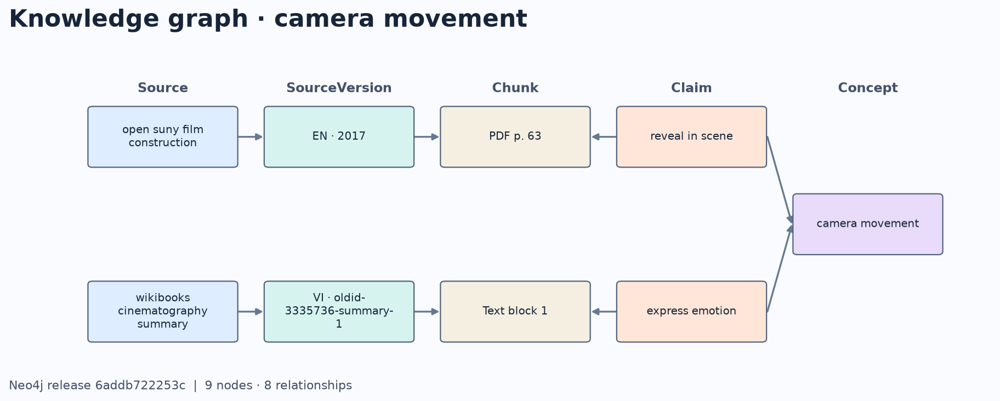

# Chạy và kiểm chứng đồ thị tri thức Cinema Booking

## Khởi động Neo4j và tạo bản đồ thị

Dùng môi trường Python nghiên cứu đã cài AI Service và các thư viện chuẩn bị nguồn. Nếu chưa có dữ liệu, tải và kiểm checksum PDF bằng `scripts/ai/fetch_knowledge_sources.py`, rồi chạy ba lệnh trích xuất trong [hướng dẫn KB](AI_RUNBOOK.md#5-kb-đa-nguồn-và-sách-pdf).

Từ thư mục gốc, chọn tên project Compose của môi trường demo. Cấu hình mật khẩu Neo4j riêng trong biến môi trường hoặc tệp cấu hình riêng của project.

```powershell
$py = '.local/ai-venv/Scripts/python.exe'
$demoProject = 'cinema-graph-demo'
$env:AI_GRAPH_URI = 'bolt://127.0.0.1:17687'
$graphCompose = @('--env-file', '.env.microservices', '-p', $demoProject, '-f', 'compose.yml', '-f', 'compose.ai-graph.yml')
docker compose @graphCompose up -d --wait neo4j
$documents = @('--document', '.local/knowledge/film-book.json', '--document', '.local/knowledge/cinematography-summary.json', '--document', '.local/knowledge/booking-guide.json')
$curation = 'pipelines/knowledge/graph-curation.v1.json'
$build = & $py scripts/ai/build_knowledge_graph.py --curation $curation @documents --output .local/knowledge/graph/demo.cypher --load
if ($LASTEXITCODE -ne 0) { throw 'Graph import failed' }
$env:AI_GRAPH_RELEASE_ID = ($build | ConvertFrom-Json).release_id
```

Tệp xuất `demo.cypher` chạy được với `cypher-shell`. Bộ dữ liệu đầu gồm năm phát biểu có đoạn bằng chứng khớp dữ liệu trích xuất, từ sách Open SUNY, bản tóm tắt Wikibooks và hướng dẫn đặt vé. Mỗi bản đồ thị có ID theo nội dung. Chạy lại cùng đầu vào giữ nguyên số phát biểu. [Danh mục nguồn và quyền sử dụng](../pipelines/knowledge/sources.json) · [Cypher nhập dữ liệu](../services/ai-service/src/ai_service/cypher/import.cypher).

Để ghép vào môi trường demo đã cấu hình, thêm `compose.ai-graph.yml` vào bộ tệp Compose đang dùng, cung cấp `AI_GRAPH_PASSWORD` và `AI_GRAPH_RELEASE_ID`, rồi build và khởi động lại AI Service để migration `ai_003` chạy trước API. Nhập ba tài liệu vào AI Service và duyệt trong quản trị. Tệp Cypher tự nó không cấp quyền cho chatbot trích dẫn.

Cấu hình graph dùng BM25 cho phần truy xuất văn bản. Có thể đặt `AI_GRAPH_RETRIEVAL_STRATEGY` khi cần chạy với cấu hình khác. Hai cấu hình trong phép so sánh phát triển dùng cùng giới hạn ba đoạn và cùng bước chuẩn hóa truy vấn Anh–Việt.

## Kịch bản kiểm chứng

```powershell
& $py scripts/ai/smoke_knowledge_graph.py --curation $curation @documents --output .local/knowledge/graph/api-trace.json
& $py scripts/ai/check_knowledge_sources.py --curation $curation @documents --output .local/knowledge/graph/source-counts.json
& $py scripts/ai/visualize_knowledge_graph.py --concept camera-movement --output .local/knowledge/graph/camera-movement.png
```

Khi Ollama đã chạy với Qwen3:4b, thêm `--generate` vào lệnh smoke và chọn tệp đầu ra khác để lưu lần chạy có mô hình sinh. Trace gồm câu Cypher, tham số, context gửi Qwen, phản hồi gốc, đoạn căn cứ và câu trả lời API.

- **Hai nguồn**. Hỏi “Chuyển động máy quay có tác dụng gì trong cinematography?”. Trong trace, kiểm tra nguồn Việt, trang PDF 63 và các trường `graph_release`, `concept_id`, `claim_id`. Neo4j Browser lắng nghe ở `http://localhost:17474` và có thể dùng truy vấn [visualize.cypher](../services/ai-service/src/ai_service/cypher/visualize.cypher).
- **Cập nhật**. Tạo curation và dữ liệu trích xuất cho phiên bản mới, biên dịch và nạp đồ thị tương ứng. Dùng `import_knowledge.py <input> --origin http://127.0.0.1:8082 --revision-of <document-id> --graph-release-id <release-id>` để lưu bản nháp. Mở **Phiên bản và lịch sử công bố** trong quản trị, xem hai bản rồi công bố. AI Service kiểm đoạn nguồn, phiên bản và checksum trước khi chuyển bản phục vụ. Chạy lại cùng câu hỏi và kiểm tra phiên bản trả về. Chọn bản trước đã công bố để khôi phục.
- **Mơ hồ, mâu thuẫn và thiếu chắc chắn**. Tra cứu alias chuẩn hóa Anh–Việt trước, sau đó thử khớp gần khi cần. Ngưỡng phát triển hiện dùng độ tương đồng ký tự tối thiểu 0,90 và khoảng cách với ứng viên đầu dưới 0,04. Nếu alias dẫn tới nhiều khái niệm, chatbot hỏi lại. Hai giá trị đã xác minh trái nhau trong cùng phạm vi và điều kiện dẫn đến từ chối. Nhóm dữ kiện chỉ có bằng chứng chờ duyệt cũng dẫn đến từ chối. Các ca xung đột, đa nghĩa và chờ duyệt ở mốc nguồn thứ tư dùng dữ liệu mô phỏng.



## Truy vết code

| Kết nối | Code thực thi | Minh chứng |
| --- | --- | --- |
| Web → Gateway → AI | [AIAssistant](../apps/web/src/components/AIAssistant.jsx), [định tuyến Gateway](../gateway/app/routing.py) | Web gửi câu hỏi và nhận nguồn hoặc liên kết điều hướng. |
| Chat → tri thức → Neo4j và PostgreSQL | [Điều phối chat](../services/ai-service/src/ai_service/chat.py), [truy vấn graph](../services/ai-service/src/ai_service/cypher/retrieve.cypher), [lọc nguồn](../services/ai-service/src/ai_service/graph.py) | `api-trace.json` lưu câu hỏi, nguồn, phiên bản, đoạn nguồn và phản hồi. |
| Quản trị → duyệt phiên bản → KB | [Màn hình quản trị](../apps/web/src/components/admin/AdminKnowledgeReports.jsx), [API công bố](../services/ai-service/src/ai_service/router/api.py), [giao dịch phiên bản](../services/ai-service/src/ai_service/knowledge_versions.py) | Bản nháp, lỗi bản đồ thị, công bố, thu hồi và khôi phục. |
| Chat → dữ liệu động | [API đọc các owner](../services/ai-service/src/ai_service/read_client.py), [API nội bộ Booking](../services/booking-service/src/booking_service/router/internal.py) | Catalog, Cinema, Booking và Review cung cấp dữ kiện đang hiệu lực. |
| Web → Booking và Payment → Notification, Reporting | [Điều phối thanh toán](../services/booking-service/src/booking_service/payment_saga.py), [Payment API](../services/payment-service/src/payment_service/router/api.py), [Notification worker](../services/notification-service/src/notification_service/worker.py), [Reporting worker](../services/reporting-service/src/reporting_service/worker.py) | Ranh giới và thứ tự khởi động theo [runtime toàn hệ thống](runbooks/final-runtime.md). |

## Đo truy xuất

```powershell
& $py scripts/ai/evaluate_rag.py --pilot --gold pipelines/knowledge/rag-development-v2.jsonl --corpus .local/knowledge/film-book.json .local/knowledge/cinematography-summary.json .local/knowledge/booking-guide.json --strategies bm25 bm25+graph --output .local/knowledge/graph/retrieval-pilot-revised.json
```

Trên 24 câu phát triển, Recall@3 trên các câu có bằng chứng chuẩn tăng từ 0,786 lên 0,857 sau khi giữ kết quả văn bản xếp đầu và dùng graph để mở rộng nguồn. MRR@3 tăng từ 0,702 lên 0,726. Trung vị độ trễ truy xuất trong lượt đo này tăng từ 12,1 lên 33,7 ms. Cả hai cấu hình vẫn trả ứng viên truy xuất ở cả 10 câu thiếu đáp án.

Ở lượt sinh với Qwen3:4b, bản đầu của cả hai cấu hình đều có một ca trả mã đoạn nguồn không tồn tại. Sau khi giới hạn các mã hợp lệ trong schema đầu ra, cả hai chạy xong 24/24 ca, có câu trả lời ở 14 ca dự kiến trả lời được và từ chối cả 10 ca thiếu căn cứ. Phiếu điểm đúng, đủ căn cứ và trích dẫn còn chờ người chấm. Trace của ca demo Open SUNY + Wikibooks ghi hai đoạn thực sự được Qwen trích.

Đánh giá độc lập cần một tập câu hỏi có đáp án/nguồn do người duyệt khóa trước, corpus đã duyệt và người chấm câu trả lời. Đo trên cùng corpus, top-k, mô hình sinh và ngân sách context. Ghi số câu đúng, đủ căn cứ, dẫn đúng nguồn, từ chối đúng và từ chối nhầm, kèm ví dụ lỗi.

Dùng `scripts/ai/benchmark_rag_answers.py` với hai lượt `--strategy bm25` và `--strategy bm25+graph`, mỗi lượt một thư mục `--output`. Với tập do người duyệt chuẩn bị, thêm `--reviewed-gold --cases <tệp-jsonl>`. Mỗi câu cần ID, câu hỏi, scope, cờ có đáp án, danh sách nguồn/phiên bản/trang kỳ vọng và metadata duyệt. Hai lượt xuất riêng `human-review.csv` với điểm để trống. Chạy `score_rag_human_review.py` sau khi người chấm điền điểm để tổng hợp và kiểm SHA của các trace gốc.

[Số liệu mới nhất trên bộ 24 câu phát triển](reports/AI_RAG_COVERAGE_2026-11-13.md).

## Demo so sánh hai mô hình cảm xúc

Dùng cùng một nhận xét để chạy TF-IDF + Logistic Regression và ViSoBERT. Mỗi kết quả hiển thị phiên bản, nhãn, ba xác suất và trạng thái cần rà soát. API chỉ cho tài khoản có quyền duyệt review. Lượt so sánh không ghi nhãn vào review hay thay model của worker.

Lấy hai thư mục artifact của pilot phim từ thành viên giữ dữ liệu hoặc tạo lại theo [hướng dẫn huấn luyện](reports/AI_FILM_HUMAN_PILOT_2026-11-04.md). Giữ các file mô hình ngoài Git. Chỉ nạp thư mục do nhóm tạo hoặc nhận từ người tin cậy vì Logistic Regression dùng định dạng Joblib.

- Thư mục LR cần `metadata.json` và `model.joblib`.
- Thư mục ViSoBERT cần `metadata.json`, `config.json`, `model.safetensors` và các file tokenizer đã lưu cùng model. Có thể bỏ các thư mục checkpoint huấn luyện.

Khi Gateway và cơ sở dữ liệu Review đã chạy, dùng cùng tên project Compose với hệ thống đang chạy.

```powershell
$env:REVIEW_DEMO_LR_ARTIFACT = (Resolve-Path '<thu-muc-artifact-lr>').Path
$env:REVIEW_DEMO_VISOBERT_ARTIFACT = (Resolve-Path '<thu-muc-artifact-visobert>').Path
docker compose --env-file .env.microservices -p backend -f compose.yml -f compose.ai-sentiment-demo.yml up -d --no-deps --build --wait review-service
```

Nếu dùng thêm các tệp Compose khác cho môi trường hiện tại, giữ nguyên danh sách đó rồi thêm overlay cảm xúc. Mở **Duyệt đánh giá → Nhãn cảm xúc**, nhập một nhận xét phim và chọn **So sánh hai mô hình**. Để quay về cấu hình API mặc định, chạy lại lệnh khởi động Review Service với bộ Compose thường dùng.

Hai artifact dùng nhãn silver và được kiểm tra trên pilot phim. Kết quả trên một nhận xét chỉ minh họa cách hai mô hình suy luận.
