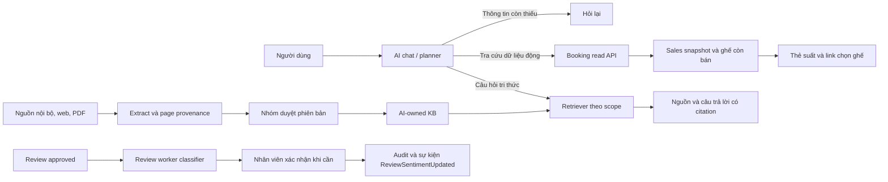

# Trạng thái thực hiện AI

**Đã hoàn tất so sánh đủ bốn dataset cho đợt nộp:** **24/24 lượt** của [protocol tiến độ bốn corpus tiếng Việt](AI_FOUR_DATASET_COMPARISON.md), gồm Bank, ViSFD GENERAL, Shopee và phim silver; mỗi bộ train riêng năm Transformer + LR, seed 42. [Báo cáo Word cập nhật Chương 3 và 4](reports/AI_GVHD_4_DATASET_2026-11-04.docx), [bảng kết quả](reports/AI_GVHD_4_DATASET_2026-11-04.md), [bằng chứng/SHA](reports/evidence/2026-11-04-four-vi/summary.json). Có EDA, tokenization, bảng cấu hình thực, confusion, F1 từng lớp, learning curves và lỗi theo ID cho đủ bốn. Shopee hai lớp; phim train bằng AI silver và dùng nhãn người cho phát triển, chưa thành D1 gold. Test chính thức còn khóa; ma trận ba seed gốc không được tự cộng thêm 24 lượt mới. Kiểm tra: **242 Python pass, không skip, 6 cảnh báo Pydantic có sẵn**; **40 pipeline pass trong Linux**; tải lại đủ bốn nguồn trong container Linux mới khớp semantic SHA của 12 split, không dùng annotation private/cache/DB trên host. Chưa bật classifier phim vào sản phẩm, chưa commit/push.

**Mốc mới sau người dùng hoàn thành pilot:** đã nhận đủ 100 nhãn mù của một người (50/27/23), lưu snapshot và đo thật Qwen + sáu model Bank; huấn luyện thêm hai model silver riêng trên 426 nhãn AI, chọn cấu hình bằng 36 quyết định cũ. Qwen Macro-F1 0,5843; ViSoBERT silver 0,5636. [Bảng, hình, cấu hình và giới hạn](reports/AI_FILM_HUMAN_PILOT_2026-11-04.md). Không bật model cảm xúc, không mở final test, ma trận chính vẫn 18/72. Các đoạn nói 0 nhãn/600 chờ bên dưới mô tả mốc trước pilot này.

Sau yêu cầu giảm gán nhãn tay ngày 04/11: đã bảo toàn 36 quyết định người dùng, tách 100 câu pilot mù trước khi gọi model và cho AI xử lý 462 ứng viên khác. Chi tiết/giới hạn ở [AI_ASSISTED_LABELING.md](AI_ASSISTED_LABELING.md). Đây là nhãn silver bổ sung, chưa thay thế D1 chuẩn hoặc làm tăng số ô thực nghiệm chính đã hoàn thành. Bản Word và snapshot trước đó giữ đúng trạng thái tại thời điểm xuất, không sửa lịch sử thành đã có nhãn người trước khi người dùng thực hiện.

Bổ sung cuối ngày 04/11: profile portable đã chạy bằng CPU Docker từ source copy không có cache/env/DB cũ, trả card thật ở mode `model_planned`. Có thêm 6 run ablation Bank ngoài 18 run ma trận chính; neutral F1 vẫn 0. RAG đã chạy 24 case phát triển, ba cấu hình chunking/năm retriever, giữ các lượt lỗi và trace cuối. 600 review phim chờ hai người gán nhãn độc lập. [Checklist hiện hành](AI_GVHD_CHECKLIST.md), [chạy máy mới](AI_PORTABLE_SETUP.md), [snapshot đưa cùng source](reports/evidence/2026-11-04/README.md). Chưa có final test, nhãn phim chuẩn hoặc duyệt KB/gold độc lập; không nhận đã đủ nghiệm thu học thuật.

Ngày 03/11/2026, bổ sung tài liệu ngày 04/11/2026. Tham chiếu [plan](AI_FEATURE_PLAN.md), [hướng dẫn chạy](AI_RUNBOOK.md), HEAD nền `7d9ca6f79b7b613b650b30e3b02946217cb8b871`. **Thực hiện cục bộ, chưa commit hoặc push. Chưa hoàn thành toàn bộ nghiệm thu học thuật trong plan.**

**Bổ sung theo GVHD ngày 04/11:** xem [checklist và bằng chứng mới](AI_GVHD_CHECKLIST.md), [nguồn dữ liệu tải trực tiếp](AI_DATA_SOURCES.md) và báo cáo Word `docs/reports/AI_GVHD_2026-11-04.docx`. Có exporter bảng cấu hình/metadata thực chạy, bản xuất KB và trace đúng request/response Ollama. Các kết quả v2 bên dưới là mốc trước lượt thực nghiệm mới; dùng bảng checklist v3 để xem kết quả cập nhật.

Lượt v3 đã hoàn tất **5 transformer + LR × 3 seed trên UTS2017 Bank = 18 run validation** bằng GPU cho transformer. Chưa mở final test, chưa đủ bốn dataset. Bộ Python sau bổ sung đạt **204 passed, 1 skipped**. KB xuất 226 chunks từ ba nguồn; corpus phim thật đã chuẩn bị 7.935 dòng pending cho nhóm, chưa có quyết định human giả.

RAG v3 đã chạy thêm BGE reranker pinned trên GPU và so sánh đủ năm chiến lược ở mức pilot. Đã giữ case dense trả lời sai trọng tâm; bản rerank/prompt mới trả lời định nghĩa bằng hai câu có citation PDF. Chưa có người chấm semantic groundedness hoặc gold độc lập, chưa tự bật cấu hình này cho khách.

**Cập nhật bước 1:** chatbot đã chạy trong ứng dụng local qua Qwen3:4B và các owner API thật. Đã thử chọn/bỏ chọn ghế demo, hội thoại tiếp nối và tải lại lịch sử. Xem [AI_LOCAL_CHAT.md](AI_LOCAL_CHAT.md) để mở ứng dụng, đăng nhập, khởi động lại và đọc bằng chứng chuyển dữ liệu.

## Phần sản phẩm đã viết và kiểm tra

| Chức năng | Mã nguồn chính | Kiểm chứng |
| --- | --- | --- |
| Trích xuất nhu cầu, ngày/giờ, thể loại, số vé, ngân sách; thiếu thông tin thì hỏi lại | `services/ai-service/src/ai_service/{llm,chat,schemas,recommendations}.py` | `tests/ai/test_knowledge_and_planner.py`; `scripts/ai/smoke_chat.py` gọi Ollama thật với owner/DB/cache riêng |
| Lọc suất theo ghế còn bán, giá từng vé và tổng nhóm trước phân trang | `services/booking-service/src/booking_service/{options,schemas/options}.py`, private router | `tests/ai/test_booking_options.py`; không dùng ghế BOOKED để tính phương án; không bảo đảm ghế liền nhau |
| Thẻ suất chiếu và đường dẫn chọn ghế | `apps/web/src/components/AIAssistant.jsx` | `apps/web/tests/ai-flow.mjs`: mobile 375px, đúng URL và tiền nhóm |
| Xác nhận/sửa nhãn cảm xúc, CAS/idempotency/audit, giữ điểm model | Review `service.py`, `router/api.py`, `models.py`, `worker.py`; `ReviewModeration.jsx` | `tests/ai/test_sentiment_decisions.py`; UI thử lỗi mạng rồi gửi lại đúng request ID |
| Nguồn KB, checksum, phạm vi, provenance PDF theo trang | AI `models.py`, `schemas.py`, `rag.py`, `documents.py`; `scripts/ai/prepare_knowledge.py` | PDF thật đã tải và trích xuất; test scope/thu hồi duyệt; UI mở đúng `#page=N` |
| BM25/dense/hybrid, tùy chọn reranker, màn hình xem truy xuất | AI `rag.py`, `router/api.py`; `pipelines/ml/serve_retrieval.py`; `AdminKnowledgeReports.jsx` | Dense E5 đã chạy thật; replay lưu từng source/điểm/page/latency; reranker chưa nạp weights |
| Migration bổ sung giữ dữ liệu cũ | AI `002_knowledge_provenance.py`, Review `003_sentiment_decisions.py` | `tests/ai/test_owner_migrations.py` nâng schema cũ có dữ liệu trên PostgreSQL riêng |
| Hợp đồng và gateway | `contracts/openapi/{ai,review}.v1.json`, schema owner, `gateway/app/routing.py` | Export bằng script hiện hành; không đổi source schema lịch sử |

Trợ lý chỉ đọc dữ liệu và dẫn người dùng tới màn hình chọn ghế; chưa tự tạo đơn, giữ ghế hoặc thanh toán. Khi model không khả dụng, phần tra cứu xác định vẫn chạy hoặc báo thiếu dữ liệu; không tạo giá/suất từ câu trả lời của model.

## Dữ liệu và công cụ cho nhóm

- Có GUI local `ml.annotation_app`, CSV round trip `ml.annotations`, exporter review thật qua API, lượt gợi ý `ml.suggest_annotations`. Người/nhãn gợi ý/nhãn xác nhận tách riêng; lưu version tránh ghi đè từ trang cũ.
- Đã chạy Qwen3:4b để tạo **100/100 gợi ý** cho bộ mẫu. File: `.local/annotations/sentiment-suggested.jsonl`. Tất cả còn `pending`; không có người duyệt giả.
- 100 câu này là **synthetic** từ draft có sẵn. Công cụ giữ cờ này cả sau xác nhận; admission không cho tính chúng thành dataset benchmark độc lập.
- GUI mẫu từng chạy ở localhost port 8765; ngày 04/11 đã mở GUI review phim công khai thật ở port 8766. Đầu vào/kết quả giữ trong `.local/annotations`; cần thành viên thật xác nhận, không thay bằng AI tự ký tên/gán nhãn "human".
- Ngày 04/11 đã tải corpus phim ViMovieABSA và chuẩn bị 7.935 dòng chờ người xác nhận; nguồn nhãn ban đầu có phần bằng LLM, chưa dùng như gold con người. Nhóm chọn không chờ xin VLSP; nguồn thay thế và Shopee Kaggle đã tải được ghi trong `AI_DATA_SOURCES.md`.

## Mốc nghiên cứu cảm xúc ngày 03 tháng 11

Đã có config 5 transformer (PhoBERT, ViSoBERT, ViDeBERTa, mBERT, XLM-R) × 4 dataset × 3 seed và LR bổ sung. Đã pin SHA checkpoint trong lock. Pipeline có audit/EDA, kiểm tra exact/group/near duplicate, giữ manifest nguồn và môi trường, chọn validation, final test cần mở rõ bằng flag, vẽ từ run đã hoàn tất. Không chạy model/dataset thiếu rồi điền số giả.

### Bộ UTS2017_Bank công khai

Nguồn tác giả: [undertheseanlp/UTS2017_Bank](https://huggingface.co/datasets/undertheseanlp/UTS2017_Bank), revision `4d1319fa229720d392c1dc0e323d10b40eeacbd0`, license card Apache-2.0 tại thời điểm nhập. Nhãn được ghi là nhãn tác giả phát hành, không phải nhóm gán. Nội dung thuộc miền ngân hàng, không đại diện riêng cho phim.

Importer ghi train gốc 1.977 và test gốc 494 bản ghi. Bỏ 162 câu train gần trùng với test, giữ nguyên test; chia phần train còn lại theo họ gần trùng thành train/validation:

| Split | Negative | Neutral | Positive | Tổng |
| --- | ---: | ---: | ---: | ---: |
| Train | 625 | 20 | 898 | 1.543 |
| Validation | 110 | 3 | 159 | 272 |
| Test giữ lại, chưa đo model | 301 | 8 | 185 | 494 |

File/EDA: `pipelines/ml/data/reviewed/uts2017-bank/source_manifest.json`, `.local/evidence/uts2017-eda/{audit.json,DATA_CARD.md,distribution.png}`. Số đếm từ dữ liệu tải thực tế, không chép con số mô tả card khi khác nhau. Dữ liệu raw/model không nằm trong file cần commit.

Baseline TF-IDF char n-gram + LR đã chạy lại 3 seed 17/42/73 bằng pipeline có fingerprint code. Chọn C=4 trên validation:

| Chỉ số validation | Giá trị quan sát |
| --- | ---: |
| Macro-F1 trung bình | 0,6333 |
| Độ lệch chuẩn Macro-F1 giữa 3 seed | 0,0000 |
| Accuracy | 0,9449 |
| F1 negative | 0,9381 |
| F1 neutral | 0,0000 |
| F1 positive | 0,9618 |

LR trên cấu hình này cho cùng kết quả qua 3 seed, không phải bằng chứng độ ổn định của transformer. Lớp neutral chỉ có 3 mẫu validation nên rất yếu; accuracy cao che mất lỗi lớp ít mẫu. Chưa suy ra ngưỡng chấp nhận hoặc model tốt nhất cho phim từ kết quả này. **Chưa mở final test.**

Run: `pipelines/ml/runs/validation-v2/uts2017-bank/lr/{17,42,73}`; mỗi run có validation, metadata/data SHA/code SHA và môi trường. Tổng hợp: `pipelines/ml/runs/validation-v2/summary.json`; hình `.local/evidence/sentiment-figures-v2/` có heatmap và 3 confusion matrices. Các run trước đó ở `ml/runs/matrix` của pipeline là lượt kiểm tra sớm; dùng v2 khi dẫn bằng chứng.

### Ma trận còn thiếu

| Dataset | Trạng thái |
| --- | --- |
| D1 cinema-vi | Có công cụ xuất/AI gợi ý/nhóm duyệt; thiếu review phim thật đã xác minh quyền dùng và gán nhãn |
| D2 UIT-VSFC | Đã xác định [repo tác giả](https://github.com/kietnv/uit-vsfc); chưa nhập/chuẩn hóa/xác minh điều kiện nhận dữ liệu |
| D3 nguồn mở thay thế | Nhóm không chờ xin VLSP; đang chọn nguồn ba lớp phù hợp từ danh mục công khai, chưa nhập benchmark |
| D4 UTS2017_Bank | Đã nhập, EDA và LR validation × 3 seed; chưa chạy 5 transformer |

Ở mốc 03/11, card ViSoBERT và ViDeBERTa chưa khai báo license trong metadata đã tải, PhoBERT chưa được cấu hình VnCoreNLP/Java và PyTorch mới là CPU. Ngày 04/11 đã có môi trường CUDA, Java/segmenter pinned và các lượt transformer thật trên UTS2017 Bank; xem checklist v3. Repo code chính thức ViDeBERTa có MIT, trong khi card checkpoint không ghi license; vẫn cần ghi rõ nguồn khi chốt sử dụng. Pin SHA/viết runner không đồng nghĩa đã hoàn thành 60 lượt transformer trên bốn dataset.

## Mốc KB RAG ngày 03 tháng 11

Ba nguồn đã chuẩn bị thành draft trong `.local/knowledge`:

1. Hướng dẫn dự án do nhóm sở hữu: luồng đặt vé hiện có, không tự đặt chính sách hoàn tiền/thời gian giữ ghế.
2. Sách **Exploring Movie Construction and Production**, John Reich/Open SUNY, bản PDF thật 94 trang, checksum `789d951902d630beafbb81ec77253cfb2c52111595066eae97715c9e6983a258`. Trích xuất 84 block trang không rỗng, 202.527 ký tự, 11 cảnh báo ít text. Đã kiểm tra hình một số trang; chưa làm OCR hoặc duyệt nội dung toàn sách. License/nguồn/mirror có trong manifest.
3. Tóm tắt/dịch ngắn từ Wikibooks Cinematography, permalink `oldid=3335736`, attribution và CC BY-SA 4.0; không nhận là đã ingest toàn website.

Không nguồn nào tự được approve vào DB dự án. Toàn bộ replay dùng SQLite RAM riêng. Embedding E5-small pinned chạy thật ở port 8011; CLI ghi checksum corpus/câu hỏi và nguồn được trả về.

Lượt pilot ba câu do AI soạn ở `pipelines/knowledge/pilot-questions.jsonl` chỉ kiểm tra cơ chế, **không phải kết quả luận văn**. Dense/hybrid tìm được trang sách mong đợi trong lượt replay mới; lexical/BM25 chưa đạt câu đó. Với câu thiếu chính sách hoàn tiền, cả bốn retriever vẫn có trả đoạn gần chủ đề. Điểm similarity dương chưa đủ để quyết định có câu trả lời. Cần gold/hard negatives và đánh giá groundedness trước khi bật cấu hình này cho khách. Hiện runtime mặc định lexical; policy trả đoạn nguồn đã duyệt, không để LLM bịa điều kiện/tiền.

Output: `.local/evidence/rag-pilot-v2.json`; có từng question → top-k → source_id/version → PDF page → score/latency. Cần thêm gold độc lập đủ lớn, cấu hình chunking/overlap để so sánh, reranker thật, groundedness/citation/correctness do người đánh giá và visual ablation. Chưa hoàn tất yêu cầu học thuật RAG trong plan.

Đã chạy `scripts/ai/smoke_rag_answer.py`: embedding và model sinh đều thật, có câu trả lời tiếng Việt kèm ID nguồn từ PDF. Output ở `.local/evidence/rag-answer-pilot.json`; kiểm tra ID citation hợp lệ chỉ chứng minh ID có trong context, chưa chứng minh mọi câu diễn đạt chính xác/đủ căn cứ. Cần người đọc đánh giá nội dung trước khi coi đây là kết quả chất lượng.

## Kiểm thử, môi trường và giới hạn triển khai

- Bộ Python hiện **198 passed, 1 skipped**: 5 owner liên quan, AI additions, pipelines, gateway và contracts. PostgreSQL local riêng port 55432; có test migration và source transfer thật. Test broker skip do chưa có RabbitMQ chạy.
- Web: ESLint đạt; 10 unit test đạt; production build đạt. `ai-flow.mjs` đạt bốn luồng mới và không có browser runtime error.
- UI smoke tổng quát cũ có timeout tại heading payment; chưa xác nhận toàn bộ E2E của dự án đạt. Không sửa luồng payment để che lỗi kiểm tra trong phạm vi AI.
- Ollama portable + Qwen3:4b đã nạp trên máy. Full chat pilot qua model thật đạt `mode=model_planned`, khoảng **4,46 giây** ở lượt ghi; owner/ghế/giá của bài kiểm tra là fixture riêng. Đây không phải SLA hoặc test tải.
- Docker Desktop hiện đã hoạt động. Tám owner API và gateway đã chạy healthy với dữ liệu chuyển từ bản sao volume cũ; AI dùng Redis và Qwen thật. Đã thêm hai phim/sáu suất demo theo lựa chọn của nhóm. `live-ai.mjs` đạt qua trình duyệt thật, không fixture API; không tạo thêm đơn/thanh toán. Notification/broker và giao dịch Payment chưa được đưa vào nghiệm thu của bước chatbot này. Chi tiết cấu hình, manifest/checksum và startup tại [AI_LOCAL_CHAT.md](AI_LOCAL_CHAT.md).
- Runtime AI dùng `services/`, web ở `apps/web`, nghiên cứu ở `pipelines/`; mỗi owner có database riêng.

## Đối chiếu phần báo cáo AI với code

| Chương AI theo góp ý GVHD | Bằng chứng đã có | Cần hoàn thiện |
| --- | --- | --- |
| 1: Tổng quan vấn đề | Mục tiêu/RQ/phạm vi trong plan | Viết thành phần báo cáo thống nhất với nhóm |
| 2: Thiết kế kiến trúc | Owner boundaries, planner/tool/KB và classifier, sơ đồ trên | Thêm sơ đồ model/tokenization/huấn luyện theo model thực sự chọn |
| 3: DL và thực nghiệm | Runner/pin/EDA/baseline thật/hình confusion | 4 bộ dữ liệu thật, 5 transformer, thống kê đa seed, ablation và phân tích lỗi; baseline không thay DL |
| 4: KB và RAG | Nhiều nguồn có PDF thật, metadata/page, code/extraction/output pilot | Duyệt nguồn, gold độc lập, reranker/chunking/generation ablation và hình/trace được người đánh giá |
| 5: Cấu trúc và luồng | Bảng code ↔ API ↔ test, sơ đồ, output UI | Dẫn số mục/hình/code cụ thể khi chốt báo cáo chung |
| 6: Cài đặt | Runbook, migration, môi trường riêng, tests, model local và demo chatbot qua API thật | Hoàn thiện cài lại độc lập và nghiệm thu các phần ngoài luồng chatbot |

Điều kiện để tiếp tục hết plan: có review phim thật và người duyệt của nhóm; có quyền/dữ liệu D2/D3; hoàn tất kiểm tra nguồn/model; chuẩn hóa gold RAG và môi trường huấn luyện phù hợp. Docker runtime cho chatbot đã hoạt động; các phần còn thiếu không được thay bằng dữ liệu tổng hợp hoặc số thực nghiệm giả.
