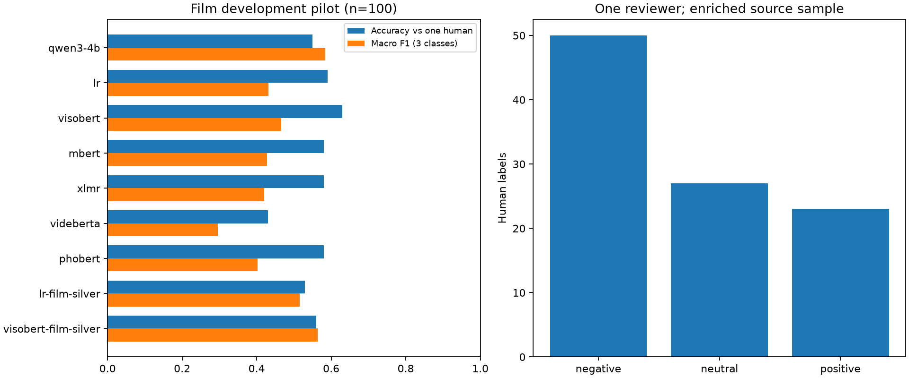

# Đánh giá pilot cảm xúc phim sau 100 nhãn người thật

Ngày 04/11/2026. Đây là bằng chứng phát triển với **một người gán nhãn**, không phải final test hay nghiệm thu chất lượng sản phẩm.

## Dữ liệu và cách đo

- Đã xác nhận 100/100 câu: 50 negative, 27 neutral, 23 positive; 99 họ văn bản.
- Khóa bản chụp và SHA trước suy luận. Nhãn người, tên người và ghi chú không gửi Qwen.
- Câu AI từ chối vẫn tính sai trong accuracy và recall; Macro-F1 giữ đủ ba lớp. Độ đúng trên riêng câu đã trả lời không thay thế chỉ số chính.
- Bootstrap theo họ văn bản, 1.000 lần, seed 42; khoảng tin cậy chỉ mô tả mẫu này, không suy rộng thành độ đúng mọi bình luận phim.
- Các mẫu được lấy từ bộ 600 cân bằng theo gợi ý nhà phát hành; phân bố nhãn người thực tế không cân bằng. Thiếu ID phim/tác giả, chỉ kiểm soát họ văn bản gần trùng.

## Kết quả thật

| Mô hình | Khớp / 100 | Macro-F1 | F1 negative | F1 neutral | F1 positive | Từ chối |
| --- | ---: | ---: | ---: | ---: | ---: | ---: |
| qwen3-4b | 55 | 0.5843 | 0.6000 | 0.4590 | 0.6939 | 10 |
| lr | 59 | 0.4311 | 0.7050 | 0.0000 | 0.5882 | 0 |
| visobert | 63 | 0.4654 | 0.7597 | 0.0000 | 0.6364 | 0 |
| mbert | 58 | 0.4274 | 0.6970 | 0.0000 | 0.5854 | 0 |
| xlmr | 58 | 0.4206 | 0.7200 | 0.0000 | 0.5417 | 0 |
| videberta | 43 | 0.2951 | 0.5833 | 0.0000 | 0.3019 | 0 |
| phobert | 58 | 0.4024 | 0.7206 | 0.0000 | 0.4865 | 0 |
| lr-film-silver | 53 | 0.5150 | 0.6292 | 0.3667 | 0.5490 | 0 |
| visobert-film-silver | 56 | 0.5636 | 0.6207 | 0.4179 | 0.6522 | 0 |

Quy tắc luôn đoán negative khớp 50/100 nhưng Macro-F1 chỉ 0,2222. Các mô hình Bank là 6 artifact seed 42 đã huấn luyện trên miền ngân hàng, không phải huấn luyện lại bằng 100 câu phim. Cả sáu model Bank có F1 neutral = 0 trên mẫu phim này; vì vậy accuracy 63% của ViSoBERT Bank không có nghĩa là nhận biết tốt đủ ba lớp.



## Hai lượt huấn luyện silver bổ sung

426 bình luận thật mang nhãn **AI chưa được người duyệt** (140 negative, 161 neutral, 125 positive) chỉ dùng train. 36 quyết định người đã có từ trước (17/7/12) dùng chọn C hoặc checkpoint. 100 câu mới chỉ được suy luận sau khi lưu artifact. Đã kiểm tra ID, họ văn bản và near-duplicate giữa ba phần. Không sửa cờ nhãn AI để qua cổng dữ liệu human gold của benchmark chính.

LR thử C = 0,25 / 1 / 4 trên 36 câu phát triển; char TF-IDF n-gram 2–5, balanced, LBFGS. ViSoBERT pin revision theo config, 3 epoch, LR 2e-5, AdamW, batch 1, tích lũy 8, max length 256, seed 42. Chọn ViSoBERT dựa trên validation Bank đã có trước pilot; config đóng băng trước khi xem chỉ số 100 câu. Cấu hình chạy thật, số tham số, số bước, best checkpoint và SHA có trong metadata kèm theo.

Đây là hai lượt thử yếu giám sát, một seed; không tính thành hai ô hoàn tất của ma trận chính 4 dataset × 6 mô hình × 3 seed. Tập pilot đã phục vụ phát triển, không được dùng lại để tuyên bố final test độc lập.

## Bất đồng và phần còn thiếu

Qwen có 45 câu không khớp nhãn người, gồm 10 câu từ chối; trong 50 câu người đánh negative, Qwen chuyển 17 câu sang neutral. Đây là bất đồng quan sát được, chưa phải kết luận người hay AI sai. Không tự sửa nhãn của bạn.

File `disagreements-to-review.csv` chỉ chứa ID/nhãn, để trống phân loại lỗi và quyết định người thứ hai. Muốn xem nội dung phải dùng dữ liệu local tương ứng; không đưa bình luận và danh tính người vào gói Git.

Chưa có người thứ hai để đo độ đồng thuận/adjudication. Chưa đủ cơ sở nhận toàn bộ 426 nhãn AI là gold hoặc bật model cảm xúc chính thức. Chưa có tập final phim độc lập. Benchmark chính giữ 18/72 lượt; ba dataset còn lại và 54 lượt chưa hoàn tất. Đánh giá KB/RAG độc lập là phần riêng, không được thay bằng 100 câu cảm xúc này.

## Tái lập trên máy khác

Cài môi trường nghiên cứu theo `../AI_PORTABLE_SETUP.md`. Các lệnh dùng Python trong môi trường đó, PYTHONPATH gồm root và pipelines. Dữ liệu người thật không nằm trên Git: muốn tái lập đúng các chỉ số phải được chủ dữ liệu chia sẻ an toàn đúng snapshot/SHA. Có thể kiểm tra báo cáo công khai mà không tải model.

```text
python -m ml.evaluate_human_pilot --help
python -m ml.train_film_silver_pilot --model lr --output .local/film-silver-rerun/lr
python -m ml.train_film_silver_pilot --model visobert --output .local/film-silver-rerun/visobert
python scripts/ai/report_human_pilot.py
```

Dùng thư mục output mới khi huấn luyện lại; không ghi đè bằng chứng cũ. Hai lệnh train cần protocol, preregistration và snapshot được chia sẻ cùng dữ liệu. Không dùng artifact thí nghiệm này cho production nếu chưa qua duyệt.

Báo cáo Word/Gói bằng chứng trước mốc này là ảnh chụp lịch sử, không chứa kết quả mới của pilot. Tài liệu hiện tại và thư mục evidence đi kèm bổ sung kết quả, không sửa ngược số liệu quá khứ.

## Bảng cấu hình hai lượt bổ sung (số thực chạy)

| Mô hình | Đặc trưng | Kiến trúc | Encoder layer | Tham số | LR | Epoch | Batch / effective | Optimizer | Chọn trên validation |
| --- | --- | --- | ---: | ---: | ---: | ---: | --- | --- | --- |
| lr-film-silver | Char TF-IDF 2–5 | Multiclass logistic regression | N/A | 149,916 | N/A | N/A (8 solver iterations) | N/A | lbfgs | C=0.25 |
| visobert-film-silver | Token IDs + mask, max 256 | ViSoBERT / XLM-R + classification head | 12 | 97,568,259 | 2e-05 | 3.0 | 1 / 8 | adamw_torch | step 162; best F1=0.6328 |

ViSoBERT hoàn tất 162 bước optimizer, chọn checkpoint cuối bằng validation. LR không có learning rate/epoch/batch theo nghĩa huấn luyện mini-batch; không tự điền các trường này bằng số dự kiến. Thời gian cục bộ gồm train/validation: LR 3,85 giây, ViSoBERT 71,56 giây; không dùng để kết luận tốc độ trên máy khác.

Kiểm tra hồi quy phần nghiên cứu/annotation sau thay đổi: `pipelines/tests` có 36 bài pass. Bằng chứng `checks.json` lưu SHA log. Đây không phải tuyên bố đã chạy lại toàn bộ test microservices ở mốc này.
