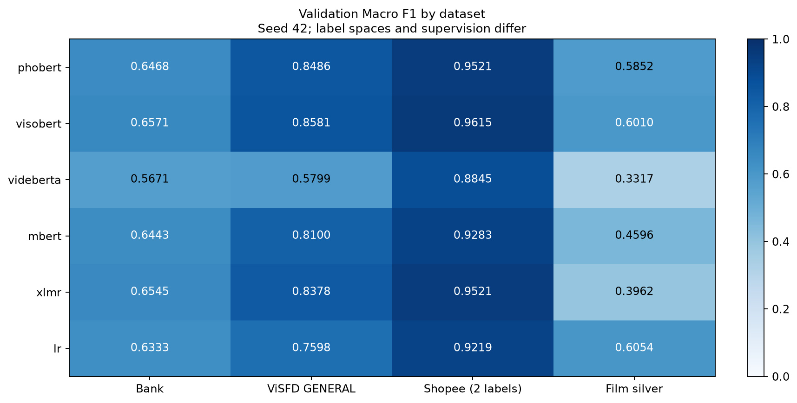

# Báo cáo AI với so sánh trên bốn dataset tiếng Việt

Đã hoàn tất **24/24** lượt: 5 Transformer + LR × 4 corpus × seed 42. Đây là validation phục vụ báo cáo tiến độ, không phải final test. Ba nguồn dùng nhãn nhà phát hành; phim train bằng AI silver, validation/pilot có nhãn người thật. Shopee giữ hai lớp; ba bộ còn lại ba lớp. Không nhận là bốn bộ gold ba lớp hoặc hoàn tất protocol ba seed gốc.

| Model | Bank | ViSFD GENERAL | Shopee | Phim silver |
| --- | ---: | ---: | ---: | ---: |
| phobert | 0.6468 | 0.8486 | 0.9521 | 0.5852 |
| visobert | 0.6571 | 0.8581 | 0.9615 | 0.6010 |
| videberta | 0.5671 | 0.5799 | 0.8845 | 0.3317 |
| mbert | 0.6443 | 0.8100 | 0.9283 | 0.4596 |
| xlmr | 0.6545 | 0.8378 | 0.9521 | 0.3962 |
| lr | 0.6333 | 0.7598 | 0.9219 | 0.6054 |

Bảng là Macro F1 validation; mỗi ô từ model được fine tune riêng. Chọn epoch/C bằng validation nên không gọi các điểm này là kết quả test cuối độc lập.

Cấu hình thực chạy, EDA, tokenization, confusion, per-class F1, learning curves và lỗi theo ID nằm trong thư mục evidence cùng SHA256SUMS. File Word cùng tên có phần Chương 3 mới và Chương 4 KB/RAG từ bằng chứng đã đo cùng ngày để ghép vào quyển. Hướng dẫn tái lập và điều chỉnh phạm vi: ../AI_FOUR_DATASET_COMPARISON.md.
